# FITM-INTERN — Student Profile Phase 4: PDF Import

วันที่: 11 ตุลาคม 2026 (Asia/Bangkok)

สถานะ: **PASS สำหรับ Preview → เลือก/แก้ค่า → ยืนยันบันทึกและเก็บต้นฉบับส่วนตัว; PARTIAL สำหรับความครบถ้วนของ OCR/การจับฟิลด์ใน PDF ทุกแบบ**

ข้อมูลจาก PDF ไม่ถูกบันทึกระหว่าง Extraction/Preview นักศึกษายังกรอกและแก้ไขผ่าน 5 Tabs เดิมได้ มีข้อจำกัดการทดสอบตามข้อ 16 ไม่เริ่ม Phase 5

## 1. PDF Extraction Architecture — PASS

ตรวจ Git Status/Diff และอ่านต้นแบบ `docs/requirements/profile.pdf`, PDF Inventory, Field Mapping, Missing Fields, UX/UI Plan และรายงาน Phase 1/3A/3B ก่อนแก้ไข เก็บ SHA-256 Baseline ของไฟล์เดิม 509 รายการเพื่อรักษางานที่ยังไม่ Commit

Reuse Private Storage, `student_files`, Sequelize Models, Aggregate Service, Validator, NLP configuration และ Shared Feedback เดิม NLP Service มี PyMuPDF 1.24.14, pytesseract และ Tesseract ภาษา `tha`, `eng`, `osd` อยู่แล้ว ไม่มี dependency/package/Schema/Migration ใหม่

Models ที่ใช้: `Student`, `StudentProfile`, `StudentAddress`, `StudentEducationRecord`, `StudentTrainingRecord`, `StudentSkill`, `StudentFile` บนตารางเดิม/ตาราง Phase 2A ที่ติดตั้งแล้ว

```mermaid
flowchart LR
  A[เลือก PDF ใน Profile เดิม] --> B[Student JWT / ตรวจไฟล์]
  B --> C[Local NLP worker: Text / AcroForm / OCR]
  C --> D[Preview ในหน่วยความจำ + signed receipt]
  D --> E[เลือกใช้ / เก็บเดิม / แก้ / ข้าม]
  E --> F[ผู้ใช้ยืนยัน + If-Match]
  F --> G[Owner row lock / Transaction]
  G --> H[Partial Profile + Child Records + private PDF]
  H --> I[อ่าน DTO จริง / รักษา Manual Draft / 5 Tabs]
```



Backend รับ Preview เป็น Memory Upload ส่ง bytes ไปบริการ NLP ภายในผ่าน HTTP ที่จำกัดปลายทาง ไม่ส่งไป External AI/OCR Worker แยก subprocess รับ PDF ทาง stdin ใช้ temporary directory ส่วนตัวและลบทิ้งเมื่อจบ รวมกรณี timeout ที่ฆ่า process group ของ OCR

Preview ส่ง snapshot/revision, candidate values, source/page, validation errors, warnings และ signed receipt อายุ 30 นาที ไม่สร้าง Profile/Child/File row และไม่เก็บต้นฉบับถาวร Receipt ผูก owner, UUID การนำเข้า, SHA-256 ไฟล์, filename และ revision; status/review ตรวจ receipt ได้ถึง 24 ชั่วโมง

ตรวจ backend container ติดต่อ `nlp-service` ด้วย configuration เดิมและ PDF Synthetic โดยตรงผ่านจริง ไม่เขียน Database/Storage: [Processor Connectivity](FITM_STUDENT_PROFILE_PHASE4_PROCESSOR_CONNECTIVITY.json)

## 2. Text-Based PDF — PASS ภายในรูปแบบที่ทดสอบ

อ่าน words/ตำแหน่งด้วย PyMuPDF แยก context ของส่วนบุคคล ที่อยู่ บิดา มารดา ฉุกเฉิน การศึกษา และการฝึกอบรม ตรวจ TGDE-COOP–02 และอย่างน้อย 2 section anchors รองรับเอกสารที่อ่านได้ 1–4 หน้า ไม่ใช้ Resume Parser เดิมเป็นตัวจับฟิลด์

รองรับ AcroForm เฉพาะชื่อฟิลด์ที่อยู่ใน allowlist; ไม่รับ actions หรือชื่อฟิลด์ที่ไม่รู้จัก ตรวจตารางทักษะจาก cell geometry เครื่องหมายในคอลัมน์ชื่อทักษะไม่ถูกแปลงเป็น proficiency เครื่องหมายกำกวมไม่มีการเดาระดับ

ต้นแบบ 4 หน้ามี Text Layer แต่ลำดับตัวอักษรไทยบางส่วนอ่านผิด จึง fallback OCR เฉพาะหน้าที่จำเป็น มี empty-region guard เฉพาะ export geometry ที่ตรวจ anchor แล้ว เพื่อไม่อ่าน label ข้างเคียงเป็นค่าช่องว่าง ไม่ใช้ geometry นี้กับ layout อื่นโดยอัตโนมัติ

ผลตรวจต้นแบบครั้งสุดท้ายแบบปิดบังค่า: Student ID อ่านได้, scalar candidates เฉพาะ `student.major`, `student.department`, `student.faculty`; addresses/education/training = 0 และ skills = 3 รายการ ไม่สร้างค่าครอบครัวจากช่องว่าง AcroForm widgets = 0 ไม่เขียน Profile หรือ Storage จากต้นแบบ

หลักฐาน: [Template Verification](FITM_STUDENT_PROFILE_PHASE4_TEMPLATE_VERIFICATION.json)

## 3. OCR / Scanned PDF — PARTIAL

ทดสอบ OCR จริงภายใน Docker ด้วย PDF ภาพสแกน Synthetic ภาษาอังกฤษและไทย ไม่ใช้ผล OCR จำลอง Render ที่ 200 DPI, `tha+eng`, จำกัด pixels และ timeout ผลทั้งหมดต้อง review ไม่มี confidence percentage ที่สร้างขึ้นเอง

ภาษาอังกฤษอ่าน Student ID/ส่วนบุคคลใน fixture ได้ ภาษาไทยอ่าน label/ค่า Synthetic ได้ แต่บางคำมีช่องว่างแทรกระหว่างอักษร เก็บ raw value ที่อ่านได้ให้ผู้ใช้แก้ ไม่รวมคำหรือเติมข้อความที่เดาไว้

**PARTIAL:** ตาราง proficiency จากภาพสแกนยังจับ cell/เครื่องหมายไม่ได้อย่างปลอดภัย จึงแสดง `OCR_SKILL_GRID_REVIEW_REQUIRED` และให้กรอกเอง Checkbox ที่ไม่แน่นอนแสดง warning ไม่เลือกค่าให้ ไม่รับรองว่าอ่านทุกฟิลด์จาก PDF สแกนหรือ export ทุกเวอร์ชันได้ครบ

## 4. Field Mapping ที่ดึงได้จริง

| กลุ่ม | วิธี/หลักฐาน | สถานะ |
| --- | --- | --- |
| Student ID | อ่านเพื่อเทียบรหัสเจ้าของเท่านั้น; mismatch/ขัดแย้งระหว่าง Text และ AcroForm ถูกบล็อก | PASS |
| ชื่อไทย / ชื่ออังกฤษรวม | identity สำหรับแสดงเทียบ; ชื่อไทยบัญชี Read-only; ชื่ออังกฤษรวมไม่ถูกแยกโดยเดา | PASS |
| ชื่อ/นามสกุลอังกฤษแยก | Approved AcroForm; ผู้ใช้แก้ค่าที่อ่านผิดก่อนยืนยันได้ | PASS |
| major / department / faculty / GPA | Text/AcroForm; ทดสอบเลือก GPA และเก็บ major เดิม | PASS |
| year_level / last_semester_gpa | Approved labels/AcroForm และ validator เดิม; ยังไม่มีเอกสาร export หลายเวอร์ชันยืนยันทุกตำแหน่ง | PARTIAL |
| วันเกิด / สัญชาติ | Text/AcroForm/OCR Synthetic; ปฏิทินจริงและ leap year | PASS |
| เพศ / ส่วนสูง / น้ำหนัก / ศาสนา / เชื้อชาติ | Approved labels/AcroForm; ไม่เติมค่าช่องว่าง; coverage ของไฟล์ export ที่กรอกครบยังจำกัด | PARTIAL |
| ใบขับขี่ / ภาวะทหาร | explicit checked marker หรือ AcroForm; ทดสอบ Yes/No; warning เมื่ออ่านเครื่องหมายไม่แน่ชัด | PASS / PARTIAL สำหรับ scan |
| ที่อยู่ทะเบียนบ้าน / ปัจจุบัน | แยก `addresses` ตามประเภท; Text/AcroForm; postcode เป็นข้อความเพื่อรักษาเลขศูนย์นำหน้า | PASS ภายใน fixtures |
| โทรศัพท์ / บิดา / มารดา / ฉุกเฉิน | scoped labels/AcroForm และ validator เดิม; blank regions ไม่สร้างข้อมูลเทียม | PARTIAL สำหรับ filled Thai export |
| ประวัติการศึกษา | อ่านหลายระดับ; Synthetic ได้ 2 รายการ; Preview/update/create ไม่มีการลบรายการเดิม | PASS |
| ฝึกอบรม / ดูงาน / ฝึกงาน | อ่านหลาย block เป็นโครงสร้าง `training` เดิม; course/institution/qualification/period | PASS ภายใน fixtures |
| ทักษะคอมพิวเตอร์ / ภาษา | ตาราง Text และ AcroForm; ต้นแบบ 3 รายการ; ระดับที่อ่านไม่ชัดเป็นค่าที่ยังไม่ระบุ | PASS / PARTIAL สำหรับ scan |
| สุขภาพ / ผู้ปกครอง / ข้อความทักษะเดิม | รักษาค่าเดิม; approved AcroForm รองรับฟิลด์เดิม ไม่สร้างข้อมูลแทนส่วนที่ PDF ไม่มี | PASS ด้าน preservation |

วันที่ `DD/MM/YYYY` จะแปลงเมื่อมี พ.ศ./ค.ศ./BE/CE ชัดเจนเท่านั้น ไม่สมมติยุคของปีที่ไม่มีเครื่องหมาย ชื่อฟิลด์/ระดับการศึกษา/ระดับความสามารถใช้ contract Phase 3A ไม่สร้าง enum ใหม่

## 5. ฟิลด์ที่อ่านไม่ได้ — PARTIAL

Checkbox/ระดับทักษะบางช่องในต้นแบบอ่านเครื่องหมายไม่ได้อย่างแน่นอน; ตารางทักษะสแกนยังไม่รองรับการจับระดับ; ชื่ออังกฤษรวมต้องแยกเอง; ปี/วันที่ไม่มียุคชัดเจนและค่าที่ผิดรูปแบบต้องแก้ก่อนเลือกใช้

ฟิลด์ที่ไม่มีหรือว่างไม่เข้าสู่ payload ล้างค่า ผู้ใช้เลือกข้ามหรือกรอกผ่าน 5 Tabs ได้ตามเดิม ไม่รายงานว่า 148 ช่องใน PDF Inventory ถูก extract ได้ครบทุกไฟล์

## 6. ฟิลด์ที่ BLOCKED ตามนโยบาย

**BLOCKED และไม่ได้พัฒนา:** เลขบัตรประชาชน/ค่าเข้ารหัส, ลายเซ็น, การรับรองข้อมูล, การยอมรับเงื่อนไขที่ policy ยังไม่ยืนยัน รวมถึง Workflow/ผลพิจารณา/บริษัทที่อนุมัติในหน้า 4

Student ID, ชื่อไทยบัญชี, Email, Authentication, Advisor Ownership และสถานะระบบไม่อยู่ใน import write allowlist ไม่ส่งกลับไปเปลี่ยนบัญชีจาก PDF วันที่ออก/หมดอายุบัตรที่ Phase 3A อนุญาตไว้ยังใช้ validator เดิม โดยไม่เปิด API เลขบัตรประชาชน

## 7. API ที่เพิ่มหรือแก้ไข — PASS

Student API prefix: `/api/student-profile`; ทุก endpoint ใช้ Student JWT เดิม, owner จาก token และ `Cache-Control: private, no-store`

| Endpoint ใหม่ | Request / ผลลัพธ์ |
| --- | --- |
| POST `/pdf-import/preview` | Multipart `document`; ส่ง Preview + snapshot + receipt; ไม่มี writes |
| POST `/pdf-import/commit` | Multipart `document`, `receipt`, `changes` เป็น JSON string; บังคับ `If-Match` ก่อนรับไฟล์ |
| POST `/pdf-import/status` | JSON `{receipt}`; `not_committed` หรือ committed DTO/metadata; read-only |
| POST `/pdf-import/review` | JSON `{receipt}`; snapshot และ receipt revision ล่าสุด หลังผู้ใช้เลือกตรวจใหม่; ไม่บันทึก |
| GET `/pdf-import/history` | metadata การนำเข้าล่าสุดไม่เกิน 5 รายการของเจ้าของ; ไม่ส่ง storage path/extracted text |

เพิ่ม internal NLP endpoint `POST /api/v1/profile-pdf` สำหรับ processing เท่านั้น ไม่อ่านบัญชี/Database/Private Storage

ตัวอย่าง `changes` ใช้ข้อมูล Synthetic:

```json
{
  "profile": { "english_first_name": "Synthetic Edited", "religion": null },
  "education": { "update": [{ "id": "owned-record-uuid", "changes": { "gpa": "3.50" } }] }
}
```

ค่าที่ไม่ส่งคงเดิม; null เป็นการล้างโดยตั้งใจเฉพาะฟิลด์ที่อนุญาต; Child updates อ้าง owned UUID; ไม่อนุญาต Child deletes ผ่าน Import Existing `/me`, `/student-info`, `/aggregate`, upload/download และ Resume contract ยังคงรูปแบบเดิม ไม่มีการเปลี่ยน Schema

Aggregate Service แยกการ prepare/apply payload เพื่อ reuse ใน Transaction เดียวกับไฟล์; read inspection ของ status ใช้ owner SHARE lock และ transaction เดียวกับ snapshot/file receipt เพื่อรอ writer ที่ยังไม่จบ

## 8. Frontend UX/UI Workflow — PASS

เพิ่ม Card ในเมนูประวัตินักศึกษาเดิม เลือก “กรอกข้อมูลด้วยตัวเอง” หรือ “นำเข้าจาก Profile PDF” ลำดับเลือกไฟล์ → อ่าน PDF/Loading → Preview เทียบค่าเดิม → เลือก/แก้/ข้าม → Shared Confirmation → บันทึกจริง → Shared Toast และประวัติต้นฉบับ

Scalar เริ่มที่เก็บค่าเดิม/ข้าม; Child เริ่มที่ข้าม ไม่เลือกนำเข้าอัตโนมัติ ช่องแก้ใช้ข้อความเพื่อให้เห็นวันที่/ตัวเลข OCR ที่ผิดแล้วแก้ได้ ก่อนส่งตรวจ calendar, GPA, safe integer, enum, phone และ required/optional ตาม contract เดิม

ยกเลิกก่อนยืนยันได้ รวมระหว่าง Extraction ผล response ที่มาช้าถูกกันด้วย request epoch และไม่บันทึก ใบรับรองหรือชื่อไฟล์ไม่ถูกนำไปเป็น HTML/คำสั่ง ไม่มี native alert/confirm ใน import flow

## 9. Preview & Conflict Resolution — PASS

Commit ตรวจ receipt/hash/filename/revision, ownership, allowlists และ current data ภายใต้ owner UPDATE lock ใช้ Transaction เดียวสำหรับ Profile/Student/Child/File/version/counter เพิ่ม counter หนึ่งครั้ง ไม่มี full-object overwrite

HTTP 428: ขาด If-Match; HTTP 409: revision เก่าหรือ duplicate record; HTTP 422: identity mismatch/อ่านไม่ได้หรือ PDF ที่ไม่รองรับ ผู้ใช้ตรวจข้อมูลล่าสุดอย่างชัดเจน แล้วเทียบและยืนยันอีกครั้ง ค่าแก้และตัวเลือกใน Preview ยังคงอยู่ ไม่มี automatic rebase/write

ตรวจ duplicates ใน server ภายใต้ lock และ client ก่อนยืนยัน โดยเทียบ identity ของที่อยู่/การศึกษา/ฝึกอบรม/ทักษะ ไม่ recreate Record ที่ถูกลบหรือเปลี่ยน ownership การอัปเดต identity เดิมของ duplicates ที่มีอยู่ก่อนแล้วไม่สร้างรายการใหม่

รักษา Manual Draft ระหว่างบันทึก PDF รวม legacy modal และ academic form ฟิลด์ pristine รับค่าที่บันทึกใหม่ โดย dirty fields ยังอยู่ Regression ยืนยัน dirty major ไม่คืน GPA เก่า และ dirty father ไม่คืน birth date เก่า

Response failure ใช้ status read ก่อนอนุญาตให้ผู้ใช้ยืนยันใหม่ ไม่มี automatic POST retry Same receipt เป็น once-only identity; replay ไม่เพิ่ม version/counter และผล recovered snapshot ไม่ถูกถือเป็น own-write revision เพื่อ rebase draft ที่อาจชนการแก้จากอีก Client

Status รอ owner SHARE lock เมื่อ SQL writer ค้าง และอ่าน snapshot/file ใน Transaction เดียวกัน ไม่อ่าน file ก่อน writer จบแล้วรายงานผลลบที่ยังไม่แน่นอน

## 10. PDF Private Storage — PASS

ใช้ `StudentFile`/`student_files` เดิม ประเภท `external_profile_pdf`, UUID filename ใน owner `profile-documents`, `original_name`, mime/size/hash, version/supersedes/is_current และ `extraction_method`, `extraction_status=ready`, `extracted_at` ที่มีอยู่แล้ว ไม่เก็บ raw extracted text ลง `extracted_text`

ตรวจ realpath ของ directory ก่อน stage, เขียน `wx`/0600 และตรวจ root/owner/file/symlink เดิมอีกครั้ง SQL failure ลบเฉพาะ staged bytes ที่พิสูจน์ว่าไม่มี durable reference หาก COMMIT acknowledgement ไม่ชัดเจนหรือ Database unavailable จะเก็บ bytes ไว้ก่อน เพื่อป้องกันการลบต้นฉบับที่บันทึกแล้ว

ไฟล์เก่าถูกเก็บเป็นเวอร์ชันก่อนหน้า ไม่ลบข้อมูลเดิม ดาวน์โหลดผ่าน authenticated `/documents/:id/download` ตรวจเจ้าของและใช้ no-store ไม่มี public URL หรือไฟล์นักศึกษาจริงเพิ่มใน `docs/requirements/`

## 11. Security & Privacy

**PASS:** Student authentication/ownership, mass-assignment allowlist, matching Student ID, signature/MIME/extension/filename/size check, private download, no sensitive import logs, bounded local processing และไม่ใช้ external AI/OCR

ข้อจำกัดที่บังคับ: PDF ≤10MB, 1 file/2 fields, Preview 20 ครั้ง/10 นาที/บัญชี, processor พร้อมกัน 2 งาน, ≤4 pages, xref ≤20,000, text ≤120,000, OCR pixels ≤6,000, worker ≤45 วินาที, backend timeout 50 วินาที/Preview client 60 วินาที และ Linux worker memory/CPU/file-descriptor limits

ปฏิเสธ encrypted/corrupt/active PDF ที่พบ JavaScript, Launch, RichMedia, EmbeddedFile, XFA, SubmitForm, ImportData หรือ external GoTo actions URL processor ต้องเป็น private/local host ที่กำหนด ไม่ follow redirect ไม่รับ arbitrary URL จากนักศึกษา

**PARTIAL ด้าน deployment isolation:** NLP endpoint เป็น internal processor ไม่มี Student JWT ของตนเองและไม่อ่านข้อมูลบัญชี ใช้ผ่าน authenticated Backend ใน flow นี้ แต่ควรจำกัด network access ของ NLP port ใน deployment จริง โครงสร้าง Docker/network เดิมไม่ได้ถูกเปลี่ยนใน Phase นี้

Resource limits ไม่ใช่หลักฐานการตรวจจับ malware ทุกชนิด ไม่มี antivirus/fuzzing/resource-exhaustion stress test จริง การหมดไฟฟ้าระหว่าง filesystem write/SQL commit ยังไม่จำลอง

## 12. Backend / Frontend / NLP Tests และ Build

| ชุดทดสอบรอบสุดท้าย | PASS | FAIL | SKIP | สถานะ |
| --- | ---: | ---: | ---: | --- |
| Backend `node --test` | 254 | 0 | 21 | PASS |
| Frontend `node --test test/*.test.js` | 309 | 0 | 2 | PASS |
| NLP pytest เดิม + Parser ใหม่ | 25 | 0 | 0 | PASS |
| PostgreSQL/API/Edge subcases | 37 | 0 | 0 | PASS |
| Frontend Build | — | 0 | — | PASS |

Backend PDF unit regressions 15 กรณี; Frontend PDF/Draft regressions 15 กรณี; Python Profile PDF tests 9 กรณี รวมใน counts ข้างต้น ไม่บวกซ้ำ Skipped tests เป็น opt-in Database/Browser ของ feature อื่นและ migration tests ซึ่งปิดตามข้อห้าม รอบ Phase 4 PostgreSQL แยกรันจริงด้วย runner ของ Phase นี้

Frontend Build `npm.cmd run build`: exit 0; Vite 8.2.2, 129 modules, Student bundle 171.02 kB (gzip 42.51 kB) ตรวจ JavaScript 16 ไฟล์, Python 5 ไฟล์, HTML Parser/IDs ไม่ซ้ำ 363 IDs และ `git diff --check`: PASS

การรันระหว่างพัฒนาพบ multipart parts limit ที่ปฏิเสธ commit ถูกต้อง แก้แล้วและตรวจ import จริงผ่าน พบ QA projection ที่ไม่เลือก extension metadata ตาม Sequelize default scope แก้ query ให้ explicit พบ NLP Tests เดิมต้องเริ่ม FastAPI lifespan จึงปรับ QA runner ให้ initialize ตาม server โดยไม่แก้ Chatbot/Resume Source รายงานตารางนี้เป็นผลรอบสุดท้าย

หลักฐาน: [Backend Tests](FITM_STUDENT_PROFILE_PHASE4_BACKEND_TEST_RESULTS.json), [Frontend Tests](FITM_STUDENT_PROFILE_PHASE4_FRONTEND_TEST_RESULTS.json), [NLP Tests](FITM_STUDENT_PROFILE_PHASE4_NLP_TEST_RESULTS.json), [Build](FITM_STUDENT_PROFILE_PHASE4_BUILD_RESULTS.json), [Syntax](FITM_STUDENT_PROFILE_PHASE4_SYNTAX_RESULTS.json)

## 13. PostgreSQL Integration — PASS

Schema-only `pg_dump/pg_restore` ลงฐาน Synthetic ใหม่ มี guard ตรวจชื่อฐาน/marker/role และไม่ copy แถวจริง ไม่เรียก migration/sync/drop/reset/truncate Production routes/controllers/Sequelize และ Local NLP worker ใช้จริง

ครอบคลุม Manual CRUD เดิม, Preview ไม่มี writes, identity/security/validation, confirmed scalar/children/file save, 428/409, duplicate protection, partial child updates, SQL rollback หลังเขียน Profile/Child, ENOSPC staging failure จำลอง, HTTP 500 หลัง actual COMMIT, same-receipt replay, two different receipt concurrency, status รอ SQL transaction จริง และการอ่านข้อมูลใหม่หลังบันทึก

กรณี extraction เพิ่มเติมท้ายชุดใช้ Production Service โดยตรงสำหรับ Preview และใช้ HTTP จริงเมื่อ Commit เพื่อไม่ปิด rate limit การ fault injection ใช้เฉพาะ Synthetic harness: beforeCreate failure/delay, ENOSPC และ response failure ไม่อยู่ใน Production Source

Development `intern_system`: READ ONLY; 33 ตาราง/398 คอลัมน์/169 constraints/83 indexes/5 triggers; ledger 23 รายการ; 022–025 Executed, 019–021 Pending Schema SHA-256 ตรง Phase 2B.2 ทุกตัว จำนวน/checksum เดิม 28 ตารางตรง private backup baseline; students/profiles/files = 4/2/3; Child ใหม่ 4 ตารางยังว่าง Prepared Sources 7 ไฟล์ตรง hash เดิม

ฐาน Synthetic ของ Phase 4 ทั้ง 7 ชุดเก็บไว้ตามข้อห้าม Drop ทุก role จบแล้วเป็น NOLOGIN/PASSWORD NULL ทุกครั้งตรวจ schema/ledger/counts/checksums ทั้ง 32 data tables ก่อนและหลังตรงกัน

หลักฐาน: [PostgreSQL/Browser Results](FITM_STUDENT_PROFILE_PHASE4_BROWSER_RESULTS.json), [Development Verification](FITM_STUDENT_PROFILE_PHASE4_DATABASE_VERIFICATION.json)

## 14. Browser / Responsive — PASS ภายในสิ่งที่ทดสอบ

Microsoft Edge headless จริง, Student Dashboard เต็มหน้า, 2 Client tabs และหน้าใหม่หลังบันทึก ใช้ synthetic Student JWT และ API/PostgreSQL จริง ทดสอบ Custom Confirmation, Loading/Preview/Cancel/Success/Error, conflict review, manual draft/save, private browser download และ 5 Tabs เดิม

Widths 1440/1366/768/390px: ทั้ง 5 Tabs และ Preview ไม่มี page horizontal overflow มี screenshot Synthetic 24 ภาพ ตรวจภาพ Desktop/Mobile Preview แล้ว; runtime exceptions = 0

**NOT TESTED:** Native F5/hard reload บนหน้าเดิมให้ผลยืนยันไม่ได้ เพราะ CDP ของ Edge ค้าง จบการทดสอบเฉพาะรอบนั้นและปิด role แล้ว ไม่ถือว่า PASS ทดแทน การเปิดหน้า Browser ใหม่และอ่านข้อมูลที่บันทึกจาก PostgreSQL พร้อม Manual Save หลังเปิดใหม่ทดสอบผ่านจริง เช่นเดียวกับปุ่มโหลดข้อมูลล่าสุดของ Profile

หลักฐานภาพ: [Desktop Preview](evidence/student-profile-phase4/1440-pdf-preview.png), [390px Preview](evidence/student-profile-phase4/390-pdf-preview.png)

## 15. รายชื่อไฟล์ที่แก้ไข

ไฟล์เดิมที่แก้ใน Phase 4 จำนวน 9 รายการ:

- `backend/src/routes/studentProfile.routes.js`
- `backend/src/services/studentProfileAggregate.service.js`
- `backend/src/services/studentProfileFiles.service.js`
- `frontend/src/api/studentProfile.api.js`
- `frontend/src/pages/studentProfileWorkspace.js`
- `frontend/src/pages/student_coop.js`
- `frontend/src/student_coop/student_coop.html`
- `frontend/src/styles/student_profile.css`
- `nlp-service/app/main.py`

ไฟล์ Source/QA ใหม่:

- `backend/src/controllers/studentProfilePdfImport.controller.js`
- `backend/src/services/studentProfilePdf.client.js`
- `backend/src/services/studentProfilePdfImport.service.js`
- `backend/test/studentProfilePdfImport.test.js`
- `backend/test/studentProfilePhase4Browser.test.js`
- `backend/scripts/runStudentProfilePhase4Integration.js`
- `backend/scripts/runStudentProfilePhase4NlpTests.js`
- `frontend/src/pages/studentProfilePdfDraft.js`
- `frontend/src/pages/studentProfilePdfImport.js`
- `frontend/test/studentProfilePdfImport.test.js`
- `nlp-service/app/api/v1/profile_pdf.py`
- `nlp-service/app/services/profile_pdf.py`
- `nlp-service/tests/profile_pdf_fixtures.py`
- `nlp-service/tests/test_profile_pdf.py`

เพิ่มรายงานนี้, JSON หลักฐานที่ลิงก์ไว้, Preservation และ Synthetic screenshot/source hash baseline ใน `docs/audits/evidence/student-profile-phase4/` ไฟล์เดิมอีก 500 จาก 509 รายการยังตรง SHA-256; ไม่มีไฟล์เดิมหาย งาน Git dirty จาก Phase ก่อน รวม Internship Logs/Sidebar/Workflow/OAuth/Resume/role dashboards คงเดิม ไม่ Commit/Push

หลักฐาน: [Preservation](FITM_STUDENT_PROFILE_PHASE4_PRESERVATION.json)

## 16. ข้อจำกัดและสิ่งที่ NOT TESTED

- PARTIAL: OCR ไทยยังแยกอักษร; scanned skill matrix/proficiency และ checkbox ที่อ่านไม่แน่ชัดให้กรอกเอง; ไม่รับรอง complete auto-fill ของ export ทุกเวอร์ชัน
- BLOCKED: นโยบายเลขบัตรประชาชน/ลายเซ็น/การรับรองและ Workflow ที่ยังไม่อนุมัติ
- NOT TESTED: เขียน Import/Manual Save ด้วยบัญชีนักศึกษาจริงหรือ Production Database; ข้อมูลจริงตรวจเพียง counts/checksums/Schema
- NOT TESTED: Native F5/hard reload ในหน้าเดิมตามข้อ 14; Browser refresh-to-latest และ fresh page read-back ผ่าน
- NOT TESTED: Browser cancel ระหว่าง OCR และ late response จริง; Preview cancel ทดสอบ Browser ผ่าน และตรวจ request-epoch guard ใน Source/Regression
- NOT TESTED: Chrome/Firefox/Safari, อุปกรณ์มือถือจริง, screen reader, ภาพเอียง/ลายมือ/สแกนคุณภาพต่ำหลายชุด และ export ที่แตกต่างจากต้นแบบ
- NOT TESTED: malware corpus/antivirus/fuzzing, resource-exhaustion load จริง, full disk/power loss/COMMIT network acknowledgement failure จริง; SQL rollback, ENOSPC และ failed HTTP response ทดสอบด้วย fault injection บน Synthetic
- PARTIAL: หาก Database unavailable ระหว่าง cleanup/reconciliation จะเก็บ staged bytes ที่ยังพิสูจน์ไม่ได้ไว้ก่อน ไม่มี automatic retention/deletion policy ใหม่
- Draft/receipt/file ก่อนยืนยันอยู่ในหน่วยความจำหน้า ไม่มี persistence ข้ามปิด Browser ต้องเลือกไฟล์ใหม่เมื่อกลับมา ยังสามารถเห็นต้นฉบับที่ committed แล้วผ่าน private history/documents

## 17. ความพร้อมสำหรับ Phase 5

พร้อมใช้เป็นฐานพัฒนาต่อ: Manual 5 Tabs และ Import ที่ผู้ใช้ review/ยืนยันอยู่ใน Aggregate เดียวกัน มี regression, private original/version, concurrency/rollback/recovery และ PostgreSQL read-back ที่ทดสอบจริง

ก่อนรับรองความแม่นยำ Extraction ครบทุกช่อง ต้องเพิ่ม filled Synthetic samples ที่ตรง export geometry/หลายเวอร์ชัน, ตรวจ OCR ตารางและ checkbox เพิ่ม และยืนยัน deployment network isolation ของ NLP รวมถึง Native Browser Reload ด้วยวิธีทดสอบที่เสถียร

**หยุดหลัง Phase 4 ไม่เริ่ม Phase 5 ไม่รัน Migration ไม่เปลี่ยน Schema ไม่ลบข้อมูลเดิม และไม่ Commit/Push**
