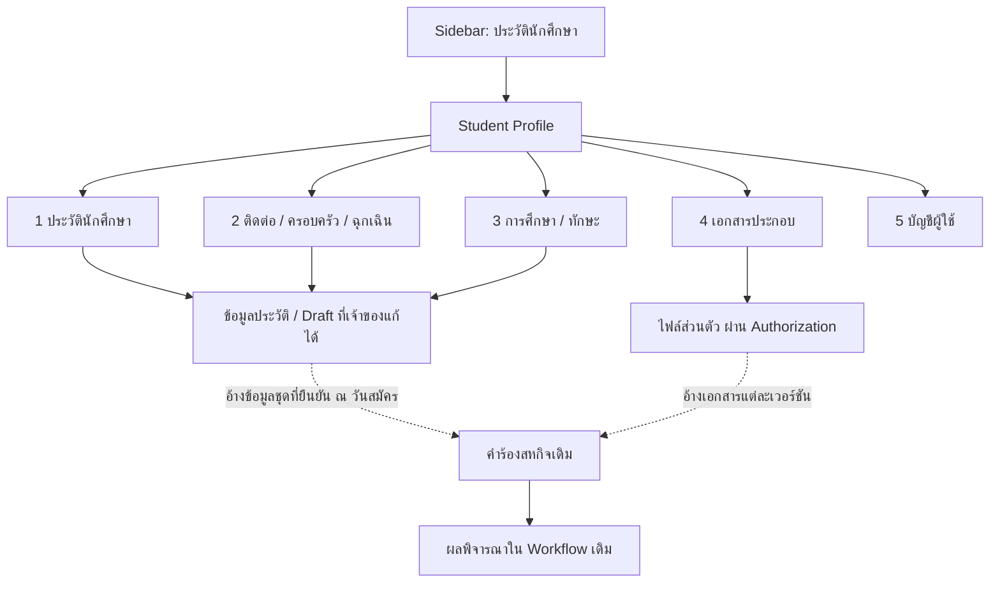

# FITM Student Profile — Proposed 5-Tab UX/UI Plan

วันที่ตรวจ 2026-10-10. DESIGN PROPOSAL เท่านั้น ไม่แก้ Frontend/Sidebar/Backend ในรอบนี้
Profile ปัจจุบัน3tabsและModal2tabsยังอยู่ตามเดิมในsource; สิ่งต่อไปนี้เป็นรูปแบบที่เสนอหลังอนุมัติ
PDF TGDE-COOP–02 VERIFIED; ทก.01 OFFICIAL SCOPE NOT VERIFIED; PostgreSQLจริงอ่านแบบread-onlyแล้ว
รายละเอียดทุกฟิลด์/สถานะดู [Field Mapping](FITM_STUDENT_PROFILE_FIELD_MAPPING.md); schemaที่เสนอยังไม่มีจริง ดู [Database Design](FITM_STUDENT_PROFILE_DATABASE_DESIGN.md)

## โครงสร้างหน้าและขอบเขต

Sidebar “ประวัตินักศึกษา” หนึ่งรายการเหมือนเดิม ภายในหน้าใช้5horizontalTabs: ประวัตินักศึกษา / ติดต่อ–ครอบครัว–ฉุกเฉิน / การศึกษา–ทักษะ / เอกสารประกอบ / บัญชีผู้ใช้
แถบบนแสดงชื่อจากบัญชีและสถานะการโหลดจริง; แต่ละtabแบ่งsectioncardsพร้อมหัวข้อ/iconและข้อความสั้น ไม่เพิ่มSidebaritems
ไม่ย้ายเมนูโครงการ/บันทึก/คำร้อง ไม่เปิดCalendarซ่อน ไม่แก้หน้าของTeacher/Staff/Head/Mentor

ลูกศรอ้างข้อมูล/snapshotเป็นข้อเสนอในอนาคต ไม่ได้มีTGDEexportหรือapplicationacknowledgementอยู่แล้ว
ผลพิจารณาหน้า4ต้องแสดงในคำร้อง/หน้าผู้พิจารณา บัญชีStudentอ่านสถานะได้ตามสิทธิ์ ไม่ทำให้กรอกอนุมัติในProfile

## TAB 1 — ประวัตินักศึกษา

| Section / Icon | Fieldทั้งหมด | Source / ข้อจำกัด |
| --- | --- | --- |
| รูปโปรไฟล์ / camera | รูปหน้าตรง; preview; เลือก/อัปโหลด/เปลี่ยนรูป | Existing profile_image API; คงJPEG/PNG/WebP5MiB; รูป1นิ้วในPDFต้องยืนยันcrop/exportแยก |
| ข้อมูลทั่วไป / user | คำนำหน้า; ชื่อ–สกุลไทย; ชื่อ–สกุลอังกฤษ; รหัสนักศึกษา; อีเมล | ไทย/รหัส/อีเมลอ่านจากบัญชีเดิม; คำนำหน้าแก้ได้; อังกฤษต้องเพิ่มfieldหลังอนุมัติ |
| การศึกษาเบื้องต้น / graduation-cap | สาขาวิชา; ภาควิชา; คณะ; ชั้นปี; GPAเทอมที่ผ่านมา; GPAสะสม; อาจารย์ประจำชั้น; อาจารย์สหกิจ/นิเทศ | สาขา/ชั้นปี/GPA/อาจารย์เดิมรักษา; GPAสะสมต้องยืนยันความหมายgpa; department/facultyไม่ดึงจากTeacherเป็นข้อมูลStudentโดยเดา |
| ส่วนตัว / id-card | เลขบัตรประชาชน; วันออกบัตร; วันหมดอายุบัตร; วันเกิด; อายุคำนวณ; เพศ; ส่วนสูง; น้ำหนัก; ศาสนา; เชื้อชาติ; สัญชาติ | วันเกิด/อายุ/height/weight/religion/ethnicity/nationalityมีแล้ว; บัตร/เพศต้องเพิ่ม; maskedIDปกติและเฉพาะเจ้าของแก้ |
| สุขภาพ / heart-pulse | กรุ๊ปเลือด; โรคประจำตัว; อาการแพ้ | ExistingSystemต้องรักษา; optional/privacyตามหน้าที่ ไม่บังคับส่งให้ทุกrole |
| ใบขับขี่ / car | มี/ไม่มี; เลขที่; ประเภท; วันหมดอายุ | มีจึงแสดงรายละเอียด; unknownเป็นยังไม่ตอบ ไม่defaultไม่มี |
| ภาวะทางทหาร / shield | รับการเกณฑ์แล้ว/ยังไม่ได้รับการเกณฑ์ | เลือกค่าเดียวตามPDF; ไม่อนุมานจากเพศ; additionaloptionต้องยืนยันpolicy |

อาจารย์สหกิจ/นิเทศเป็นreadonlyและอธิบายว่ากำหนดผ่านWorkflowเดิม; ไม่แทรกปุ่มเลือกอาจารย์ในstudent-infoที่ไม่มีสิทธิ์
เลขบัตรแสดงแบบmaskและไม่ใส่ไว้ในNavbar/tooltip/toast/log; ปุ่มดูค่าจริงเสนอเฉพาะเมื่อมีauthorization/APIที่เหมาะสม ห้ามแสดงtoggleจำลอง

## TAB 2 — ติดต่อ / ครอบครัว / ฉุกเฉิน

| Section / Icon | Fieldทั้งหมด | Source / ข้อจำกัด |
| --- | --- | --- |
| ทะเบียนบ้าน / house | บ้านเลขที่; ถนน; แขวง/ตำบล; อำเภอ/เขต; จังหวัด; รหัสไปรษณีย์; โทรศัพท์ทะเบียนบ้าน | hometown_address/phoneเดิมเป็นภูมิลำเนา ต้องยืนยันก่อนถือเป็นregistered; เก็บข้อความเก่าไว้ |
| ที่อยู่ปัจจุบัน / location-dot | บ้านเลขที่; ถนน; แขวง/ตำบล; อำเภอ/เขต; จังหวัด; รหัสไปรษณีย์; โทรศัพท์ปัจจุบัน; อีเมล | current_addressรวมมีแล้ว; phoneมี; emailบัญชีreadonly; structuredfieldsยังไม่มี |
| บิดา / person | ชื่อ–สกุล; อายุ; อาชีพ; ที่อยู่ปัจจุบัน; โทรศัพท์ | 3ช่องแรกมี; address/phoneแยกต้องเพิ่ม |
| มารดา / person-dress | ชื่อ–สกุล; อายุ; อาชีพ; ที่อยู่ปัจจุบัน; โทรศัพท์ | 3ช่องแรกมี; address/phoneแยกต้องเพิ่ม |
| ผู้ปกครองเดิม / people-roof | ที่อยู่ที่สามารถติดต่อได้; โทรศัพท์ | parent_contact_address/parent_phoneต้องรักษา; ไม่มีguardian_name/relationshipเดิม ห้ามอ้างว่ามี |
| ฉุกเฉิน / phone | ชื่อ–สกุล; ความเกี่ยวข้อง; อาชีพ; สถานที่ทำงาน; ที่อยู่ปัจจุบัน; โทรศัพท์ | 4ช่องเดิมมี; occupation/workplaceยังไม่มี; ใช้ข้อมูลบุคคลที่เจ้าของยืนยัน |

บนdesktopบิดา/มารดาเป็นcardsคู่ขนาดสม่ำเสมอ tablet/mobileเรียงลง; ไม่ลดlabelเหลือplaceholder
ปุ่ม “ใช้ที่อยู่ทะเบียนบ้าน” เป็นcopyที่ผู้ใช้ยืนยัน ไม่แอบเปลี่ยนตามอีกformภายหลัง; เมื่อข้อมูลทะเบียนบ้านยังไม่ครบต้องแจ้งจุดที่ขาด
โทรศัพท์เป็นtel/stringรับ+รูปแบบที่policyรองรับ postcodeเป็นstringไม่ทำleadingzeroหาย; ไม่เดาชื่อจังหวัด/ตำบลจากข้อความlegacy
existingguardianยังแสดงเป็นsectionต่างหาก ไม่เอาaddress/phoneร่วมมาเติมให้father/motherทั้งคู่

## TAB 3 — การศึกษา / ทักษะ

| Section / Icon | Fieldทั้งหมด | Dynamic Form / สถานะ |
| --- | --- | --- |
| ประวัติการศึกษา / school | แต่ละระดับ: ปริญญาตรี, อนุปริญญา/ปวส., มัธยมปลาย/ปวช.; สถานศึกษา,วุฒิ,วิชาเอก,GPA,ปีสำเร็จการศึกษา | เพิ่ม/แก้/ลบrecordที่มีstableid; ไม่ส่งGPAปัจจุบันเป็นhistoryโดยอัตโนมัติ; formใหม่ต้องมีAPIจริงก่อนใช้งาน |
| ฝึกอบรม/ดูงาน/ฝึกงานเดิม / certificate | ชื่อหลักสูตร,สถาบัน,วุฒิ/ประกาศนียบัตร,ระยะเวลา (5รายการตามPDF) | เพิ่มrecord; ระยะเวลาข้อความตามPDF; วันเริ่ม/สิ้นสุดเป็นenhancementถ้ายืนยัน |
| คอมพิวเตอร์ / laptop-code | ชื่อทักษะ + ระดับ ต่อรายการ (PDF4แถว) | select/radio1ค่า: ดีมาก/ดี/ปานกลาง/พอใช้; เพิ่ม/ลบrecord; ไม่defaultrating |
| ภาษา / language | ชื่อภาษา + ระดับ ต่อรายการ (PDF4แถว) | รูปแบบเดียวกับคอมพิวเตอร์; categoryต่างกัน; ไม่เพิ่มหลายlevelsต่อหนึ่งskill |
| ความสามารถเดิม / star | special_abilities; related_skills | รักษาTEXTเดิมและjobmatchingbinding; แสดงข้อมูลเดิมไม่บังคับsplitหรือให้rating; สถานะPARTIALตามPDF |

รายการใหม่เปิดcardเปล่าที่focusfieldแรก มีปุ่มcancelก่อนpersist; เมื่อremoveรายการที่มีข้อมูลให้sharedconfirmหลังเตรียมผลให้ตรวจได้
การลบเป็นexplicitdelete ไม่เอาrecordที่อยู่ในtabซ่อนหรือไม่โหลดมาทิ้งเพราะไม่มีในpayload
validateแต่ละrowแสดงใต้fieldและสรุปด้านบน; เลื่อน/focusไปfieldผิดแม้อยู่tabอื่น โดยคงค่าในtabที่กำลังแก้
PDFขยายrowเกิน4skills/5trainingต้องออกแบบcontinuation ไม่ตัดexportโดยไม่แจ้ง; ระบบควรเก็บมากกว่าหน้ากระดาษได้เมื่อscopeอนุมัติ

## TAB 4 — เอกสารประกอบ

| Section / Icon | Field/การทำงานที่เสนอ | สถานะปัจจุบัน / ขอบเขต |
| --- | --- | --- |
| เอกสาร / file-lines | Transcript; สำเนาบัตรประชาชน; สำเนาบัตรนักศึกษา; เอกสารอื่นและชื่อประเภท | ทั้ง4categoryของTGDEยังไม่มีfile_type/API/UI; resume/projectfilesเดิมไม่ถือว่าเป็นตัวแทน |
| รายการไฟล์ / paperclip | ชื่อไฟล์; ประเภท; ขนาด; วันที่อัปโหลด; สถานะที่APIคืน; preview/download/replaceตามสิทธิ์ | StudentFilemetadataเดิมใช้ซ้ำได้; สถานะตรวจเอกสารต้องมีbackendworkflowจริงก่อนแสดงverified |
| รับรอง / clipboard-check | ยืนยันข้อมูลและหลักฐานเป็นจริง; ยอมรับประกาศและระเบียบ; เวลาและเวอร์ชันที่รับรอง | PDFมีข้อความ2ความหมาย ไม่ใช่checkboxเดิม; เสนอackต่อapplicationไม่ใช่profileboolean |
| ลงนาม / signature | ลายเซ็นนักศึกษา; ชื่อผู้ลงนาม; วันที่; อ้างข้อมูล/ไฟล์เวอร์ชันที่ลงนาม | ยังไม่มีsignatureAPI; acknowledgement/บัญชี/ชื่อprintไม่ใช่signature; วิธีต้องยืนยันก่อนพัฒนา |

แต่ละdocumentcardแสดงpolicyเฉพาะประเภทที่ยืนยัน ไม่ใช้รูปแบบ/ขนาดของprojectuploadโดยอัตโนมัติ
แสดงupload/loading/errorตามrequestจริง ไม่ทำprogressเปอร์เซ็นต์จำลอง; ข้อความ “อัปโหลดแล้ว” แยกจาก “ตรวจแล้ว/รับรองสำเนาแล้ว”
Preview/downloadผ่านauthorizedblob/endpointที่queryowner+id+allowedtype; จำกัดframe/URLrevokeและno-storeตามpolicy ห้ามpublicdirectURLหรือใส่storagepathเป็นhref
เอกสารอื่นอาจหลายไฟล์จึงใช้recordlist; เลขบัตร/ชื่อบุคคลในไฟล์ไม่ทำOCRเผยในprofileหรือlogsโดยไม่จำเป็น
การreplaceไฟล์ที่เคยอ้างในการรับรองต้องเก็บversionเก่า/แจ้งว่าต้องรับรองชุดใหม่ตามpolicy; ไม่เปลี่ยนsnapshotย้อนหลัง
การรับรองข้อมูลเสนอเป็นขั้นตอนผูกคำร้องในเมนูเดิมหลังreadinessvalidated ส่วนTabนี้แสดงสถานะ/หลักฐานได้ ไม่ย้ายapprovalหรือสร้างsubmitapplicationซ้ำ
“ลงชื่อรับรองสำเนาในเอกสาร” ตามPDFต้องมีวิธีตรวจจริง ไม่มีcheckboxบอกว่าเสร็จแล้วโดยไม่มีหลักฐาน

## TAB 5 — บัญชีผู้ใช้

- ชื่อ–สกุลเจ้าของบัญชี จากStudent.first_name/last_nameและprefixที่มี; รหัสทางการStudent.student_id; อีเมลStudent.email
- วิธีเข้าสู่ระบบ: อีเมลและรหัสผ่าน ยืนยันจากauthroutes/loginและStudentpasswordhash; ปัจจุบันไม่มีauthentication_methodcolumnและstudentOAuthroute
- อ่านอย่างเดียวเหมือนเดิม; ไม่แสดงpassword/password_hash/token/sessioninternal/storagepath
- คงLogoutเดิมที่มีอยู่; ไม่สร้างChangePassword/ResetPassword/ChangeEmail/GoogleConnect/2FAปุ่มใช้งาน หากไม่มีendpointจริง
- Emailบัญชีไม่ถูกPUTจากModalprofile; หากอนาคตเพิ่มcontactemailต้องแยกความหมาย ไม่แก้loginemailจากTab2โดยไม่ตั้งใจ

## Shared Design System / Accessibility

ใช้existingstudent_coop.cssและcomponent/card/modal/confirm/toastที่มี; ขอบเขตCSSจำกัด#panel-profile/#profileEditModalและsectionใหม่ ไม่เปลี่ยนlayoutdashboardroleอื่น
ใช้spacing/typography/color tokensเดิม: sectionheader+FontAwesomeicon aria-hidden; labelเต็มภาษาไทย; fieldhelpสั้น; errorไม่ใช้สีอย่างเดียว
Tabsต้องมีrole=tablist/tab/tabpanel,aria-selected/controls/labelledby,rovingtabindex,ArrowLeft/Right/Home/Endและfocusที่เห็นได้; ไม่ย้ายfocusทันทีเมื่อผู้ใช้กำลังพิมพ์
แต่ละtabheadingชื่อหมวดและbuttonsในตำแหน่งสม่ำเสมอ; profileeditreadonlyกับinputeditableแยกชัด ไม่ใช้textareaปลอมreadonlyเพื่อส่งpayload
หากยังใช้Modalให้focusเข้าเมื่อเปิด/trapfocus/คืนfocusเมื่อปิด/sharedconfirmdirty/escdisabledขณะsave; sourceปัจจุบันมีrole/ariaแต่ยังไม่พบครบทุกfocusmanagement ไม่อ้างว่าทำแล้ว
aria-busy/status/messageแยกinitialload/saving/upload/error; buttonlabelsสื่อการกระทำ และไม่ทำให้unsavedchangesหายหลังAPIretry

## Responsive Proposal (ยังไม่ได้ทดสอบเบราว์เซอร์)

| ขนาด | รูปแบบที่เสนอ | การตรวจหลังImplementation |
| --- | --- | --- |
| Desktop1440/1366 | horizontal5tabs; cards maxwidthตามdashboard; form2columns; father/motherคู่ | ข้อความไทย/แท็บไม่ตัด; table/dynamiccardsไม่overflow |
| Tablet768 | tablabelsอ่านได้หรือscrollแนวนอน; cards1–2columnsตามพื้นที่ | focusไม่ถูกซ่อน; sidebarcollapseเหมือนเดิม; scrollcontainerไม่ดันviewport |
| Mobile390 | tabstripscrollแนวนอน; field/card1column; ปุ่มเต็มพื้นที่ตามdesignsystem | ไม่มีpagehorizontalscroll; keyboardไม่บังsave/field; modalheightscrollภายใน |
| Keyboard/reducedmotion | visiblefocus; rovingtabs; statusอ่านได้; transitionsลดเมื่อprefers-reduced-motion | taborder/focusreturn/validationfocus/screenreader |

ไม่ใช้carouselgestureแทนtabbuttonsเพียงอย่างเดียว และไม่ใส่ทั้งหมดเป็นlongmodalที่ไม่มีsectionnavigation

## Draft / Saving Contract ที่ต้องออกแบบก่อนพัฒนา

1. Loadสำเร็จและมีvalidrevisionจึงเปิดแก้; errorแสดงretryพร้อมเก็บdraftเดิม ไม่เปิดModalเปล่าที่ส่งnullทั้งหมด
2. เก็บinitialsnapshot+dirtymapของแต่ละscalar/record; switchingtabเปลี่ยนvisibilityเท่านั้น ไม่reloadAPI/ไม่resetform
3. ส่งเฉพาะdirtyfields/explicitdeletesตามcontractที่อนุมัติ; omittedpreserve,explicitnullclearโดยความตั้งใจ; ไม่serializeHTMLnameผิดกับAPIparent/emergency
4. Freezepayload+revisionตอนส่ง แต่ไม่restoreolderdraftทับการพิมพ์ใหม่ระหว่างawait; ปุ่มloadingกันduplicate request และจัดการsaveข้ามtabที่เกี่ยวข้อง
5. SuccessจากPUTแสดงว่าsaveสำเร็จ; ถ้าGETrefreshล้มเหลวแจ้งrefreshไม่สำเร็จแยก ไม่แสดงว่าข้อมูลล่าสุดโหลดแล้ว; ใช้responseที่serverยืนยันหรือretryอย่างมีstate
6. Conflict409คงdraftและให้เปรียบเทียบค่าที่เปลี่ยน; ไม่ใช้last-write-winsเงียบๆ; first-upsertatomicเมื่อapprovebackenddesign
7. Modalclose/navigationที่dirtyให้ยืนยันเก็บ/ทิ้งตามsharedUIที่มี; การเตือนbeforeunloadพิจารณาเมื่อมีunsavedchangesจริง ไม่warnทุกการเปลี่ยนtab
8. SaveDraftไม่เท่ากับReadyToApply: ความครบตามpolicyคำนวณจากrecordsจริง/เอกสารstatus/ackversion ไม่ hardcodeจำนวนfilledfields; ไม่แสดง“ครบ100%”จาก24COMPLETEfieldtypesในaudit
9. รูปuploadแยกจากprofiledetailsคงพฤติกรรมเดิม; เอกสารใหม่ใช้separateauthorizedhandlers ไม่เอา28fields PUTมารับfilepayload

## Acceptance Plan หลังอนุมัติ (ยังไม่รัน)

- mappingทุกfieldใน148จุดตามscopeที่ตกลง; preserveExistingSystemทั้งhealth/guardian/advisors/skills/account
- GETเดิม/NULL/ยังไม่มีprofile/error/retry; profile/privateimage401/403/cross-owner; identityreadonlyตามcontract
- Tabสลับ/keyboard/dirtydraft/reopen/savingพร้อมswitch; ไม่เพิ่มlistenersซ้ำหรือreloadทุกtab
- Partialsave: เปลี่ยนTab2เพียงphoneต้องไม่ล้างbirth_date/health/skills; arrayrecordsที่ไม่ถูกโหลดไม่ถูกdelete; concurrentbrowser409
- Educationlevels/GPA0–4/graduationyear; trainingหลายรายการ; skillcategory/proficiencyenum; deleteidต้องเป็นของowner
- Birthdatecalendar invalid/future/todayหลายtimezone; ageboundary; nationalIDmasked; licenseconditional/expiry; addresslegacycopyconfirmation
- Transcript/ID/studentID/others MIME/bytes/extensions/size/emptyfile/filename/path/owner; preview/logout/no-cache; replacecleanup/version
- Applicationacksต้องผูกsnapshotversions; ลงนามตามวิธีที่ยืนยัน; reviewและinstituteยังในWorkflowที่มีauthority
- Othermenus,projectupload,internshiplog,calendarhidden,roleDashboardunchanged; frontendbuild/testsเหมาะกับการแก้จริงรอบหน้า

## ไฟล์ที่เกี่ยวข้องหลังอนุมัติ

Frontendสามไฟล์หลัก: frontend/src/student_coop/student_coop.html, frontend/src/pages/student_coop.js, frontend/src/styles/student_coop.css
APIclient: frontend/src/api/studentProfile.api.js; sharedcomponents/stylesที่มีให้reuse ไม่เปลี่ยนทั่วระบบโดยไม่จำเป็น
Backend/scalar/history/files/versionvalidators/models/routesตาม [Database Design](FITM_STUDENT_PROFILE_DATABASE_DESIGN.md) ต้องเป็นงานที่อนุมัติใหม่ ไม่แก้ในรอบaudit
หน้าTeacher/Staff/Head/Mentor/sidebar/calendar/บันทึกไม่มีงานแก้เพื่อให้5Profiletabsเกิดขึ้น

## ข้อจำกัดและจุดตัดสินใจ

ต้องมี ทก.01ต้นฉบับเพื่อยืนยันขอบเขต/fieldrequired,ความหมายGPA,masterภาควิชา/คณะ,licensetype/gender/militarystatuspolicy,รูปแบบเอกสารที่รับ,วิธีack/signature และauthorityของสถาบันก่อนImplementation
DBschemaยืนยันจริง แต่ไม่อ่านบุคคล ไม่ทดสอบauthenticatedAPI/save/upload/Browsers; ไม่มีscreenshotอ้างว่าทดสอบแล้ว
รอบนี้สร้างเฉพาะเอกสารรายงาน5ไฟล์ งานFrontend/Backend/Databaseต้องรออนุมัติรอบถัดไป

