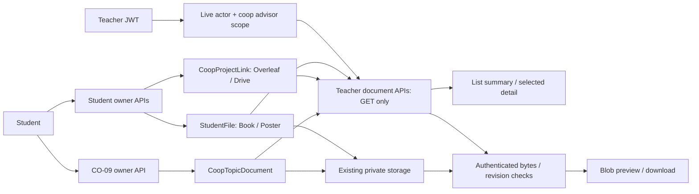

# Teacher Project Documents — Source Audit and Implementation

**Follow-up 11 November 2026:** ผู้ใช้ส่งManualAcceptanceแล้ว และมี [Bugfix Round 1](TEACHER_BUGFIX_ROUND1_2026-11-11.md) แทนรายละเอียดNativePDFiframe/UnknownFilterบางส่วนด้านล่างด้วยPDF.jsCanvasและUnknownYearOption. เอกสารนี้คงหลักฐานSourceก่อนBugfix; ไม่ใช่สถานะRuntimeล่าสุดหรือผลทดสอบใหม่. ผลผู้ใช้53ข้อ PASS27/FAIL10/BLOCKED16ไม่ถูกเปลี่ยนโดยSourceUpdate.

11 November 2026 (Asia/Bangkok). ผู้ใช้อนุญาต Source Audit/Dependency Trace/Authorization Review เฉพาะระบบเอกสารและให้พัฒนาต่อโดยไม่หยุดที่รายงาน. **Source inspection only; Tests: NOT RUN — USER-OWNED TESTING.** ไม่มี API/DB/Filesystem fixture inspection, Browser, Test Suite, Build, Lint, Typecheck, Syntax/Automated Validation หรือผล PASS/FAIL. ไม่รับรองว่าไฟล์/Schema/ข้อมูลในRuntimeมีอยู่จากการอ่านSource; รายละเอียดด้านล่างเป็นพฤติกรรมที่โค้ดกำหนดไว้.

Git ก่อนงาน **18 Modified / 9 Untracked** ตรงLocal Workspace. รักษางานSearch/Filter/CardTable/Sortingที่ยังไม่Commitทั้งหมด; ทุกงานก่อนหน้ายังPENDING USER TESTING. ไม่ใช้GitHubแทนSourceปัจจุบัน.

## Architecture / data flow

Book/Poster: `student_coop.js:4136`อ่านMetadata, `:4180`อัปโหลดและreadbackผ่าน`api/studentCoop.api.js:19`; `routes/studentCoop.routes.js:47`ผูกOwnerAPI; `services/studentCoopProject.service.js:96`ตรวจOwner/MIME/extension/signature/size, อัปเดตStudentFileในTransactionและรักษาไฟล์เมื่อCommitไม่แน่ชัด. Pathถูกสร้างโดย`middlewares/upload.middleware.js:15`และ`config/storage.js`ภายในStudentDirectory. Topicอยู่ในCoopProjectแบบ1ต่อStudent ไม่ใช่เอกสารไฟล์.

Links: `studentProjectLinks.service.js:20`อ่าน/`:25`CAS save; Model`coopProjectLink.model.js:3`ใช้Student+category composite key, ไม่ปนStudentFile. CO-09: `coopTopicExam.service.js:61`saveDocumentแยกจากreview/schedule; `coopTopicDocumentStorage.js:7`ใช้co09/studentUUID/UUID.pdf immutable private files. `coopTopicExam.policy.js:4`เป็นmanagerStaff/Admin; ไม่ใช้policyนี้ให้Teacherอ่านและไม่ให้Teacherreview/schedule.

Teacherใหม่: `app.js:74`→`teacherProjectDocuments.routes.js:11`→`teacherProjectDocuments.service.js:75`→Shared`teacherSearch.service.js:22`. Search/Year/Semester/Major/Sort/Countก่อนPaginationและownershipเป็นcoop advisorเดิม; Project Documentsเพิ่มtopicsearchเฉพาะkinddocuments ไม่เปลี่ยนการค้นของสามเมนูเดิม. Listอ่าน5ชุดModelแบบbulkต่อหน้า แล้วตรวจphysical file metadataแบบbounded filesystem reads; Detail/Bytesโหลดเมื่อเลือกเท่านั้น. ไม่มีN+1HTTP/DBDetail calls. Physical IOต่อไฟล์ในหน้าจำเป็นเพื่อไม่กล่าวว่ามีไฟล์จริงจากrowอย่างเดียว.

## Audit table — before / reusable / gaps / resulting changes

| Function | Baseline classification | Source evidence | Required change / implementation |
|---|---|---|---|
| Teacher project workspace | Missing | ก่อนแก้`teacher_coop.html:138`เป็นplanned cards; NavigationมีprojectDocumentsอยู่แล้ว | แทนPlaceholderที่ตำแหน่งเดิมด้วยList/Detail; เพิ่มmoduleentryที่`:182`; ไม่เพิ่มเมนู |
| Teacher dashboard/navigation integration | Implemented and reusable | `teacherNavigation.js:5`mapPanel,`:89`syncvisibility; Dashboardlinkเดิม`teacher_coop.html:57` | ใช้teacher:viewchangeเดิม; เปลี่ยนเฉพาะข้อความการ์ดลิงก์เอกสารจากplanned ไม่แตะMetricQueues/Sidebar/Navigationlogic |
| Current Teacher lists / filters / sort | Implemented and reusable, pending user testing | `teacherSearch.service.js:22`, `teacherSearchToolbar.js:3`, `teacherListView.js:4`, `teacherSupervision.js:10` | เพิ่มkinddocuments+internalstudentIdconstraint; ใช้Contracts/Pagination/Unknown/NULLSLAST/SortPreferencesเดิม ไม่mountSupervisionซ้ำ |
| Student book/poster metadata and upload | Implemented and reusable | `studentCoopProject.service.js:20,69,96,150`; `studentFile.model.js:19` | Bulkreadเฉพาะประเภทcoop_project_book/coop_poster; exposeownedPathเฉพาะInternalServiceเพิ่มเติม ไม่เปลี่ยนUpload/cleanup/Ownerroute |
| Project links | Implemented and reusable | `studentProjectLinks.service.js:20`; `coopProjectLink.model.js:3`; `projectDocumentUrl.rules.js:3` | DTOใหม่ไม่คืนpath; LinkvalidatorเดิมOverleaf/Drive. URLไม่ได้รับรองProviderSharing |
| CO-09 metadata/review status | Implemented and reusable | `coopTopicDocument.model.js:3`, `coopTopicExam.service.js:35,61` | Teacherอ่านDocModelโดยDTOเฉพาะdocument/reviewstatus+reason+dates ไม่มีmanagerpermissions/examediting/historyปลอม |
| Teacher private-file access | Missing / security risk if owner routes or manager privileges were reused directly | StudentrouteมีStudentJWT guard; CO09manageมีmanagerpolicy; ก่อนงานไม่มีTeacherDocumentroute | GET-onlyrouterแยก ใช้ApplicationTeacherJWT+liveaccount+activeTeacher+co_op+coop_advisor_teacher_id ทุกPreview/Download; ไม่มีadminbypass |
| Book/poster path validation | Implemented and reusable | `studentCoopProject.service.js:74`lexical/realpath/category/basename/regularfile guards | ใช้ตัวเดิมผ่านinternalownedPath ไม่สร้างStorageอีกชุด; ก่อนส่งBytesตรวจsize/signature/revisionและOwnerอีกครั้ง |
| CO-09 private path validation | Implemented and reusable; metadata inspection missing | `coopTopicDocumentStorage.js:9`walkdirectories/lstat/UUIDscope | เพิ่มinspectใช้guardเดียวกับreadเพื่อตรวจstatในListโดยไม่อ่านPDFทั้งไฟล์; writeยังimmutable/ไม่เปลี่ยน |
| File replacement race | Partial for existing file display | StudentFileuploadแทนMetadataบนIDเดิม; CO09versionเพิ่มทุกwrite | DTOfile.revision=updatedAtหรือCO09version; ตรวจเทียบก่อนอ่านและหลังอ่านbytes, pathต้องตรงrowเดิม; 409ให้reloadDetail |
| Preview modal / lifecycle | Shared modal reusable; existing inline/new-tab previews not a generic Teacher utility | `feedback.js:18`, `student_coop.js:4220`, `coopTopicExams.js:133`, `studentProfileWorkspace.js:568` | ใช้mountContentModal/focus/inert/scroll/Escapeเดิม. เพิ่มTeacherlifecycleที่ผูกAbortController/requestversion/sessiontokenและrevokeBlobOnClose/Exit/Session/Pagehide |
| Auth/session-bound API | Implemented and reusable | `teacherProjectAdvisor.api.js:6`, `api/client.js:74`, `auth.middleware.js:39,85`, `teacherAuth.middleware.js:6` | ใช้teacherRequest+signal ไม่มีStudentJWT/URLToken; ไม่แก้JWT/account/Google/RBACpolicy |
| Empty/error/schema states | Missing for document workspace | ก่อนแก้ไม่มีList/DetailAPIในหน้านี้ | Schema/readfailureเป็น503/error ไม่fakeempty; file_unavailable/invalid_linkแยกจากmissing; CO09existsแยกไม่เคยสร้าง |
| Responsive / table accessibility | Reusable and partial | `teacherListView.js`semanticTable/regions, TeacherCSS, Sharedfeedback | Docs8columnstable, container-onlyhorizontal scroll, cards3→1columns, namedcontrols/status/aria-busy; ยังไม่Browserตรวจจริง |

## Authorization and file delivery

- ทั้ง4GET routesผ่าน`authenticateToken`เดิมก่อนrequireTeacher. Middlewareตรวจsignature/expiry/currentActor/accountcontrols/revocation; Student/Staff/standaloneSuperAdminJWTไม่ผ่านTeacherguard. Teacherที่เป็นHead/Adminmemberยังต้องมีStudent.coop_advisor_teacher_idตรงกัน. ClassAdvisorอย่างเดียวไม่พอ.
- `service.owner:30`กรองStudentUUID+track+coopadvisorจากDB; filelookupใช้StudentID+FileID+Categoryร่วมกัน ไม่ค้นFileIDอย่างเดียว. UnknownStudent/ownershipchangeคืน404เพื่อลดการเปิดเผยว่าคนอื่นมีrecord. ไม่มีReview/Approval/Upload/Edit routeใหม่.
- `service.physical:42`ใช้Storageเดิม. Book/PosterมีallowlistMIME/ownerDirectory/realpath/UUIDbasename. CO09มีownerpath/lstat/noSymlink/regularfile/sizeguard. DTOไม่มีstorage_path/password/hash/token/contacts/transcript. ไม่เปิดStaticStorageหรือPublicFileURL.
- `service.file:105`ตรวจrevision/physicalsize≤10MB/signature/MIMEและreadbackMetadataล่าสุด; recheckOwner/Teacherก่อนคืนBuffer. Headersในroute: no-store/nosniff/no-referrer, MIMEจริงและinlineหรือattachment UTF8filename, CSPsandbox/default-src none. ไม่มีTokenในURL; queryrevisionเป็นversionข้อมูล ไม่ใช่Credentialและไม่ให้อำนาจเข้าถึงไฟล์เอง.
- Previewผ่านBlobจากAuthenticatedRequest; iframeใส่sandboxallow-same-originโดยไม่อนุญาตscripts, imgไม่มีSVG. Escape/focusใช้SharedModal; ClientrevokeURLเมื่อปิด/เปลี่ยนนักศึกษา/ออกเมนู/บัญชีเปลี่ยน/Logout/pagehide. Downloadเป็นAuthenticatedGETใหม่แม้มีPreviewBlobแล้ว ไม่ใช้Blobเดิมข้ามการตรวจสิทธิ์.
- ลิงก์Book/Posterใช้exactproviderHTTPSvalidatorเดิมทั้งServer/Browser. CO09คงข้อยกเว้นread-onlylegacyHTTPSผ่าน`coopTopicExam.rules.httpsUrl`และfrontend`httpsDocumentUrl`, แสดง“เปิดลิงก์เดิม(host)”ไม่อ้างว่าเป็นOverleaf. ไม่มีrewriteURL/OAuth/fetchprovider/ส่งAuthheaderไปExternalURL; noreferrer/noopener/no-referrer. สิทธิ์แชร์Providerอยู่นอกระบบนี้.

## API contracts

Root `/api/teachers/project-documents` (Teacher JWT ในAuthorizationheaderเท่านั้น).

| GET | Input | Output |
|---|---|---|
| `/students` | search/year/semester/major/sort/offset/limit/metadata ตามSharedallowlists | `{rows,total,years,offset,limit}`; Studentidentity+topic+academicPeriod+documentsummary3ประเภท ไม่มีURLs/filebytes/path |
| `/students/:studentId` | Filter/Sortcontextเดิม | `{student}` พร้อม3DocumentCards: flags/state/filemetadata/revision/document_url/legacy_link/reviewstatus+reason/dates, companyเมื่อมีplacementชัดเจน |
| `/students/:studentId/documents/:category/files/:fileId/preview` | category=project-book/poster/co09, UUID, `revision`ที่Detailคืน | AuthenticatedinlinePDF/PNG/JPEGbytesหรือ400/401/403/404/409/503 |
| `/students/:studentId/documents/:category/files/:fileId/download` | เหมือนPreview | Authenticatedattachmentbytes; ไม่พึ่งPublicURL |

Summaryfields: has_file/has_link/file_unavailable/invalid_link/state; CO09เพิ่มexists/review_status. Statesfile/file_and_link/link/missing/unavailable. `has_file`ต้องผ่านstat+MIME+sizeจริง ไม่ใช่แค่มีrow/path; magic bytesตรวจอีกครั้งตอนเปิด. Rowที่ไม่ครบ/Pathผิด/อ่านไม่ได้ไม่ทำให้แสดง“พร้อมใช้งาน”. Listbulkไม่ส่งExternalURL; Detailเท่านั้นที่เปิดเผยลิงก์ซึ่งผ่านValidator.

## Findings outside implementation scope / limits

1. `coopTopicExam.service.js:123`ManagerlistเดิมวนdetailทีละStudent (N+1DBqueries); ใหม่ไม่เรียกตัวนั้นและไม่refactorStaff/Adminในงานนี้.
2. `studentCoop.routes.js:68`Ownerpreviewเดิมไม่มีCSPheaderแบบrouteใหม่ และStudentprojectเปิดBlobในnewtab; sourceนี้ไม่ใช่หลักฐานว่าเกิดexploit. ไม่เปลี่ยนOwnerUIหรือขยายhardeningไปStudent/Staffโดยพลการ.
3. Project/File/Links/CO09เป็นStudent-level current documents ไม่ได้มีacademic_period_idบนไฟล์. ปี/ภาคในรายการระบุรอบPlacementของStudentจากSharedsorting ไม่รับรองว่าไฟล์currentเป็นเวอร์ชันของรอบนั้น. ไม่สร้างHistoricalDocumentMappingหรือBackfill/Migration. แสดงข้อมูลcurrentที่มีอยู่จริงเท่านั้น.
4. CO09legacyHTTPSอาจชี้Providerอื่นตามreadcompatibilityเดิม ต้องตรวจสิทธิ์แชร์/ปลายทางเอง; ไม่เพิ่มProviderpolicyหรือแก้URLเดิม. Book/Posterproviderpolicyคงเดิม.
5. NativePDFViewerของChrome/OSอาจแสดงไม่เหมือนกันเมื่อsandbox; มีAuthenticatedDownloadเป็นทางเลือก. การแสดงPDFและEscapeขณะFocusอยู่ในNativeViewerต้องตรวจด้วยManualChrome ไม่อ้างจากSourceว่าBrowserผ่านแล้ว.
6. ไฟล์ที่Browserดาวน์โหลด/เปิดไปแล้วไม่สามารถถอนสำเนาย้อนหลังได้. Serverตรวจสิทธิ์ใหม่ทุกGET และClientล้างBlobเมื่อทราบSessionchange; Assignment/disableที่Serverจะทราบจากคำขอถัดไป ไม่เพิ่มpollingAPIหรือเปลี่ยนRBAC.
7. PhysicalIOต่อหน้าและBuffer≤10MBต่อfileเป็นboundedread แต่ยังไม่วัดLatency/Performance/ConcurrentUploadReadback. RuntimeSchema/StorageavailabilityทุกTargetยังไม่ได้ตรวจในงานนี้. ไม่มีDDLจำเป็นจากSource; ถ้าติดตั้งSchemaไม่ครบใช้503 ไม่auto-install.

**Database Changes: NONE.** ไม่มีSchema/Seed/Data/ApprovalHistory/Account/Permission/ExternalServices writes. ManualChecklist: `docs/testing/TEACHER_PROJECT_DOCUMENTS_MANUAL_ACCEPTANCE.md` ทุกข้อNOT TESTED. **NEXT TASK: User Manual Chrome Acceptance.**
