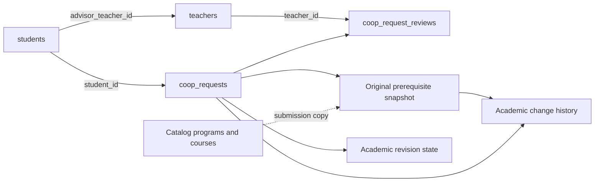

# FITM-INTERN — PostgreSQL Database Audit — 8 November 2026

วันที่อ้างอิง: **8 พฤศจิกายน 2026 (Asia/Bangkok)**. ขอบเขต: PostgreSQL Development `intern_system`, schema `public`; อ่านโครงสร้างจริงและเทียบ Sequelize declarations ใน Working Tree ปัจจุบัน. รายงานนี้เป็น Database Baseline ณ snapshot ที่อ่าน ไม่ใช่ผลทดสอบหรือ Manual Acceptance.

**Database Changes: NONE. Tests: NOT RUN — USER-OWNED TESTING.** ไม่แก้ Application Source, Models, Associations, Schema, Records, README, Project Skill หรือ Environment; ไม่เรียก migrations/initializers/seeders/reset/build/lint/validation/Browser/health checks และไม่ Commit/Push.

## 1. Executive Summary

- **CONFIRMED:** PostgreSQL **16.15 / UTF8**, **56 ตาราง / 640 คอลัมน์**, อ่าน metadata และนับแถวครบ **56/56 ตาราง**. รวม **135 records**, **33 ตารางว่าง**; จำนวนเป็น exact `COUNT(*)` ภายใน snapshot เดียว ไม่ใช่ estimates.
- **CONFIRMED:** **56 PK / 94 FK / 19 UNIQUE constraints / 128 CHECK constraints**, รวม 297 constraints. **141 indexes** รวม 113 unique indexes (นับ PK ด้วย), 8 partial indexes; 19 user triggers และ 15 public functions. ไม่พบ identity/sequence/auto increment หรือ public views/materialized views/foreign tables ในรายการที่อ่าน.
- **SEQUELIZE:** 51 ไฟล์ `*.model.js` และ 5 models จาก Profile aggregate รวม **56 models / 640 persistent attributes**. ผลเทียบโครงสร้างเป็น **MATCHED (metadata)**: table/column mappings, types/enum labels, nullable/defaults, PK, single-column FK, indexes และ 7 composite FK จาก integrity definitions. ไม่พบ Schema/Model MISMATCH ที่ยืนยันได้ในการอ่านครั้งนี้; ไม่รับรอง runtime หรือ SQL behavior จากผลนี้.
- **POTENTIAL ISSUE:** CHECK ของ Review สองตัวเป็น `NOT VALID` ตามทั้ง Database และ Source; ยังไม่ได้ตรวจข้อมูลย้อนหลังหรือทดลองการบังคับใช้. ค่าเริ่มต้นสถานะคำร้องเป็น `submitted` แต่เส้นทางสร้างคำร้องปัจจุบันระบุ `advisor_review` เอง. ทั้งสองข้อไม่ใช่ Model drift.
- **COMPANY/JOBS:** `companies`, `job_submissions`, `job_postings`, `job_posting_work_modes`, `job_posting_reviews`, `company_access_tokens`, `company_responses`, `company_response_history` ว่างทั้งหมด. โครงสร้างหลักรองรับการเตรียมข้อมูล Development ได้ แต่ไม่มี business description, structured job skills หรือ IT/INE relevance mapping โดยเฉพาะ.

## 2. Database Environment

| Item | Observed / Evidence |
| --- | --- |
| Database / schema | `current_database() = intern_system`, `current_schema() = public` |
| PostgreSQL / encoding | `current_setting('server_version') = 16.15`, `server_encoding = UTF8` |
| Configured container | `intern_postgres`, image reference `postgres:16-alpine` จาก `docker-compose.yml` และรายการ Container ที่อ่านได้; SQL connection รอบนี้เป็น host TCP ตาม port mapping |
| Repository connection | `backend/src/config/database.js` ใช้ Sequelize/PostgreSQL และ environment ของ Backend; Compose map `127.0.0.1:5432:5432` |
| Actual audit connection | ใช้ dependency `pg` ที่ติดตั้งอยู่แล้ว เชื่อม `127.0.0.1:5432`; โหลด credentials เข้า memory จาก Backend config โดยไม่แสดงหรือบันทึกค่า |
| Snapshot | `BEGIN TRANSACTION ISOLATION LEVEL REPEATABLE READ READ ONLY`; ยืนยัน `transaction_read_only=on`, `transaction_isolation=repeatable read` |
| Query bounds | transaction-local statement timeout30s / lock timeout3s; ทุกตารางมีขนาดและจำนวนแถวเหมาะกับ exact count; ไม่มี estimates ที่ใช้แทน counts |
| SQL evidence | `pg_class`, `pg_namespace`, `pg_attribute`, `pg_attrdef`, `pg_constraint`, `pg_index`, `pg_trigger`, `pg_proc`, `pg_enum`, `pg_extension`; อ่าน definitions ด้วย `pg_get_*` และใช้ `COUNT(*)` เท่านั้นสำหรับ business tables |
| Extensions | `plpgsql` |
| Access limitation | `docker ps` อ่านรายการได้ แต่ `docker exec` ถูก Docker API ปฏิเสธ; ไม่ยกระดับสิทธิ์หรือข้ามระบบ. ช่องทาง TCP ที่มีอยู่เดิมอ่าน metadata ได้ จึงไม่มี Database inventory blocker ค้าง |

ไม่มี `SELECT *` สำหรับดึง business rows, ไม่มีการนำชื่อบุคคล/ข้อมูลบัญชี/เนื้อหาเอกสาร/credentials/token/hash values ลงรายงาน. ชื่อ column เช่น `password_hash`, `token_hash` และ `national_id_ciphertext` เป็น schema metadata เท่านั้น. ข้อความ `CREATE`/`UPDATE` ใน definitions ที่รายงานเป็นสิ่งที่อ่านจาก catalog ไม่ใช่คำสั่งที่รัน.

การอ่าน Models ใช้ Sequelize registry แยกใน memory เพื่อเก็บ declarations/associations หลัง register Profile aggregate และ schema integrity; ไม่ import live Database config และปิด query/authenticate ของ registry นี้. ไม่เรียก `validate`, `sync`, `inspectColumns`, `verifyIntegrity` หรือ initializer. ใช้สคริปต์จัดรูปแบบ metadata เป็นเอกสารเท่านั้น ไม่รัน automated validation/เปรียบเทียบแบบ test assertions.

## 3. Inventory of All Tables

ทุกตารางอยู่ใน schema `public`. FK/UQ/CK/IX คือจำนวน Foreign Keys / UNIQUE constraints / CHECK constraints / indexes ของตารางนั้น; unique indexes ที่ไม่ได้เป็น constraint รวมอยู่ใน IX. Definitions อยู่หัวข้อ 4–5; D1–D14 อยู่หัวข้อ 6.

| Schema.Table | Columns | PK fields | FK | UQ | CK | IX | Exact records | Sequelize model | Domain |
| --- | --- | --- | --- | --- | --- | --- | --- | --- | --- |
| `public.admin_account_controls` | 7 | `actor_type, actor_id` | 0 | 0 | 1 | 1 | 1 | AdminAccountControl | D1 |
| `public.admin_audit_logs` | 7 | `id` | 1 | 0 | 0 | 2 | 7 | AdminAuditLog | D13 |
| `public.companies` | 14 | `id` | 0 | 0 | 0 | 4 | 0 | Company | D8 |
| `public.company_access_tokens` | 10 | `id` | 2 | 0 | 3 | 4 | 0 | CompanyAccessToken | D11 |
| `public.company_evaluations` | 11 | `id` | 2 | 0 | 2 | 2 | 0 | CompanyEvaluation | D12 |
| `public.company_response_history` | 12 | `id` | 4 | 0 | 2 | 2 | 0 | CompanyResponseHistory | D8 |
| `public.company_responses` | 11 | `id` | 4 | 0 | 1 | 2 | 0 | CompanyResponse | D8 |
| `public.coop_activities` | 20 | `id` | 2 | 0 | 8 | 4 | 0 | CoopActivity | D14 |
| `public.coop_activity_history` | 9 | `id` | 2 | 0 | 2 | 2 | 0 | CoopActivityHistory | D14 |
| `public.coop_document_revisions` | 13 | `id` | 2 | 0 | 2 | 2 | 0 | CoopDocumentRevision | D10 |
| `public.coop_documents` | 16 | `id` | 3 | 0 | 5 | 3 | 0 | CoopDocument | D10 |
| `public.coop_prerequisite_catalog_courses` | 11 | `id` | 2 | 0 | 1 | 2 | 10 | CoopPrerequisiteCatalogCourse | D7 |
| `public.coop_prerequisite_catalog_grants` | 7 | `id` | 2 | 0 | 1 | 2 | 4 | CoopPrerequisiteCatalogGrant | D7 |
| `public.coop_prerequisite_catalog_programs` | 4 | `program` | 0 | 0 | 1 | 1 | 2 | CoopPrerequisiteCatalogProgram | D7 |
| `public.coop_project_advisor_requests` | 11 | `id` | 2 | 0 | 2 | 3 | 1 | CoopProjectAdvisorRequest | D6 |
| `public.coop_projects` | 5 | `id` | 1 | 0 | 1 | 2 | 1 | CoopProject | D14 |
| `public.coop_request_academic_history` | 13 | `id` | 3 | 0 | 1 | 3 | 0 | CoopRequestAcademic History | D7 |
| `public.coop_request_academic_states` | 4 | `coop_request_id` | 1 | 0 | 1 | 1 | 0 | CoopRequestAcademicState | D7 |
| `public.coop_request_delivery_methods` | 5 | `id` | 1 | 0 | 0 | 2 | 0 | CoopRequestDeliveryMethod | D5 |
| `public.coop_request_prerequisite_courses` | 10 | `id` | 1 | 0 | 2 | 2 | 0 | CoopRequestPrerequisiteCourse | D7 |
| `public.coop_request_reviews` | 11 | `id` | 4 | 0 | 3 | 2 | 0 | CoopRequestReview | D6 |
| `public.coop_requests` | 18 | `id` | 3 | 0 | 0 | 5 | 0 | CoopRequest | D5 |
| `public.coop_topic_documents` | 15 | `id` | 1 | 2 | 6 | 3 | 1 | CoopTopicDocument | D10 |
| `public.coop_topic_exam_committee_members` | 7 | `id` | 2 | 0 | 1 | 3 | 0 | CoopTopicExamCommitteeMember | D14 |
| `public.coop_topic_exam_history` | 6 | `id` | 1 | 0 | 1 | 2 | 0 | CoopTopicExamHistory | D14 |
| `public.coop_topic_exams` | 17 | `id` | 2 | 1 | 6 | 3 | 0 | CoopTopicExam | D14 |
| `public.department_staffs` | 12 | `id` | 0 | 1 | 0 | 2 | 2 | DepartmentStaff | D4 |
| `public.google_auth_requests` | 7 | `id` | 0 | 0 | 0 | 2 | 1 | GoogleAuthRequest | D1 |
| `public.google_identities` | 8 | `id` | 3 | 0 | 2 | 5 | 1 | GoogleIdentity | D1 |
| `public.internship_daily_logs` | 13 | `id` | 1 | 1 | 4 | 2 | 0 | InternshipDailyLog | D12 |
| `public.internship_review_tokens` | 9 | `id` | 2 | 1 | 0 | 2 | 0 | InternshipReviewToken | D11 |
| `public.internship_week_events` | 10 | `id` | 2 | 1 | 5 | 2 | 0 | InternshipWeekEvent | D12 |
| `public.internship_weeks` | 11 | `id` | 2 | 1 | 5 | 2 | 0 | InternshipWeek | D12 |
| `public.job_posting_reviews` | 8 | `id` | 2 | 0 | 2 | 2 | 0 | JobPostingReview | D9 |
| `public.job_posting_work_modes` | 5 | `id` | 1 | 0 | 1 | 3 | 0 | JobPostingWorkMode | D9 |
| `public.job_postings` | 18 | `id` | 2 | 0 | 4 | 4 | 0 | JobPosting | D9 |
| `public.job_submissions` | 11 | `id` | 1 | 0 | 1 | 2 | 0 | JobSubmission | D9 |
| `public.mentor_tokens` | 7 | `id` | 1 | 1 | 0 | 2 | 1 | MentorToken | D11 |
| `public.mentors` | 10 | `id` | 1 | 1 | 0 | 3 | 1 | Mentor | D11 |
| `public.student_addresses` | 12 | `id` | 1 | 1 | 2 | 2 | 6 | StudentAddress | D2 |
| `public.student_close_friends` | 10 | `id` | 1 | 0 | 1 | 2 | 1 | StudentCloseFriend | D2 |
| `public.student_education_records` | 12 | `id` | 1 | 0 | 5 | 2 | 9 | StudentEducationRecord | D2 |
| `public.student_files` | 18 | `id` | 2 | 2 | 5 | 7 | 19 | StudentFile | D10 |
| `public.student_profiles` | 53 | `id` | 1 | 1 | 8 | 2 | 6 | StudentProfile | D2 |
| `public.student_skills` | 8 | `id` | 1 | 0 | 3 | 2 | 20 | StudentSkill | D2 |
| `public.student_training_records` | 9 | `id` | 1 | 0 | 1 | 2 | 10 | StudentTrainingRecord | D2 |
| `public.students` | 20 | `id` | 2 | 2 | 2 | 4 | 7 | Student | D2 |
| `public.super_admins` | 12 | `id` | 1 | 2 | 2 | 3 | 1 | SuperAdmin | D1 |
| `public.supervision_appointments` | 15 | `id` | 6 | 0 | 6 | 3 | 0 | SupervisionAppointment | D12 |
| `public.supervision_events` | 9 | `id` | 2 | 0 | 2 | 2 | 0 | SupervisionEvent | D12 |
| `public.supervision_images` | 7 | `id` | 1 | 0 | 2 | 3 | 0 | SupervisionImage | D12 |
| `public.supervision_result_revisions` | 7 | `id` | 2 | 0 | 1 | 2 | 0 | SupervisionResultRevision | D12 |
| `public.supervision_results` | 16 | `id` | 4 | 0 | 9 | 2 | 0 | SupervisionResult | D12 |
| `public.supervision_tokens` | 8 | `id` | 1 | 0 | 1 | 3 | 0 | SupervisionToken | D12 |
| `public.system_settings` | 6 | `key` | 1 | 0 | 1 | 1 | 0 | SystemSetting | D13 |
| `public.teachers` | 15 | `id` | 0 | 1 | 0 | 2 | 23 | Teacher | D3 |

## 4. Column / Constraint Summary

ข้อมูลรายคอลัมน์และ definitions อ่านจาก PostgreSQL จริง. ขีด — ใน DB default หมายถึงไม่มี default expression ไม่ได้หมายความว่า nullable; อ่านช่อง Nullable ประกอบ. `app:UUIDV4` เป็น application default ไม่ใช่ SQL default จึงไม่ถือว่าต่างจาก Models. Virtual password attributes ไม่ใช่ database columns.

**Identity / Auto Increment:** ทั้ง 640 คอลัมน์ไม่มี identity/generated/sequence increment; UUID keys ส่วนใหญ่สร้างโดย Application. การ insert ตรงด้วย SQL ต้องเตรียม UUID และ timestamps ตาม schema. Column relationships แสดง FK → parent(columns); composite FK ต้องใช้ชุดคอลัมน์ครบตามหัวข้อ 5.

### public.admin_account_controls

Model: [AdminAccountControl](../../backend/src/models/adminAccountControl.model.js); domain D1.

| Column | PostgreSQL type | Nullable | DB default | Model attribute → field / type / default | Keys / references |
| --- | --- | --- | --- | --- | --- |
| `actor_type` | `character varying(32)` | NO | — | `actor_type → actor_type` / `VARCHAR(32)` / `—` | `PK` |
| `actor_id` | `uuid` | NO | — | `actor_id → actor_id` / `UUID` / `—` | `PK` |
| `enabled` | `boolean` | NO | `true` | `enabled → enabled` / `BOOLEAN` / `true` | — |
| `revoked_before` | `bigint` | NO | `0` | `revoked_before → revoked_before` / `BIGINT` / `0` | — |
| `version` | `integer` | NO | `0` | `version → version` / `INTEGER` / `0` | — |
| `created_at` | `timestamp with time zone` | NO | `now()` | `createdAt → created_at` / `TIMESTAMP WITH TIME ZONE` / `now()` | — |
| `updated_at` | `timestamp with time zone` | NO | `now()` | `updatedAt → updated_at` / `TIMESTAMP WITH TIME ZONE` / `now()` | — |

**PK / UNIQUE / CHECK constraints** (FK อยู่หัวข้อ 5):

- `admin_account_controls_check` [CHECK; validated]: `CHECK ((actor_type::text = ANY (ARRAY['student'::character varying, 'teacher'::character varying, 'department_staff'::character varying, 'super_admin'::character varying]::text[])) AND version >= 0 AND revoked_before >= 0)`
- `admin_account_controls_pkey` [PK; validated]: `PRIMARY KEY (actor_type, actor_id)`

**Indexes:**

- `admin_account_controls_pkey` [valid=true]: `CREATE UNIQUE INDEX admin_account_controls_pkey ON public.admin_account_controls USING btree (actor_type, actor_id)`

### public.admin_audit_logs

Model: [AdminAuditLog](../../backend/src/models/adminAuditLog.model.js); domain D13.

| Column | PostgreSQL type | Nullable | DB default | Model attribute → field / type / default | Keys / references |
| --- | --- | --- | --- | --- | --- |
| `id` | `uuid` | NO | — | `id → id` / `UUID` / `app:UUIDV4` | `PK` |
| `actor_id` | `uuid` | NO | — | `actor_id → actor_id` / `UUID` / `—` | `FK → super_admins(id)` |
| `action` | `character varying(80)` | NO | — | `action → action` / `VARCHAR(80)` / `—` | — |
| `target_type` | `character varying(40)` | NO | — | `target_type → target_type` / `VARCHAR(40)` / `—` | — |
| `target_id` | `character varying(100)` | NO | — | `target_id → target_id` / `VARCHAR(100)` / `—` | — |
| `changes` | `jsonb` | NO | `'{}'::jsonb` | `changes → changes` / `JSONB` / `{}` | — |
| `created_at` | `timestamp with time zone` | NO | `now()` | `createdAt → created_at` / `TIMESTAMP WITH TIME ZONE` / `now()` | — |

**PK / UNIQUE / CHECK constraints** (FK อยู่หัวข้อ 5):

- `admin_audit_logs_pkey` [PK; validated]: `PRIMARY KEY (id)`

**Indexes:**

- `admin_audit_logs_created_at_id` [valid=true]: `CREATE INDEX admin_audit_logs_created_at_id ON public.admin_audit_logs USING btree (created_at, id)`
- `admin_audit_logs_pkey` [valid=true]: `CREATE UNIQUE INDEX admin_audit_logs_pkey ON public.admin_audit_logs USING btree (id)`

**User triggers:**

- `admin_audit_logs_immutable` [enabled=O]: `CREATE TRIGGER admin_audit_logs_immutable BEFORE DELETE OR UPDATE ON admin_audit_logs FOR EACH ROW EXECUTE FUNCTION admin_audit_log_guard()`
- `admin_audit_logs_no_truncate` [enabled=O]: `CREATE TRIGGER admin_audit_logs_no_truncate BEFORE TRUNCATE ON admin_audit_logs FOR EACH STATEMENT EXECUTE FUNCTION admin_audit_log_guard()`

### public.companies

Model: [Company](../../backend/src/models/company.model.js); domain D8.

| Column | PostgreSQL type | Nullable | DB default | Model attribute → field / type / default | Keys / references |
| --- | --- | --- | --- | --- | --- |
| `id` | `uuid` | NO | — | `id → id` / `UUID` / `app:UUIDV4` | `PK` |
| `name` | `character varying(255)` | NO | — | `name → name` / `VARCHAR(255)` / `—` | — |
| `normalized_name` | `character varying(255)` | NO | — | `normalized_name → normalized_name` / `VARCHAR(255)` / `—` | — |
| `email` | `character varying(254)` | NO | — | `email → email` / `VARCHAR(254)` / `—` | — |
| `normalized_email` | `character varying(254)` | NO | — | `normalized_email → normalized_email` / `VARCHAR(254)` / `—` | — |
| `phone` | `character varying(32)` | NO | — | `phone → phone` / `VARCHAR(32)` / `—` | — |
| `address_no` | `character varying(50)` | NO | — | `address_no → address_no` / `VARCHAR(50)` / `—` | — |
| `moo` | `character varying(30)` | YES | — | `moo → moo` / `VARCHAR(30)` / `—` | — |
| `subdistrict` | `character varying(100)` | NO | — | `subdistrict → subdistrict` / `VARCHAR(100)` / `—` | — |
| `district` | `character varying(100)` | NO | — | `district → district` / `VARCHAR(100)` / `—` | — |
| `province` | `character varying(100)` | NO | — | `province → province` / `VARCHAR(100)` / `—` | — |
| `email_verified_at` | `timestamp with time zone` | YES | — | `email_verified_at → email_verified_at` / `TIMESTAMP WITH TIME ZONE` / `—` | — |
| `created_at` | `timestamp with time zone` | NO | — | `createdAt → created_at` / `TIMESTAMP WITH TIME ZONE` / `—` | — |
| `updated_at` | `timestamp with time zone` | NO | — | `updatedAt → updated_at` / `TIMESTAMP WITH TIME ZONE` / `—` | — |

**PK / UNIQUE / CHECK constraints** (FK อยู่หัวข้อ 5):

- `companies_pkey` [PK; validated]: `PRIMARY KEY (id)`

**Indexes:**

- `companies_normalized_email_idx` [valid=true]: `CREATE INDEX companies_normalized_email_idx ON public.companies USING btree (normalized_email)`
- `companies_normalized_name_idx` [valid=true]: `CREATE INDEX companies_normalized_name_idx ON public.companies USING btree (normalized_name)`
- `companies_pkey` [valid=true]: `CREATE UNIQUE INDEX companies_pkey ON public.companies USING btree (id)`
- `companies_province_idx` [valid=true]: `CREATE INDEX companies_province_idx ON public.companies USING btree (province)`

### public.company_access_tokens

Model: [CompanyAccessToken](../../backend/src/models/companyAccessToken.model.js); domain D11.

| Column | PostgreSQL type | Nullable | DB default | Model attribute → field / type / default | Keys / references |
| --- | --- | --- | --- | --- | --- |
| `id` | `uuid` | NO | — | `id → id` / `UUID` / `app:UUIDV4` | `PK` |
| `company_id` | `uuid` | NO | — | `company_id → company_id` / `UUID` / `—` | `FK → companies(id)` |
| `job_submission_id` | `uuid` | YES | — | `job_submission_id → job_submission_id` / `UUID` / `—` | `FK → job_submissions(id)` |
| `purpose` | `character varying(32)` | NO | — | `purpose → purpose` / `VARCHAR(32)` / `—` | — |
| `token_hash` | `character(64)` | NO | — | `token_hash → token_hash` / `CHAR(64)` / `—` | — |
| `expires_at` | `timestamp with time zone` | NO | — | `expires_at → expires_at` / `TIMESTAMP WITH TIME ZONE` / `—` | — |
| `used_at` | `timestamp with time zone` | YES | — | `used_at → used_at` / `TIMESTAMP WITH TIME ZONE` / `—` | — |
| `revoked_at` | `timestamp with time zone` | YES | — | `revoked_at → revoked_at` / `TIMESTAMP WITH TIME ZONE` / `—` | — |
| `created_at` | `timestamp with time zone` | NO | — | `createdAt → created_at` / `TIMESTAMP WITH TIME ZONE` / `—` | — |
| `updated_at` | `timestamp with time zone` | NO | — | `updatedAt → updated_at` / `TIMESTAMP WITH TIME ZONE` / `—` | — |

**PK / UNIQUE / CHECK constraints** (FK อยู่หัวข้อ 5):

- `company_access_tokens_expiry_check` [CHECK; validated]: `CHECK (expires_at > created_at)`
- `company_access_tokens_pkey` [PK; validated]: `PRIMARY KEY (id)`
- `company_access_tokens_purpose_check` [CHECK; validated]: `CHECK (purpose::text = ANY (ARRAY['email_verification'::character varying, 'management_access'::character varying]::text[]))`
- `company_access_tokens_scope_check` [CHECK; validated]: `CHECK (purpose::text = 'email_verification'::text AND job_submission_id IS NOT NULL OR purpose::text = 'management_access'::text AND job_submission_id IS NULL)`

**Indexes:**

- `company_access_tokens_company_purpose_idx` [valid=true]: `CREATE INDEX company_access_tokens_company_purpose_idx ON public.company_access_tokens USING btree (company_id, purpose)`
- `company_access_tokens_expires_at_idx` [valid=true]: `CREATE INDEX company_access_tokens_expires_at_idx ON public.company_access_tokens USING btree (expires_at)`
- `company_access_tokens_pkey` [valid=true]: `CREATE UNIQUE INDEX company_access_tokens_pkey ON public.company_access_tokens USING btree (id)`
- `company_access_tokens_token_hash_uq` [valid=true]: `CREATE UNIQUE INDEX company_access_tokens_token_hash_uq ON public.company_access_tokens USING btree (token_hash)`

### public.company_evaluations

Model: [CompanyEvaluation](../../backend/src/models/companyEvaluation.model.js); domain D12.

| Column | PostgreSQL type | Nullable | DB default | Model attribute → field / type / default | Keys / references |
| --- | --- | --- | --- | --- | --- |
| `id` | `uuid` | NO | — | `id → id` / `UUID` / `app:UUIDV4` | `PK` |
| `student_id` | `uuid` | NO | — | `student_id → student_id` / `UUID` / `—` | `FK → students(id)` |
| `mentor_id` | `uuid` | YES | — | `mentor_id → mentor_id` / `UUID` / `—` | `FK → mentors(id)` |
| `q1_score` | `smallint` | NO | — | `q1_score → q1_score` / `SMALLINT` / `—` | — |
| `q2_score` | `smallint` | NO | — | `q2_score → q2_score` / `SMALLINT` / `—` | — |
| `q3_score` | `smallint` | NO | — | `q3_score → q3_score` / `SMALLINT` / `—` | — |
| `q4_score` | `smallint` | NO | — | `q4_score → q4_score` / `SMALLINT` / `—` | — |
| `q5_score` | `smallint` | NO | — | `q5_score → q5_score` / `SMALLINT` / `—` | — |
| `comment` | `text` | NO | `''::text` | `comment → comment` / `TEXT` / `''::text` | — |
| `created_at` | `timestamp with time zone` | NO | `CURRENT_TIMESTAMP` | `createdAt → created_at` / `TIMESTAMP WITH TIME ZONE` / `CURRENT_TIMESTAMP` | — |
| `updated_at` | `timestamp with time zone` | NO | `CURRENT_TIMESTAMP` | `updatedAt → updated_at` / `TIMESTAMP WITH TIME ZONE` / `CURRENT_TIMESTAMP` | — |

**PK / UNIQUE / CHECK constraints** (FK อยู่หัวข้อ 5):

- `company_evaluations_comment_check` [CHECK; validated]: `CHECK (char_length(comment) <= 2000 AND comment = btrim(comment))`
- `company_evaluations_pkey` [PK; validated]: `PRIMARY KEY (id)`
- `company_evaluations_scores_check` [CHECK; validated]: `CHECK (q1_score >= 1 AND q1_score <= 10 AND q2_score >= 1 AND q2_score <= 10 AND q3_score >= 1 AND q3_score <= 10 AND q4_score >= 1 AND q4_score <= 10 AND q5_score >= 1 AND q5_score <= 10)`

**Indexes:**

- `company_evaluations_pkey` [valid=true]: `CREATE UNIQUE INDEX company_evaluations_pkey ON public.company_evaluations USING btree (id)`
- `company_evaluations_student_unique` [valid=true]: `CREATE UNIQUE INDEX company_evaluations_student_unique ON public.company_evaluations USING btree (student_id)`

### public.company_response_history

Model: [CompanyResponseHistory](../../backend/src/models/companyResponseHistory.model.js); domain D8.

| Column | PostgreSQL type | Nullable | DB default | Model attribute → field / type / default | Keys / references |
| --- | --- | --- | --- | --- | --- |
| `id` | `uuid` | NO | — | `id → id` / `UUID` / `app:UUIDV4` | `PK` |
| `company_response_id` | `uuid` | NO | — | `company_response_id → company_response_id` / `UUID` / `—` | `FK → company_responses(id)` |
| `status` | `character varying(16)` | NO | — | `status → status` / `VARCHAR(16)` / `—` | — |
| `responded_at` | `timestamp with time zone` | NO | — | `responded_at → responded_at` / `TIMESTAMP WITH TIME ZONE` / `—` | — |
| `note` | `text` | YES | — | `note → note` / `TEXT` / `—` | — |
| `version` | `integer` | NO | — | `version → version` / `INTEGER` / `—` | — |
| `department_staff_id` | `uuid` | NO | — | `department_staff_id → department_staff_id` / `UUID` / `—` | `FK → department_staffs(id)` |
| `cooperation_document_id` | `uuid` | NO | — | `cooperation_document_id → cooperation_document_id` / `UUID` / `—` | `FK → coop_documents(id)`; `FK → coop_document_revisions(coop_document_id, version)` |
| `cooperation_version` | `integer` | NO | — | `cooperation_version → cooperation_version` / `INTEGER` / `—` | `FK → coop_document_revisions(coop_document_id, version)` |
| `action` | `character varying(16)` | NO | — | `action → action` / `VARCHAR(16)` / `—` | — |
| `correction_reason` | `text` | YES | — | `correction_reason → correction_reason` / `TEXT` / `—` | — |
| `created_at` | `timestamp with time zone` | NO | `CURRENT_TIMESTAMP` | `createdAt → created_at` / `TIMESTAMP WITH TIME ZONE` / `CURRENT_TIMESTAMP` | — |

**PK / UNIQUE / CHECK constraints** (FK อยู่หัวข้อ 5):

- `company_response_history_action_check` [CHECK; validated]: `CHECK (action::text = 'create'::text AND version = 1 AND correction_reason IS NULL OR action::text = 'correct'::text AND version > 1 AND correction_reason IS NOT NULL AND length(btrim(correction_reason)) >= 1 AND length(btrim(correction_reason)) <= 2000)`
- `company_response_history_pkey` [PK; validated]: `PRIMARY KEY (id)`
- `company_response_history_values_check` [CHECK; validated]: `CHECK ((status::text = ANY (ARRAY['accepted'::character varying, 'rejected'::character varying]::text[])) AND version >= 1 AND cooperation_version >= 1 AND (note IS NULL OR length(note) <= 2000))`

**Indexes:**

- `company_response_history_pkey` [valid=true]: `CREATE UNIQUE INDEX company_response_history_pkey ON public.company_response_history USING btree (id)`
- `company_response_history_version_unique` [valid=true]: `CREATE UNIQUE INDEX company_response_history_version_unique ON public.company_response_history USING btree (company_response_id, version)`

**User triggers:**

- `company_response_history_immutable` [enabled=O]: `CREATE TRIGGER company_response_history_immutable BEFORE DELETE OR UPDATE ON company_response_history FOR EACH ROW EXECUTE FUNCTION fitm_company_response_history_immutable()`

### public.company_responses

Model: [CompanyResponse](../../backend/src/models/companyResponse.model.js); domain D8.

| Column | PostgreSQL type | Nullable | DB default | Model attribute → field / type / default | Keys / references |
| --- | --- | --- | --- | --- | --- |
| `id` | `uuid` | NO | — | `id → id` / `UUID` / `app:UUIDV4` | `PK` |
| `coop_request_id` | `uuid` | NO | — | `coop_request_id → coop_request_id` / `UUID` / `—` | `FK → coop_requests(id)` |
| `status` | `character varying(16)` | NO | — | `status → status` / `VARCHAR(16)` / `—` | — |
| `responded_at` | `timestamp with time zone` | NO | — | `responded_at → responded_at` / `TIMESTAMP WITH TIME ZONE` / `—` | — |
| `note` | `text` | YES | — | `note → note` / `TEXT` / `—` | — |
| `version` | `integer` | NO | — | `version → version` / `INTEGER` / `—` | — |
| `department_staff_id` | `uuid` | NO | — | `department_staff_id → department_staff_id` / `UUID` / `—` | `FK → department_staffs(id)` |
| `cooperation_document_id` | `uuid` | NO | — | `cooperation_document_id → cooperation_document_id` / `UUID` / `—` | `FK → coop_documents(id)`; `FK → coop_document_revisions(coop_document_id, version)` |
| `cooperation_version` | `integer` | NO | — | `cooperation_version → cooperation_version` / `INTEGER` / `—` | `FK → coop_document_revisions(coop_document_id, version)` |
| `created_at` | `timestamp with time zone` | NO | `CURRENT_TIMESTAMP` | `createdAt → created_at` / `TIMESTAMP WITH TIME ZONE` / `CURRENT_TIMESTAMP` | — |
| `updated_at` | `timestamp with time zone` | NO | `CURRENT_TIMESTAMP` | `updatedAt → updated_at` / `TIMESTAMP WITH TIME ZONE` / `CURRENT_TIMESTAMP` | — |

**PK / UNIQUE / CHECK constraints** (FK อยู่หัวข้อ 5):

- `company_responses_pkey` [PK; validated]: `PRIMARY KEY (id)`
- `company_responses_values_check` [CHECK; validated]: `CHECK ((status::text = ANY (ARRAY['accepted'::character varying, 'rejected'::character varying]::text[])) AND version >= 1 AND cooperation_version >= 1 AND (note IS NULL OR length(note) <= 2000))`

**Indexes:**

- `company_responses_pkey` [valid=true]: `CREATE UNIQUE INDEX company_responses_pkey ON public.company_responses USING btree (id)`
- `company_responses_request_unique` [valid=true]: `CREATE UNIQUE INDEX company_responses_request_unique ON public.company_responses USING btree (coop_request_id)`

**User triggers:**

- `company_response_cooperation_check` [enabled=O]: `CREATE TRIGGER company_response_cooperation_check BEFORE INSERT OR UPDATE ON company_responses FOR EACH ROW EXECUTE FUNCTION fitm_company_response_cooperation_check()`

### public.coop_activities

Model: [CoopActivity](../../backend/src/models/coopActivity.model.js); domain D14.

| Column | PostgreSQL type | Nullable | DB default | Model attribute → field / type / default | Keys / references |
| --- | --- | --- | --- | --- | --- |
| `id` | `uuid` | NO | — | `id → id` / `UUID` / `app:UUIDV4` | `PK` |
| `title` | `character varying(200)` | NO | — | `title → title` / `VARCHAR(200)` / `—` | — |
| `description` | `text` | NO | `''::text` | `description → description` / `TEXT` / `''` | — |
| `category` | `character varying(32)` | NO | — | `category → category` / `VARCHAR(32)` / `—` | — |
| `starts_at` | `timestamp with time zone` | NO | — | `starts_at → starts_at` / `TIMESTAMP WITH TIME ZONE` / `—` | — |
| `ends_at` | `timestamp with time zone` | NO | — | `ends_at → ends_at` / `TIMESTAMP WITH TIME ZONE` / `—` | — |
| `timezone` | `character varying(32)` | NO | `'Asia/Bangkok'::character varying` | `timezone → timezone` / `VARCHAR(32)` / `'Asia/Bangkok'` | — |
| `location` | `character varying(500)` | NO | `''::character varying` | `location → location` / `VARCHAR(500)` / `''` | — |
| `meeting_url` | `character varying(1000)` | NO | `''::character varying` | `meeting_url → meeting_url` / `VARCHAR(1000)` / `''` | — |
| `internal_notes` | `text` | NO | `''::text` | `internal_notes → internal_notes` / `TEXT` / `''` | — |
| `status` | `character varying(16)` | NO | — | `status → status` / `VARCHAR(16)` / `—` | — |
| `published_at` | `timestamp with time zone` | YES | — | `published_at → published_at` / `TIMESTAMP WITH TIME ZONE` / `—` | — |
| `version` | `integer` | NO | — | `version → version` / `INTEGER` / `—` | — |
| `created_by` | `uuid` | NO | — | `created_by → created_by` / `UUID` / `—` | `FK → department_staffs(id)` |
| `updated_by` | `uuid` | NO | — | `updated_by → updated_by` / `UUID` / `—` | `FK → department_staffs(id)` |
| `creation_key` | `uuid` | NO | — | `creation_key → creation_key` / `UUID` / `—` | — |
| `creation_hash` | `character(64)` | NO | — | `creation_hash → creation_hash` / `CHAR(64)` / `—` | — |
| `duplicate_key` | `character(64)` | NO | — | `duplicate_key → duplicate_key` / `CHAR(64)` / `—` | — |
| `created_at` | `timestamp with time zone` | NO | `now()` | `createdAt → created_at` / `TIMESTAMP WITH TIME ZONE` / `now()` | — |
| `updated_at` | `timestamp with time zone` | NO | `now()` | `updatedAt → updated_at` / `TIMESTAMP WITH TIME ZONE` / `now()` | — |

**PK / UNIQUE / CHECK constraints** (FK อยู่หัวข้อ 5):

- `coop_activities_integrity_100` [CHECK; validated]: `CHECK (category::text = ANY (ARRAY['orientation'::character varying::text, 'training'::character varying::text, 'presentation'::character varying::text, 'other'::character varying::text]))`
- `coop_activities_integrity_101` [CHECK; validated]: `CHECK (ends_at > starts_at)`
- `coop_activities_integrity_102` [CHECK; validated]: `CHECK (timezone::text = 'Asia/Bangkok'::text)`
- `coop_activities_integrity_103` [CHECK; validated]: `CHECK (status::text = ANY (ARRAY['draft'::character varying::text, 'published'::character varying::text, 'canceled'::character varying::text]))`
- `coop_activities_integrity_104` [CHECK; validated]: `CHECK (version > 0)`
- `coop_activities_integrity_105` [CHECK; validated]: `CHECK (status::text <> 'published'::text OR published_at IS NOT NULL)`
- `coop_activities_integrity_106` [CHECK; validated]: `CHECK (status::text <> 'draft'::text OR published_at IS NULL)`
- `coop_activities_integrity_99` [CHECK; validated]: `CHECK (length(TRIM(BOTH FROM title)) > 0)`
- `coop_activities_pkey` [PK; validated]: `PRIMARY KEY (id)`

**Indexes:**

- `coop_activities_creation_key_key` [valid=true]: `CREATE UNIQUE INDEX coop_activities_creation_key_key ON public.coop_activities USING btree (creation_key)`
- `coop_activities_pkey` [valid=true]: `CREATE UNIQUE INDEX coop_activities_pkey ON public.coop_activities USING btree (id)`
- `coop_activity_dates` [valid=true]: `CREATE INDEX coop_activity_dates ON public.coop_activities USING btree (starts_at, ends_at)`
- `coop_activity_duplicate` [valid=true]: `CREATE UNIQUE INDEX coop_activity_duplicate ON public.coop_activities USING btree (duplicate_key) WHERE ((status)::text <> 'canceled'::text)`

**User triggers:**

- `coop_activity_transition` [enabled=O]: `CREATE TRIGGER coop_activity_transition BEFORE DELETE OR UPDATE ON coop_activities FOR EACH ROW EXECUTE FUNCTION coop_activity_guard()`

### public.coop_activity_history

Model: [CoopActivityHistory](../../backend/src/models/coopActivityHistory.model.js); domain D14.

| Column | PostgreSQL type | Nullable | DB default | Model attribute → field / type / default | Keys / references |
| --- | --- | --- | --- | --- | --- |
| `id` | `uuid` | NO | — | `id → id` / `UUID` / `app:UUIDV4` | `PK` |
| `activity_id` | `uuid` | NO | — | `activity_id → activity_id` / `UUID` / `—` | `FK → coop_activities(id)` |
| `version` | `integer` | NO | — | `version → version` / `INTEGER` / `—` | — |
| `action` | `character varying(16)` | NO | — | `action → action` / `VARCHAR(16)` / `—` | — |
| `staff_id` | `uuid` | NO | — | `staff_id → staff_id` / `UUID` / `—` | `FK → department_staffs(id)` |
| `actor_name` | `character varying(255)` | NO | — | `actor_name → actor_name` / `VARCHAR(255)` / `—` | — |
| `reason` | `text` | NO | `''::text` | `reason → reason` / `TEXT` / `''` | — |
| `snapshot` | `jsonb` | NO | — | `snapshot → snapshot` / `JSONB` / `—` | — |
| `created_at` | `timestamp with time zone` | NO | `now()` | `created_at → created_at` / `TIMESTAMP WITH TIME ZONE` / `now()` | — |

**PK / UNIQUE / CHECK constraints** (FK อยู่หัวข้อ 5):

- `coop_activity_history_integrity_107` [CHECK; validated]: `CHECK (version > 0)`
- `coop_activity_history_integrity_108` [CHECK; validated]: `CHECK (action::text = ANY (ARRAY['created'::character varying::text, 'updated'::character varying::text, 'canceled'::character varying::text]))`
- `coop_activity_history_pkey` [PK; validated]: `PRIMARY KEY (id)`

**Indexes:**

- `coop_activity_history_activity_id_version_key` [valid=true]: `CREATE UNIQUE INDEX coop_activity_history_activity_id_version_key ON public.coop_activity_history USING btree (activity_id, version)`
- `coop_activity_history_pkey` [valid=true]: `CREATE UNIQUE INDEX coop_activity_history_pkey ON public.coop_activity_history USING btree (id)`

**User triggers:**

- `coop_activity_history_immutable` [enabled=O]: `CREATE TRIGGER coop_activity_history_immutable BEFORE DELETE OR UPDATE ON coop_activity_history FOR EACH ROW EXECUTE FUNCTION coop_activity_history_guard()`

### public.coop_document_revisions

Model: [CoopDocumentRevision](../../backend/src/models/coopDocumentRevision.model.js); domain D10.

| Column | PostgreSQL type | Nullable | DB default | Model attribute → field / type / default | Keys / references |
| --- | --- | --- | --- | --- | --- |
| `id` | `uuid` | NO | — | `id → id` / `UUID` / `app:UUIDV4` | `PK` |
| `coop_document_id` | `uuid` | NO | — | `coop_document_id → coop_document_id` / `UUID` / `—` | `FK → coop_documents(id)` |
| `version` | `integer` | NO | — | `version → version` / `INTEGER` / `—` | — |
| `action` | `character varying(16)` | NO | — | `action → action` / `VARCHAR(16)` / `—` | — |
| `status` | `character varying(16)` | NO | — | `status → status` / `VARCHAR(16)` / `—` | — |
| `department_staff_id` | `uuid` | NO | — | `department_staff_id → department_staff_id` / `UUID` / `—` | `FK → department_staffs(id)` |
| `document_number` | `character varying(80)` | YES | — | `document_number → document_number` / `VARCHAR(80)` / `—` | — |
| `metadata` | `jsonb` | NO | — | `metadata → metadata` / `JSONB` / `—` | — |
| `snapshot` | `jsonb` | NO | — | `snapshot → snapshot` / `JSONB` / `—` | — |
| `template_version` | `character varying(40)` | NO | — | `template_version → template_version` / `VARCHAR(40)` / `—` | — |
| `rendered_html` | `text` | YES | — | `rendered_html → rendered_html` / `TEXT` / `—` | — |
| `content_sha256` | `character(64)` | YES | — | `content_sha256 → content_sha256` / `CHAR(64)` / `—` | — |
| `created_at` | `timestamp with time zone` | NO | `CURRENT_TIMESTAMP` | `createdAt → created_at` / `TIMESTAMP WITH TIME ZONE` / `CURRENT_TIMESTAMP` | — |

**PK / UNIQUE / CHECK constraints** (FK อยู่หัวข้อ 5):

- `coop_document_revisions_action_check` [CHECK; validated]: `CHECK (version >= 1 AND (action::text = ANY (ARRAY['create'::character varying, 'edit'::character varying, 'generate'::character varying, 'regenerate'::character varying]::text[])))`
- `coop_document_revisions_pkey` [PK; validated]: `PRIMARY KEY (id)`
- `coop_document_revisions_state_check` [CHECK; validated]: `CHECK (status::text = 'draft'::text AND (action::text = ANY (ARRAY['create'::character varying, 'edit'::character varying]::text[])) AND rendered_html IS NULL AND content_sha256 IS NULL OR status::text = 'generated'::text AND (action::text = ANY (ARRAY['generate'::character varying, 'regenerate'::character varying]::text[])) AND rendered_html IS NOT NULL AND content_sha256 IS NOT NULL AND content_sha256 ~ '^[0-9a-f]{64}$'::text)`

**Indexes:**

- `coop_document_revisions_pkey` [valid=true]: `CREATE UNIQUE INDEX coop_document_revisions_pkey ON public.coop_document_revisions USING btree (id)`
- `coop_document_revisions_version_unique` [valid=true]: `CREATE UNIQUE INDEX coop_document_revisions_version_unique ON public.coop_document_revisions USING btree (coop_document_id, version)`

### public.coop_documents

Model: [CoopDocument](../../backend/src/models/coopDocument.model.js); domain D10.

| Column | PostgreSQL type | Nullable | DB default | Model attribute → field / type / default | Keys / references |
| --- | --- | --- | --- | --- | --- |
| `id` | `uuid` | NO | — | `id → id` / `UUID` / `app:UUIDV4` | `PK` |
| `coop_request_id` | `uuid` | NO | — | `coop_request_id → coop_request_id` / `UUID` / `—` | `FK → coop_requests(id)` |
| `document_type` | `character varying(24)` | NO | — | `document_type → document_type` / `VARCHAR(24)` / `—` | — |
| `status` | `character varying(16)` | NO | — | `status → status` / `VARCHAR(16)` / `—` | — |
| `version` | `integer` | NO | — | `version → version` / `INTEGER` / `—` | — |
| `document_number` | `character varying(80)` | YES | — | `document_number → document_number` / `VARCHAR(80)` / `—` | — |
| `metadata` | `jsonb` | NO | — | `metadata → metadata` / `JSONB` / `—` | — |
| `snapshot` | `jsonb` | NO | — | `snapshot → snapshot` / `JSONB` / `—` | — |
| `template_version` | `character varying(40)` | NO | — | `template_version → template_version` / `VARCHAR(40)` / `—` | — |
| `rendered_html` | `text` | YES | — | `rendered_html → rendered_html` / `TEXT` / `—` | — |
| `content_sha256` | `character(64)` | YES | — | `content_sha256 → content_sha256` / `CHAR(64)` / `—` | — |
| `generated_at` | `timestamp with time zone` | YES | — | `generated_at → generated_at` / `TIMESTAMP WITH TIME ZONE` / `—` | — |
| `created_by` | `uuid` | NO | — | `created_by → created_by` / `UUID` / `—` | `FK → department_staffs(id)` |
| `updated_by` | `uuid` | NO | — | `updated_by → updated_by` / `UUID` / `—` | `FK → department_staffs(id)` |
| `created_at` | `timestamp with time zone` | NO | `CURRENT_TIMESTAMP` | `createdAt → created_at` / `TIMESTAMP WITH TIME ZONE` / `CURRENT_TIMESTAMP` | — |
| `updated_at` | `timestamp with time zone` | NO | `CURRENT_TIMESTAMP` | `updatedAt → updated_at` / `TIMESTAMP WITH TIME ZONE` / `CURRENT_TIMESTAMP` | — |

**PK / UNIQUE / CHECK constraints** (FK อยู่หัวข้อ 5):

- `coop_documents_json_check` [CHECK; validated]: `CHECK (jsonb_typeof(metadata) = 'object'::text AND jsonb_typeof(snapshot) = 'object'::text)`
- `coop_documents_number_check` [CHECK; validated]: `CHECK (document_number IS NULL OR document_number::text = btrim(document_number::text) AND length(document_number::text) >= 1 AND length(document_number::text) <= 80)`
- `coop_documents_pkey` [PK; validated]: `PRIMARY KEY (id)`
- `coop_documents_state_check` [CHECK; validated]: `CHECK (status::text = 'draft'::text AND generated_at IS NULL AND rendered_html IS NULL AND content_sha256 IS NULL OR status::text = 'generated'::text AND generated_at IS NOT NULL AND rendered_html IS NOT NULL AND length(rendered_html) > 0 AND content_sha256 IS NOT NULL AND content_sha256 ~ '^[0-9a-f]{64}$'::text)`
- `coop_documents_type_check` [CHECK; validated]: `CHECK (document_type::text = ANY (ARRAY['cooperation'::character varying, 'placement'::character varying]::text[]))`
- `coop_documents_version_check` [CHECK; validated]: `CHECK (version >= 1)`

**Indexes:**

- `coop_documents_number_unique` [valid=true]: `CREATE UNIQUE INDEX coop_documents_number_unique ON public.coop_documents USING btree (document_number)`
- `coop_documents_pkey` [valid=true]: `CREATE UNIQUE INDEX coop_documents_pkey ON public.coop_documents USING btree (id)`
- `coop_documents_request_type_unique` [valid=true]: `CREATE UNIQUE INDEX coop_documents_request_type_unique ON public.coop_documents USING btree (coop_request_id, document_type)`

### public.coop_prerequisite_catalog_courses

Model: [CoopPrerequisiteCatalogCourse](../../backend/src/models/coopPrerequisiteCatalogCourse.model.js); domain D7.

| Column | PostgreSQL type | Nullable | DB default | Model attribute → field / type / default | Keys / references |
| --- | --- | --- | --- | --- | --- |
| `id` | `uuid` | NO | — | `id → id` / `UUID` / `app:UUIDV4` | `PK` |
| `program` | `character varying(3)` | NO | — | `program → program` / `VARCHAR(3)` / `—` | `FK → coop_prerequisite_catalog_programs(program)` |
| `course_code` | `character varying(9)` | NO | — | `course_code → course_code` / `VARCHAR(9)` / `—` | — |
| `course_name` | `character varying(255)` | NO | — | `course_name → course_name` / `VARCHAR(255)` / `—` | — |
| `english_name` | `character varying(255)` | YES | — | `english_name → english_name` / `VARCHAR(255)` / `—` | — |
| `is_active` | `boolean` | NO | `true` | `is_active → is_active` / `BOOLEAN` / `true` | — |
| `display_order` | `integer` | NO | `0` | `display_order → display_order` / `INTEGER` / `0` | — |
| `version` | `integer` | NO | `1` | `version → version` / `INTEGER` / `1` | — |
| `updated_by` | `uuid` | YES | — | `updated_by → updated_by` / `UUID` / `—` | `FK → department_staffs(id)` |
| `created_at` | `timestamp with time zone` | NO | — | `createdAt → created_at` / `TIMESTAMP WITH TIME ZONE` / `—` | — |
| `updated_at` | `timestamp with time zone` | NO | — | `updatedAt → updated_at` / `TIMESTAMP WITH TIME ZONE` / `—` | — |

**PK / UNIQUE / CHECK constraints** (FK อยู่หัวข้อ 5):

- `coop_catalog_course_values_check` [CHECK; validated]: `CHECK ((program::text = ANY (ARRAY['IT'::character varying, 'INE'::character varying]::text[])) AND course_code::text ~ '^[0-9]{9}$'::text AND length(btrim(course_name::text)) > 0 AND display_order >= 0 AND display_order <= 10000 AND version > 0)`
- `coop_prerequisite_catalog_courses_pkey` [PK; validated]: `PRIMARY KEY (id)`

**Indexes:**

- `coop_catalog_program_code_unique` [valid=true]: `CREATE UNIQUE INDEX coop_catalog_program_code_unique ON public.coop_prerequisite_catalog_courses USING btree (program, course_code)`
- `coop_prerequisite_catalog_courses_pkey` [valid=true]: `CREATE UNIQUE INDEX coop_prerequisite_catalog_courses_pkey ON public.coop_prerequisite_catalog_courses USING btree (id)`

### public.coop_prerequisite_catalog_grants

Model: [CoopPrerequisiteCatalogGrant](../../backend/src/models/coopPrerequisiteCatalogGrant.model.js); domain D7.

| Column | PostgreSQL type | Nullable | DB default | Model attribute → field / type / default | Keys / references |
| --- | --- | --- | --- | --- | --- |
| `id` | `uuid` | NO | — | `id → id` / `UUID` / `app:UUIDV4` | `PK` |
| `department_staff_id` | `uuid` | NO | — | `department_staff_id → department_staff_id` / `UUID` / `—` | `FK → department_staffs(id)` |
| `permission` | `character varying(64)` | NO | — | `permission → permission` / `VARCHAR(64)` / `—` | — |
| `program` | `character varying(3)` | NO | — | `program → program` / `VARCHAR(3)` / `—` | `FK → coop_prerequisite_catalog_programs(program)` |
| `is_active` | `boolean` | NO | `true` | `is_active → is_active` / `BOOLEAN` / `true` | — |
| `created_at` | `timestamp with time zone` | NO | — | `createdAt → created_at` / `TIMESTAMP WITH TIME ZONE` / `—` | — |
| `updated_at` | `timestamp with time zone` | NO | — | `updatedAt → updated_at` / `TIMESTAMP WITH TIME ZONE` / `—` | — |

**PK / UNIQUE / CHECK constraints** (FK อยู่หัวข้อ 5):

- `coop_catalog_grant_permission_check` [CHECK; validated]: `CHECK ((program::text = ANY (ARRAY['IT'::character varying, 'INE'::character varying]::text[])) AND permission::text = 'coop_prerequisite_catalog.manage'::text)`
- `coop_prerequisite_catalog_grants_pkey` [PK; validated]: `PRIMARY KEY (id)`

**Indexes:**

- `coop_catalog_staff_permission_program_unique` [valid=true]: `CREATE UNIQUE INDEX coop_catalog_staff_permission_program_unique ON public.coop_prerequisite_catalog_grants USING btree (department_staff_id, permission, program)`
- `coop_prerequisite_catalog_grants_pkey` [valid=true]: `CREATE UNIQUE INDEX coop_prerequisite_catalog_grants_pkey ON public.coop_prerequisite_catalog_grants USING btree (id)`

### public.coop_prerequisite_catalog_programs

Model: [CoopPrerequisiteCatalogProgram](../../backend/src/models/coopPrerequisiteCatalogProgram.model.js); domain D7.

| Column | PostgreSQL type | Nullable | DB default | Model attribute → field / type / default | Keys / references |
| --- | --- | --- | --- | --- | --- |
| `program` | `character varying(3)` | NO | — | `program → program` / `VARCHAR(3)` / `—` | `PK` |
| `revision` | `bigint` | NO | `'1'::bigint` | `revision → revision` / `BIGINT` / `"1"` | — |
| `created_at` | `timestamp with time zone` | NO | — | `createdAt → created_at` / `TIMESTAMP WITH TIME ZONE` / `—` | — |
| `updated_at` | `timestamp with time zone` | NO | — | `updatedAt → updated_at` / `TIMESTAMP WITH TIME ZONE` / `—` | — |

**PK / UNIQUE / CHECK constraints** (FK อยู่หัวข้อ 5):

- `coop_catalog_program_revision_check` [CHECK; validated]: `CHECK ((program::text = ANY (ARRAY['IT'::character varying, 'INE'::character varying]::text[])) AND revision > 0)`
- `coop_prerequisite_catalog_programs_pkey` [PK; validated]: `PRIMARY KEY (program)`

**Indexes:**

- `coop_prerequisite_catalog_programs_pkey` [valid=true]: `CREATE UNIQUE INDEX coop_prerequisite_catalog_programs_pkey ON public.coop_prerequisite_catalog_programs USING btree (program)`

### public.coop_project_advisor_requests

Model: [CoopProjectAdvisorRequest](../../backend/src/models/coopProjectAdvisorRequest.model.js); domain D6.

| Column | PostgreSQL type | Nullable | DB default | Model attribute → field / type / default | Keys / references |
| --- | --- | --- | --- | --- | --- |
| `id` | `uuid` | NO | — | `id → id` / `UUID` / `app:UUIDV4` | `PK` |
| `student_id` | `uuid` | NO | — | `student_id → student_id` / `UUID` / `—` | `FK → students(id)` |
| `requested_advisor_teacher_id` | `uuid` | NO | — | `requested_advisor_teacher_id → requested_advisor_teacher_id` / `UUID` / `—` | `FK → teachers(id)` |
| `status` | `character varying(16)` | NO | `'pending'::character varying` | `status → status` / `VARCHAR(16)` / `'pending'::character varying` | — |
| `requested_at` | `timestamp with time zone` | NO | `CURRENT_TIMESTAMP` | `requested_at → requested_at` / `TIMESTAMP WITH TIME ZONE` / `CURRENT_TIMESTAMP` | — |
| `confirmed_at` | `timestamp with time zone` | YES | — | `confirmed_at → confirmed_at` / `TIMESTAMP WITH TIME ZONE` / `—` | — |
| `rejected_at` | `timestamp with time zone` | YES | — | `rejected_at → rejected_at` / `TIMESTAMP WITH TIME ZONE` / `—` | — |
| `superseded_at` | `timestamp with time zone` | YES | — | `superseded_at → superseded_at` / `TIMESTAMP WITH TIME ZONE` / `—` | — |
| `rejection_reason` | `character varying(2000)` | YES | — | `rejection_reason → rejection_reason` / `VARCHAR(2000)` / `—` | — |
| `created_at` | `timestamp with time zone` | NO | `CURRENT_TIMESTAMP` | `createdAt → created_at` / `TIMESTAMP WITH TIME ZONE` / `CURRENT_TIMESTAMP` | — |
| `updated_at` | `timestamp with time zone` | NO | `CURRENT_TIMESTAMP` | `updatedAt → updated_at` / `TIMESTAMP WITH TIME ZONE` / `CURRENT_TIMESTAMP` | — |

**PK / UNIQUE / CHECK constraints** (FK อยู่หัวข้อ 5):

- `coop_project_advisor_requests_pkey` [PK; validated]: `PRIMARY KEY (id)`
- `project_advisor_request_state_check` [CHECK; validated]: `CHECK (status::text = 'pending'::text AND confirmed_at IS NULL AND rejected_at IS NULL AND superseded_at IS NULL AND rejection_reason IS NULL OR status::text = 'confirmed'::text AND confirmed_at IS NOT NULL AND rejected_at IS NULL AND superseded_at IS NULL AND rejection_reason IS NULL OR status::text = 'rejected'::text AND confirmed_at IS NULL AND rejected_at IS NOT NULL AND superseded_at IS NULL AND rejection_reason IS NOT NULL AND length(btrim(rejection_reason::text)) > 0 OR status::text = 'superseded'::text AND confirmed_at IS NULL AND superseded_at IS NOT NULL AND (rejected_at IS NULL AND rejection_reason IS NULL OR rejected_at IS NOT NULL AND rejection_reason IS NOT NULL AND length(btrim(rejection_reason::text)) > 0))`
- `project_advisor_request_time_check` [CHECK; validated]: `CHECK ((confirmed_at IS NULL OR confirmed_at >= requested_at) AND (rejected_at IS NULL OR rejected_at >= requested_at) AND (superseded_at IS NULL OR superseded_at >= COALESCE(rejected_at, requested_at)))`

**Indexes:**

- `coop_project_advisor_requests_pkey` [valid=true]: `CREATE UNIQUE INDEX coop_project_advisor_requests_pkey ON public.coop_project_advisor_requests USING btree (id)`
- `project_advisor_one_current_per_student` [valid=true]: `CREATE UNIQUE INDEX project_advisor_one_current_per_student ON public.coop_project_advisor_requests USING btree (student_id) WHERE ((status)::text <> 'superseded'::text)`
- `project_advisor_teacher_pending_idx` [valid=true]: `CREATE INDEX project_advisor_teacher_pending_idx ON public.coop_project_advisor_requests USING btree (requested_advisor_teacher_id, requested_at) WHERE ((status)::text = 'pending'::text)`

### public.coop_projects

Model: [CoopProject](../../backend/src/models/coopProject.model.js); domain D14.

| Column | PostgreSQL type | Nullable | DB default | Model attribute → field / type / default | Keys / references |
| --- | --- | --- | --- | --- | --- |
| `id` | `uuid` | NO | — | `id → id` / `UUID` / `app:UUIDV4` | `PK` |
| `student_id` | `uuid` | NO | — | `student_id → student_id` / `UUID` / `—` | `FK → students(id)` |
| `topic` | `character varying(500)` | NO | — | `topic → topic` / `VARCHAR(500)` / `—` | — |
| `created_at` | `timestamp with time zone` | NO | `CURRENT_TIMESTAMP` | `createdAt → created_at` / `TIMESTAMP WITH TIME ZONE` / `CURRENT_TIMESTAMP` | — |
| `updated_at` | `timestamp with time zone` | NO | `CURRENT_TIMESTAMP` | `updatedAt → updated_at` / `TIMESTAMP WITH TIME ZONE` / `CURRENT_TIMESTAMP` | — |

**PK / UNIQUE / CHECK constraints** (FK อยู่หัวข้อ 5):

- `coop_projects_pkey` [PK; validated]: `PRIMARY KEY (id)`
- `coop_projects_topic_check` [CHECK; validated]: `CHECK (length(btrim(topic::text)) >= 1 AND length(btrim(topic::text)) <= 500 AND topic::text = btrim(topic::text))`

**Indexes:**

- `coop_projects_pkey` [valid=true]: `CREATE UNIQUE INDEX coop_projects_pkey ON public.coop_projects USING btree (id)`
- `coop_projects_student_unique` [valid=true]: `CREATE UNIQUE INDEX coop_projects_student_unique ON public.coop_projects USING btree (student_id)`

### public.coop_request_academic_history

Model: [CoopRequestAcademic History](../../backend/src/models/coopRequestAcademic History.model.js); domain D7.

| Column | PostgreSQL type | Nullable | DB default | Model attribute → field / type / default | Keys / references |
| --- | --- | --- | --- | --- | --- |
| `id` | `uuid` | NO | — | `id → id` / `UUID` / `app:UUIDV4` | `PK` |
| `coop_request_id` | `uuid` | NO | — | `coop_request_id → coop_request_id` / `UUID` / `—` | `FK → coop_requests(id)` |
| `prerequisite_course_id` | `uuid` | NO | — | `prerequisite_course_id → prerequisite_course_id` / `UUID` / `—` | `FK → coop_request_prerequisite_courses(id)` |
| `course_code` | `character varying(9)` | NO | — | `course_code → course_code` / `VARCHAR(9)` / `—` | — |
| `actor_student_id` | `uuid` | NO | — | `actor_student_id → actor_student_id` / `UUID` / `—` | `FK → students(id)` |
| `operation_id` | `uuid` | NO | — | `operation_id → operation_id` / `UUID` / `—` | — |
| `revision` | `integer` | NO | — | `revision → revision` / `INTEGER` / `—` | — |
| `old_status` | `character varying(16)` | NO | — | `old_status → old_status` / `VARCHAR(16)` / `—` | — |
| `old_grade` | `character varying(10)` | YES | — | `old_grade → old_grade` / `VARCHAR(10)` / `—` | — |
| `new_status` | `character varying(16)` | NO | — | `new_status → new_status` / `VARCHAR(16)` / `—` | — |
| `new_grade` | `character varying(10)` | NO | — | `new_grade → new_grade` / `VARCHAR(10)` / `—` | — |
| `request_status_at_change` | `character varying(32)` | NO | — | `request_status_at_change → request_status_at_change` / `VARCHAR(32)` / `—` | — |
| `created_at` | `timestamp with time zone` | NO | — | `createdAt → created_at` / `TIMESTAMP WITH TIME ZONE` / `—` | — |

**PK / UNIQUE / CHECK constraints** (FK อยู่หัวข้อ 5):

- `coop_academic_history_values_check` [CHECK; validated]: `CHECK (revision >= 1 AND course_code::text ~ '^[0-9]{9}$'::text AND old_status::text = 'studying'::text AND old_grade IS NULL AND (new_status::text = 'passed'::text AND (new_grade::text = ANY (ARRAY['A'::character varying, 'B+'::character varying, 'B'::character varying, 'C+'::character varying, 'C'::character varying, 'D+'::character varying, 'D'::character varying]::text[])) OR new_status::text = 'failed'::text AND new_grade::text = 'F'::text))`
- `coop_request_academic_history_pkey` [PK; validated]: `PRIMARY KEY (id)`

**Indexes:**

- `coop_academic_request_operation_unique` [valid=true]: `CREATE UNIQUE INDEX coop_academic_request_operation_unique ON public.coop_request_academic_history USING btree (coop_request_id, operation_id)`
- `coop_academic_request_revision_unique` [valid=true]: `CREATE UNIQUE INDEX coop_academic_request_revision_unique ON public.coop_request_academic_history USING btree (coop_request_id, revision)`
- `coop_request_academic_history_pkey` [valid=true]: `CREATE UNIQUE INDEX coop_request_academic_history_pkey ON public.coop_request_academic_history USING btree (id)`

**User triggers:**

- `coop_academic_history_immutable` [enabled=O]: `CREATE TRIGGER coop_academic_history_immutable BEFORE DELETE OR UPDATE ON coop_request_academic_history FOR EACH ROW EXECUTE FUNCTION coop_academic_immutable()`
- `coop_academic_history_insert` [enabled=O]: `CREATE TRIGGER coop_academic_history_insert BEFORE INSERT ON coop_request_academic_history FOR EACH ROW EXECUTE FUNCTION coop_academic_history_insert_guard()`

### public.coop_request_academic_states

Model: [CoopRequestAcademicState](../../backend/src/models/coopRequestAcademicState.model.js); domain D7.

| Column | PostgreSQL type | Nullable | DB default | Model attribute → field / type / default | Keys / references |
| --- | --- | --- | --- | --- | --- |
| `coop_request_id` | `uuid` | NO | — | `coop_request_id → coop_request_id` / `UUID` / `—` | `PK`; `FK → coop_requests(id)` |
| `revision` | `integer` | NO | `1` | `revision → revision` / `INTEGER` / `1` | — |
| `created_at` | `timestamp with time zone` | NO | — | `createdAt → created_at` / `TIMESTAMP WITH TIME ZONE` / `—` | — |
| `updated_at` | `timestamp with time zone` | NO | — | `updatedAt → updated_at` / `TIMESTAMP WITH TIME ZONE` / `—` | — |

**PK / UNIQUE / CHECK constraints** (FK อยู่หัวข้อ 5):

- `coop_academic_revision_check` [CHECK; validated]: `CHECK (revision >= 1)`
- `coop_request_academic_states_pkey` [PK; validated]: `PRIMARY KEY (coop_request_id)`

**Indexes:**

- `coop_request_academic_states_pkey` [valid=true]: `CREATE UNIQUE INDEX coop_request_academic_states_pkey ON public.coop_request_academic_states USING btree (coop_request_id)`

**User triggers:**

- `coop_academic_revision_update` [enabled=O]: `CREATE TRIGGER coop_academic_revision_update BEFORE UPDATE ON coop_request_academic_states FOR EACH ROW EXECUTE FUNCTION coop_academic_revision_guard()`

### public.coop_request_delivery_methods

Model: [CoopRequestDeliveryMethod](../../backend/src/models/coopRequestDeliveryMethod.model.js); domain D5.

| Column | PostgreSQL type | Nullable | DB default | Model attribute → field / type / default | Keys / references |
| --- | --- | --- | --- | --- | --- |
| `id` | `uuid` | NO | — | `id → id` / `UUID` / `app:UUIDV4` | `PK` |
| `coop_request_id` | `uuid` | NO | — | `coop_request_id → coop_request_id` / `UUID` / `—` | `FK → coop_requests(id)` |
| `method` | `enum_coop_request_delivery_methods_method` | NO | — | `method → method` / `ENUM` / `—` | `enum: self_submit, postal, email` |
| `created_at` | `timestamp with time zone` | NO | — | `createdAt → created_at` / `TIMESTAMP WITH TIME ZONE` / `—` | — |
| `updated_at` | `timestamp with time zone` | NO | — | `updatedAt → updated_at` / `TIMESTAMP WITH TIME ZONE` / `—` | — |

**PK / UNIQUE / CHECK constraints** (FK อยู่หัวข้อ 5):

- `coop_request_delivery_methods_pkey` [PK; validated]: `PRIMARY KEY (id)`

**Indexes:**

- `coop_request_delivery_methods_coop_request_id_method` [valid=true]: `CREATE UNIQUE INDEX coop_request_delivery_methods_coop_request_id_method ON public.coop_request_delivery_methods USING btree (coop_request_id, method)`
- `coop_request_delivery_methods_pkey` [valid=true]: `CREATE UNIQUE INDEX coop_request_delivery_methods_pkey ON public.coop_request_delivery_methods USING btree (id)`

### public.coop_request_prerequisite_courses

Model: [CoopRequestPrerequisiteCourse](../../backend/src/models/coopRequestPrerequisiteCourse.model.js); domain D7.

| Column | PostgreSQL type | Nullable | DB default | Model attribute → field / type / default | Keys / references |
| --- | --- | --- | --- | --- | --- |
| `id` | `uuid` | NO | — | `id → id` / `UUID` / `app:UUIDV4` | `PK` |
| `coop_request_id` | `uuid` | NO | — | `coop_request_id → coop_request_id` / `UUID` / `—` | `FK → coop_requests(id)` |
| `program` | `character varying(3)` | NO | — | `program → program` / `VARCHAR(3)` / `—` | — |
| `course_code` | `character varying(9)` | NO | — | `course_code → course_code` / `VARCHAR(9)` / `—` | — |
| `course_name` | `character varying(255)` | NO | — | `course_name → course_name` / `VARCHAR(255)` / `—` | — |
| `english_name` | `character varying(255)` | YES | — | `english_name → english_name` / `VARCHAR(255)` / `—` | — |
| `status` | `character varying(16)` | NO | — | `status → status` / `VARCHAR(16)` / `—` | — |
| `grade` | `character varying(10)` | YES | — | `grade → grade` / `VARCHAR(10)` / `—` | — |
| `created_at` | `timestamp with time zone` | NO | `CURRENT_TIMESTAMP` | `createdAt → created_at` / `TIMESTAMP WITH TIME ZONE` / `CURRENT_TIMESTAMP` | — |
| `updated_at` | `timestamp with time zone` | NO | `CURRENT_TIMESTAMP` | `updatedAt → updated_at` / `TIMESTAMP WITH TIME ZONE` / `CURRENT_TIMESTAMP` | — |

**PK / UNIQUE / CHECK constraints** (FK อยู่หัวข้อ 5):

- `coop_prerequisites_program_code_format_check` [CHECK; validated]: `CHECK ((program::text = ANY (ARRAY['IT'::character varying, 'INE'::character varying]::text[])) AND course_code::text ~ '^[0-9]{9}$'::text)`
- `coop_prerequisites_status_grade_check` [CHECK; validated]: `CHECK (status::text = 'passed'::text AND grade IS NOT NULL AND length(TRIM(BOTH FROM grade)) > 0 OR (status::text = ANY (ARRAY['studying'::character varying::text, 'unselected'::character varying::text])) AND grade IS NULL OR status::text = 'failed'::text AND grade IS NOT NULL AND grade::text = 'F'::text)`
- `coop_request_prerequisite_courses_pkey` [PK; validated]: `PRIMARY KEY (id)`

**Indexes:**

- `coop_prerequisites_request_code_unique` [valid=true]: `CREATE UNIQUE INDEX coop_prerequisites_request_code_unique ON public.coop_request_prerequisite_courses USING btree (coop_request_id, course_code)`
- `coop_request_prerequisite_courses_pkey` [valid=true]: `CREATE UNIQUE INDEX coop_request_prerequisite_courses_pkey ON public.coop_request_prerequisite_courses USING btree (id)`

**User triggers:**

- `coop_academic_snapshot_immutable` [enabled=O]: `CREATE TRIGGER coop_academic_snapshot_immutable BEFORE DELETE OR UPDATE ON coop_request_prerequisite_courses FOR EACH ROW EXECUTE FUNCTION coop_academic_immutable()`

### public.coop_request_reviews

Model: [CoopRequestReview](../../backend/src/models/coopRequestReview.model.js); domain D6.

| Column | PostgreSQL type | Nullable | DB default | Model attribute → field / type / default | Keys / references |
| --- | --- | --- | --- | --- | --- |
| `id` | `uuid` | NO | — | `id → id` / `UUID` / `app:UUIDV4` | `PK` |
| `from_status` | `character varying(32)` | NO | — | `from_status → from_status` / `VARCHAR(32)` / `—` | — |
| `to_status` | `character varying(32)` | NO | — | `to_status → to_status` / `VARCHAR(32)` / `—` | — |
| `decision` | `character varying(16)` | NO | — | `decision → decision` / `VARCHAR(16)` / `—` | — |
| `reason` | `character varying(2000)` | YES | — | `reason → reason` / `VARCHAR(2000)` / `—` | — |
| `created_at` | `timestamp with time zone` | NO | `CURRENT_TIMESTAMP` | `createdAt → created_at` / `TIMESTAMP WITH TIME ZONE` / `CURRENT_TIMESTAMP` | — |
| `coop_request_id` | `uuid` | NO | — | `coop_request_id → coop_request_id` / `UUID` / `—` | `FK → coop_requests(id)` |
| `actor_role` | `character varying(32)` | NO | — | `actor_role → actor_role` / `VARCHAR(32)` / `—` | — |
| `teacher_id` | `uuid` | YES | — | `teacher_id → teacher_id` / `UUID` / `—` | `FK → teachers(id)` |
| `department_staff_id` | `uuid` | YES | — | `department_staff_id → department_staff_id` / `UUID` / `—` | `FK → department_staffs(id)` |
| `student_id` | `uuid` | YES | — | `student_id → student_id` / `UUID` / `—` | `FK → students(id)` |

**PK / UNIQUE / CHECK constraints** (FK อยู่หัวข้อ 5):

- `coop_request_reviews_pkey` [PK; validated]: `PRIMARY KEY (id)`
- `coop_reviews_actor_check` [CHECK; validated]: `CHECK (actor_role::text = 'student'::text AND student_id IS NOT NULL AND teacher_id IS NULL AND department_staff_id IS NULL OR actor_role::text = 'department_staff'::text AND department_staff_id IS NOT NULL AND teacher_id IS NULL AND student_id IS NULL OR (actor_role::text = ANY (ARRAY['teacher'::character varying, 'department_head'::character varying]::text[])) AND teacher_id IS NOT NULL AND department_staff_id IS NULL AND student_id IS NULL)`
- `coop_reviews_reason_check` [CHECK; NOT VALID]: `CHECK ((decision::text <> ALL (ARRAY['reject'::character varying, 'cancel'::character varying]::text[])) OR reason IS NOT NULL AND length(TRIM(BOTH FROM reason)) > 0) NOT VALID`
- `coop_reviews_transition_check` [CHECK; NOT VALID]: `CHECK (actor_role::text = 'student'::text AND decision::text = 'submit'::text AND from_status::text = 'new'::text AND to_status::text = 'advisor_review'::text OR (actor_role::text = ANY (ARRAY['student'::character varying, 'department_staff'::character varying]::text[])) AND decision::text = 'cancel'::text AND (from_status::text = ANY (ARRAY['submitted'::character varying, 'advisor_review'::character varying, 'staff_review'::character varying, 'department_head_review'::character varying]::text[])) AND to_status::text = 'cancelled'::text OR actor_role::text = 'teacher'::text AND (from_status::text = ANY (ARRAY['submitted'::character varying, 'advisor_review'::character varying]::text[])) AND (decision::text = 'approve'::text AND to_status::text = 'department_head_review'::text OR decision::text = 'reject'::text AND to_status::text = 'rejected'::text) OR actor_role::text = 'department_head'::text AND from_status::text = 'department_head_review'::text AND (decision::text = 'approve'::text AND to_status::text = 'approved'::text OR decision::text = 'reject'::text AND to_status::text = 'rejected'::text)) NOT VALID`

**Indexes:**

- `coop_request_reviews_pkey` [valid=true]: `CREATE UNIQUE INDEX coop_request_reviews_pkey ON public.coop_request_reviews USING btree (id)`
- `coop_reviews_request_time_idx` [valid=true]: `CREATE INDEX coop_reviews_request_time_idx ON public.coop_request_reviews USING btree (coop_request_id, created_at)`

### public.coop_requests

Model: [CoopRequest](../../backend/src/models/coopRequest.model.js); domain D5.

| Column | PostgreSQL type | Nullable | DB default | Model attribute → field / type / default | Keys / references |
| --- | --- | --- | --- | --- | --- |
| `id` | `uuid` | NO | — | `id → id` / `UUID` / `app:UUIDV4` | `PK` |
| `student_id` | `uuid` | NO | — | `student_id → student_id` / `UUID` / `—` | `FK → students(id)` |
| `company_name` | `character varying(255)` | NO | — | `company_name → company_name` / `VARCHAR(255)` / `—` | — |
| `company_province` | `character varying(100)` | NO | — | `company_province → company_province` / `VARCHAR(100)` / `—` | — |
| `letter_recipient_name` | `character varying(255)` | NO | — | `letter_recipient_name → letter_recipient_name` / `VARCHAR(255)` / `—` | — |
| `letter_recipient_position_department` | `character varying(255)` | YES | — | `letter_recipient_position_department → letter_recipient_position_department` / `VARCHAR(255)` / `—` | — |
| `company_address` | `text` | NO | — | `company_address → company_address` / `TEXT` / `—` | — |
| `work_start_date` | `date` | NO | — | `work_start_date → work_start_date` / `DATE` / `—` | — |
| `work_end_date` | `date` | NO | — | `work_end_date → work_end_date` / `DATE` / `—` | — |
| `status` | `enum_coop_requests_status` | NO | `'submitted'::enum_coop_requests_status` | `status → status` / `ENUM` / `'submitted'::enum_coop_requests_status` | `enum: submitted, staff_review, advisor_review, department_head_review, approved, document_issued, in_progress, rejected, cancelled` |
| `submitted_at` | `timestamp with time zone` | NO | `CURRENT_TIMESTAMP` | `submitted_at → submitted_at` / `TIMESTAMP WITH TIME ZONE` / `CURRENT_TIMESTAMP` | — |
| `cancelled_at` | `timestamp with time zone` | YES | — | `cancelled_at → cancelled_at` / `TIMESTAMP WITH TIME ZONE` / `—` | — |
| `document_issued_at` | `timestamp with time zone` | YES | — | `document_issued_at → document_issued_at` / `TIMESTAMP WITH TIME ZONE` / `—` | — |
| `started_at` | `timestamp with time zone` | YES | — | `started_at → started_at` / `TIMESTAMP WITH TIME ZONE` / `—` | — |
| `created_at` | `timestamp with time zone` | NO | — | `createdAt → created_at` / `TIMESTAMP WITH TIME ZONE` / `—` | — |
| `updated_at` | `timestamp with time zone` | NO | — | `updatedAt → updated_at` / `TIMESTAMP WITH TIME ZONE` / `—` | — |
| `company_id` | `uuid` | YES | — | `company_id → company_id` / `UUID` / `—` | `FK → companies(id)` |
| `job_posting_id` | `uuid` | YES | — | `job_posting_id → job_posting_id` / `UUID` / `—` | `FK → job_postings(id)` |

**PK / UNIQUE / CHECK constraints** (FK อยู่หัวข้อ 5):

- `coop_requests_pkey` [PK; validated]: `PRIMARY KEY (id)`

**Indexes:**

- `coop_requests_company_id_idx` [valid=true]: `CREATE INDEX coop_requests_company_id_idx ON public.coop_requests USING btree (company_id)`
- `coop_requests_job_posting_id_idx` [valid=true]: `CREATE INDEX coop_requests_job_posting_id_idx ON public.coop_requests USING btree (job_posting_id)`
- `coop_requests_pkey` [valid=true]: `CREATE UNIQUE INDEX coop_requests_pkey ON public.coop_requests USING btree (id)`
- `coop_requests_review_queue_idx` [valid=true]: `CREATE INDEX coop_requests_review_queue_idx ON public.coop_requests USING btree (status, submitted_at)`
- `supervision_request_owner` [valid=true]: `CREATE UNIQUE INDEX supervision_request_owner ON public.coop_requests USING btree (id, student_id)`

### public.coop_topic_documents

Model: [CoopTopicDocument](../../backend/src/models/coopTopicDocument.model.js); domain D10.

| Column | PostgreSQL type | Nullable | DB default | Model attribute → field / type / default | Keys / references |
| --- | --- | --- | --- | --- | --- |
| `id` | `uuid` | NO | — | `id → id` / `UUID` / `app:UUIDV4` | `PK` |
| `student_id` | `uuid` | NO | — | `student_id → student_id` / `UUID` / `—` | `FK → students(id)` |
| `storage_path` | `character varying(500)` | YES | — | `storage_path → storage_path` / `VARCHAR(500)` / `—` | — |
| `original_name` | `character varying(255)` | YES | — | `original_name → original_name` / `VARCHAR(255)` / `—` | — |
| `file_size` | `bigint` | YES | — | `file_size → file_size` / `BIGINT` / `—` | — |
| `mime_type` | `character varying(100)` | YES | — | `mime_type → mime_type` / `VARCHAR(100)` / `—` | — |
| `uploaded_at` | `timestamp with time zone` | YES | — | `uploaded_at → uploaded_at` / `TIMESTAMP WITH TIME ZONE` / `—` | — |
| `document_url` | `character varying(2000)` | NO | `''::character varying` | `document_url → document_url` / `VARCHAR(2000)` / `""` | — |
| `review_status` | `character varying(24)` | NO | `'missing'::character varying` | `review_status → review_status` / `VARCHAR(24)` / `"missing"` | — |
| `review_reason` | `character varying(2000)` | NO | `''::character varying` | `review_reason → review_reason` / `VARCHAR(2000)` / `""` | — |
| `reviewed_at` | `timestamp with time zone` | YES | — | `reviewed_at → reviewed_at` / `TIMESTAMP WITH TIME ZONE` / `—` | — |
| `reviewed_by` | `character varying(100)` | YES | — | `reviewed_by → reviewed_by` / `VARCHAR(100)` / `—` | — |
| `version` | `integer` | NO | `1` | `version → version` / `INTEGER` / `1` | — |
| `created_at` | `timestamp with time zone` | NO | — | `createdAt → created_at` / `TIMESTAMP WITH TIME ZONE` / `—` | — |
| `updated_at` | `timestamp with time zone` | NO | — | `updatedAt → updated_at` / `TIMESTAMP WITH TIME ZONE` / `—` | — |

**PK / UNIQUE / CHECK constraints** (FK อยู่หัวข้อ 5):

- `co09_document_file` [CHECK; validated]: `CHECK (storage_path IS NULL AND original_name IS NULL AND file_size IS NULL AND mime_type IS NULL AND uploaded_at IS NULL OR storage_path IS NOT NULL AND original_name IS NOT NULL AND file_size IS NOT NULL AND file_size > 0 AND file_size <= 10485760 AND mime_type IS NOT NULL AND mime_type::text = 'application/pdf'::text AND uploaded_at IS NOT NULL)`
- `co09_document_review` [CHECK; validated]: `CHECK ((review_status::text = ANY (ARRAY['missing'::character varying, 'pending'::character varying]::text[])) AND reviewed_at IS NULL AND reviewed_by IS NULL AND review_reason::text = ''::text OR (review_status::text = ANY (ARRAY['needs_revision'::character varying, 'approved'::character varying]::text[])) AND reviewed_at IS NOT NULL AND reviewed_by IS NOT NULL AND (review_status::text <> 'needs_revision'::text OR length(btrim(review_reason::text)) > 0))`
- `co09_document_status` [CHECK; validated]: `CHECK (review_status::text = ANY (ARRAY['missing'::character varying, 'pending'::character varying, 'needs_revision'::character varying, 'approved'::character varying]::text[]))`
- `co09_document_submission` [CHECK; validated]: `CHECK (review_status::text = 'missing'::text AND storage_path IS NULL AND document_url::text = ''::text OR review_status::text <> 'missing'::text AND (storage_path IS NOT NULL OR document_url::text <> ''::text))`
- `co09_document_url` [CHECK; validated]: `CHECK (document_url::text = ''::text OR document_url::text ~~ 'https://%'::text AND length(document_url::text) <= 2000)`
- `co09_document_version` [CHECK; validated]: `CHECK (version >= 1)`
- `coop_topic_documents_pkey` [PK; validated]: `PRIMARY KEY (id)`
- `coop_topic_documents_storage_path_key` [UNIQUE; validated]: `UNIQUE (storage_path)`
- `coop_topic_documents_student_id_key` [UNIQUE; validated]: `UNIQUE (student_id)`

**Indexes:**

- `coop_topic_documents_pkey` [valid=true]: `CREATE UNIQUE INDEX coop_topic_documents_pkey ON public.coop_topic_documents USING btree (id)`
- `coop_topic_documents_storage_path_key` [valid=true]: `CREATE UNIQUE INDEX coop_topic_documents_storage_path_key ON public.coop_topic_documents USING btree (storage_path)`
- `coop_topic_documents_student_id_key` [valid=true]: `CREATE UNIQUE INDEX coop_topic_documents_student_id_key ON public.coop_topic_documents USING btree (student_id)`

### public.coop_topic_exam_committee_members

Model: [CoopTopicExamCommitteeMember](../../backend/src/models/coopTopicExamCommitteeMember.model.js); domain D14.

| Column | PostgreSQL type | Nullable | DB default | Model attribute → field / type / default | Keys / references |
| --- | --- | --- | --- | --- | --- |
| `id` | `uuid` | NO | — | `id → id` / `UUID` / `app:UUIDV4` | `PK` |
| `exam_id` | `uuid` | NO | — | `exam_id → exam_id` / `UUID` / `—` | `FK → coop_topic_exams(id)` |
| `teacher_id` | `uuid` | NO | — | `teacher_id → teacher_id` / `UUID` / `—` | `FK → teachers(id)` |
| `role` | `character varying(24)` | NO | — | `role → role` / `VARCHAR(24)` / `—` | — |
| `display_order` | `integer` | NO | `0` | `display_order → display_order` / `INTEGER` / `0` | — |
| `created_at` | `timestamp with time zone` | NO | — | `createdAt → created_at` / `TIMESTAMP WITH TIME ZONE` / `—` | — |
| `updated_at` | `timestamp with time zone` | NO | — | `updatedAt → updated_at` / `TIMESTAMP WITH TIME ZONE` / `—` | — |

**PK / UNIQUE / CHECK constraints** (FK อยู่หัวข้อ 5):

- `co09_committee_values` [CHECK; validated]: `CHECK ((role::text = ANY (ARRAY['chair'::character varying, 'member'::character varying, 'advisor'::character varying]::text[])) AND display_order >= 0)`
- `coop_topic_exam_committee_members_pkey` [PK; validated]: `PRIMARY KEY (id)`

**Indexes:**

- `coop_topic_exam_committee_members_exam_id_teacher_id` [valid=true]: `CREATE UNIQUE INDEX coop_topic_exam_committee_members_exam_id_teacher_id ON public.coop_topic_exam_committee_members USING btree (exam_id, teacher_id)`
- `coop_topic_exam_committee_members_pkey` [valid=true]: `CREATE UNIQUE INDEX coop_topic_exam_committee_members_pkey ON public.coop_topic_exam_committee_members USING btree (id)`
- `coop_topic_exam_committee_members_teacher_id` [valid=true]: `CREATE INDEX coop_topic_exam_committee_members_teacher_id ON public.coop_topic_exam_committee_members USING btree (teacher_id)`

### public.coop_topic_exam_history

Model: [CoopTopicExamHistory](../../backend/src/models/coopTopicExamHistory.model.js); domain D14.

| Column | PostgreSQL type | Nullable | DB default | Model attribute → field / type / default | Keys / references |
| --- | --- | --- | --- | --- | --- |
| `id` | `uuid` | NO | — | `id → id` / `UUID` / `app:UUIDV4` | `PK` |
| `exam_id` | `uuid` | NO | — | `exam_id → exam_id` / `UUID` / `—` | `FK → coop_topic_exams(id)` |
| `version` | `integer` | NO | — | `version → version` / `INTEGER` / `—` | — |
| `actor` | `character varying(100)` | NO | — | `actor → actor` / `VARCHAR(100)` / `—` | — |
| `snapshot` | `jsonb` | NO | — | `snapshot → snapshot` / `JSONB` / `—` | — |
| `created_at` | `timestamp with time zone` | NO | — | `createdAt → created_at` / `TIMESTAMP WITH TIME ZONE` / `—` | — |

**PK / UNIQUE / CHECK constraints** (FK อยู่หัวข้อ 5):

- `co09_history_version` [CHECK; validated]: `CHECK (version >= 1)`
- `coop_topic_exam_history_pkey` [PK; validated]: `PRIMARY KEY (id)`

**Indexes:**

- `coop_topic_exam_history_exam_id_version` [valid=true]: `CREATE UNIQUE INDEX coop_topic_exam_history_exam_id_version ON public.coop_topic_exam_history USING btree (exam_id, version)`
- `coop_topic_exam_history_pkey` [valid=true]: `CREATE UNIQUE INDEX coop_topic_exam_history_pkey ON public.coop_topic_exam_history USING btree (id)`

### public.coop_topic_exams

Model: [CoopTopicExam](../../backend/src/models/coopTopicExam.model.js); domain D14.

| Column | PostgreSQL type | Nullable | DB default | Model attribute → field / type / default | Keys / references |
| --- | --- | --- | --- | --- | --- |
| `id` | `uuid` | NO | — | `id → id` / `UUID` / `app:UUIDV4` | `PK` |
| `student_id` | `uuid` | NO | — | `student_id → student_id` / `UUID` / `—` | `FK → students(id)` |
| `project_id` | `uuid` | NO | — | `project_id → project_id` / `UUID` / `—` | `FK → coop_projects(id)` |
| `starts_at` | `timestamp with time zone` | YES | — | `starts_at → starts_at` / `TIMESTAMP WITH TIME ZONE` / `—` | — |
| `ends_at` | `timestamp with time zone` | YES | — | `ends_at → ends_at` / `TIMESTAMP WITH TIME ZONE` / `—` | — |
| `mode` | `character varying(10)` | NO | — | `mode → mode` / `VARCHAR(10)` / `—` | — |
| `location` | `character varying(500)` | NO | `''::character varying` | `location → location` / `VARCHAR(500)` / `""` | — |
| `location_key` | `character varying(500)` | NO | `''::character varying` | `location_key → location_key` / `VARCHAR(500)` / `""` | — |
| `meeting_url` | `character varying(2000)` | NO | `''::character varying` | `meeting_url → meeting_url` / `VARCHAR(2000)` / `""` | — |
| `status` | `character varying(24)` | NO | — | `status → status` / `VARCHAR(24)` / `—` | — |
| `notes` | `text` | NO | `''::text` | `notes → notes` / `TEXT` / `""` | — |
| `reason` | `character varying(2000)` | NO | `''::character varying` | `reason → reason` / `VARCHAR(2000)` / `""` | — |
| `created_by` | `character varying(100)` | NO | — | `created_by → created_by` / `VARCHAR(100)` / `—` | — |
| `updated_by` | `character varying(100)` | NO | — | `updated_by → updated_by` / `VARCHAR(100)` / `—` | — |
| `version` | `integer` | NO | `1` | `version → version` / `INTEGER` / `1` | — |
| `created_at` | `timestamp with time zone` | NO | — | `createdAt → created_at` / `TIMESTAMP WITH TIME ZONE` / `—` | — |
| `updated_at` | `timestamp with time zone` | NO | — | `updatedAt → updated_at` / `TIMESTAMP WITH TIME ZONE` / `—` | — |

**PK / UNIQUE / CHECK constraints** (FK อยู่หัวข้อ 5):

- `co09_exam_meeting_url` [CHECK; validated]: `CHECK (meeting_url::text = ''::text OR meeting_url::text ~~ 'https://%'::text)`
- `co09_exam_mode` [CHECK; validated]: `CHECK ((mode::text = ANY (ARRAY['onsite'::character varying, 'online'::character varying]::text[])) AND (status::text = 'cancelled'::text OR mode::text = 'onsite'::text AND length(btrim(location::text)) > 0 OR mode::text = 'online'::text AND meeting_url::text ~~ 'https://%'::text))`
- `co09_exam_reason` [CHECK; validated]: `CHECK ((status::text <> ALL (ARRAY['rescheduled'::character varying, 'cancelled'::character varying]::text[])) OR length(btrim(reason::text)) > 0)`
- `co09_exam_status` [CHECK; validated]: `CHECK (status::text = ANY (ARRAY['scheduled'::character varying, 'rescheduled'::character varying, 'cancelled'::character varying, 'completed'::character varying]::text[]))`
- `co09_exam_times` [CHECK; validated]: `CHECK (starts_at IS NULL AND ends_at IS NULL AND status::text = 'cancelled'::text OR starts_at IS NOT NULL AND ends_at IS NOT NULL AND starts_at < ends_at)`
- `co09_exam_version` [CHECK; validated]: `CHECK (version >= 1)`
- `coop_topic_exams_pkey` [PK; validated]: `PRIMARY KEY (id)`
- `coop_topic_exams_student_id_key` [UNIQUE; validated]: `UNIQUE (student_id)`

**Indexes:**

- `coop_topic_exams_pkey` [valid=true]: `CREATE UNIQUE INDEX coop_topic_exams_pkey ON public.coop_topic_exams USING btree (id)`
- `coop_topic_exams_status_starts_at_ends_at` [valid=true]: `CREATE INDEX coop_topic_exams_status_starts_at_ends_at ON public.coop_topic_exams USING btree (status, starts_at, ends_at)`
- `coop_topic_exams_student_id_key` [valid=true]: `CREATE UNIQUE INDEX coop_topic_exams_student_id_key ON public.coop_topic_exams USING btree (student_id)`

### public.department_staffs

Model: [DepartmentStaff](../../backend/src/models/departmentStaff.model.js); domain D4.

| Column | PostgreSQL type | Nullable | DB default | Model attribute → field / type / default | Keys / references |
| --- | --- | --- | --- | --- | --- |
| `id` | `uuid` | NO | — | `id → id` / `UUID` / `app:UUIDV4` | `PK` |
| `first_name` | `character varying(100)` | NO | — | `first_name → first_name` / `VARCHAR(100)` / `—` | — |
| `last_name` | `character varying(100)` | NO | — | `last_name → last_name` / `VARCHAR(100)` / `—` | — |
| `email` | `character varying(254)` | NO | — | `email → email` / `VARCHAR(254)` / `—` | — |
| `password_hash` | `character varying(255)` | NO | — | `password_hash → password_hash` / `VARCHAR(255)` / `—` | — |
| `is_active` | `boolean` | NO | `true` | `is_active → is_active` / `BOOLEAN` / `true` | — |
| `created_at` | `timestamp with time zone` | NO | — | `createdAt → created_at` / `TIMESTAMP WITH TIME ZONE` / `—` | — |
| `updated_at` | `timestamp with time zone` | NO | — | `updatedAt → updated_at` / `TIMESTAMP WITH TIME ZONE` / `—` | — |
| `first_name_en` | `character varying(255)` | YES | — | `first_name_en → first_name_en` / `VARCHAR(255)` / `—` | — |
| `last_name_en` | `character varying(255)` | YES | — | `last_name_en → last_name_en` / `VARCHAR(255)` / `—` | — |
| `position` | `character varying(255)` | YES | — | `position → position` / `VARCHAR(255)` / `—` | — |
| `department` | `character varying(255)` | YES | — | `department → department` / `VARCHAR(255)` / `—` | — |

**PK / UNIQUE / CHECK constraints** (FK อยู่หัวข้อ 5):

- `department_staffs_email_key` [UNIQUE; validated]: `UNIQUE (email)`
- `department_staffs_pkey` [PK; validated]: `PRIMARY KEY (id)`

**Indexes:**

- `department_staffs_email_key` [valid=true]: `CREATE UNIQUE INDEX department_staffs_email_key ON public.department_staffs USING btree (email)`
- `department_staffs_pkey` [valid=true]: `CREATE UNIQUE INDEX department_staffs_pkey ON public.department_staffs USING btree (id)`

### public.google_auth_requests

Model: [GoogleAuthRequest](../../backend/src/models/googleAuthRequest.model.js); domain D1.

| Column | PostgreSQL type | Nullable | DB default | Model attribute → field / type / default | Keys / references |
| --- | --- | --- | --- | --- | --- |
| `id` | `uuid` | NO | — | `id → id` / `UUID` / `—` | `PK` |
| `secret_hash` | `character varying(64)` | NO | — | `secret_hash → secret_hash` / `VARCHAR(64)` / `—` | — |
| `nonce_hash` | `character varying(64)` | NO | — | `nonce_hash → nonce_hash` / `VARCHAR(64)` / `—` | — |
| `role` | `character varying(32)` | NO | — | `role → role` / `VARCHAR(32)` / `—` | — |
| `purpose` | `character varying(16)` | NO | — | `purpose → purpose` / `VARCHAR(16)` / `—` | — |
| `expires_at` | `timestamp with time zone` | NO | — | `expires_at → expires_at` / `TIMESTAMP WITH TIME ZONE` / `—` | — |
| `consumed_at` | `timestamp with time zone` | YES | — | `consumed_at → consumed_at` / `TIMESTAMP WITH TIME ZONE` / `—` | — |

**PK / UNIQUE / CHECK constraints** (FK อยู่หัวข้อ 5):

- `google_auth_requests_pkey` [PK; validated]: `PRIMARY KEY (id)`

**Indexes:**

- `google_auth_requests_pkey` [valid=true]: `CREATE UNIQUE INDEX google_auth_requests_pkey ON public.google_auth_requests USING btree (id)`
- `google_request_expiry` [valid=true]: `CREATE INDEX google_request_expiry ON public.google_auth_requests USING btree (expires_at)`

### public.google_identities

Model: [GoogleIdentity](../../backend/src/models/googleIdentity.model.js); domain D1.

| Column | PostgreSQL type | Nullable | DB default | Model attribute → field / type / default | Keys / references |
| --- | --- | --- | --- | --- | --- |
| `id` | `uuid` | NO | — | `id → id` / `UUID` / `app:UUIDV4` | `PK` |
| `subject` | `character varying(255)` | NO | — | `subject → subject` / `VARCHAR(255)` / `—` | — |
| `actor_type` | `character varying(32)` | NO | — | `actor_type → actor_type` / `VARCHAR(32)` / `—` | — |
| `student_id` | `uuid` | YES | — | `student_id → student_id` / `UUID` / `—` | `FK → students(id)` |
| `teacher_id` | `uuid` | YES | — | `teacher_id → teacher_id` / `UUID` / `—` | `FK → teachers(id)` |
| `staff_id` | `uuid` | YES | — | `staff_id → staff_id` / `UUID` / `—` | `FK → department_staffs(id)` |
| `created_at` | `timestamp with time zone` | NO | — | `createdAt → created_at` / `TIMESTAMP WITH TIME ZONE` / `—` | — |
| `updated_at` | `timestamp with time zone` | NO | — | `updatedAt → updated_at` / `TIMESTAMP WITH TIME ZONE` / `—` | — |

**PK / UNIQUE / CHECK constraints** (FK อยู่หัวข้อ 5):

- `google_identities_pkey` [PK; validated]: `PRIMARY KEY (id)`
- `google_identity_actor_check` [CHECK; validated]: `CHECK (actor_type::text = 'student'::text AND student_id IS NOT NULL AND teacher_id IS NULL AND staff_id IS NULL OR actor_type::text = 'teacher'::text AND teacher_id IS NOT NULL AND student_id IS NULL AND staff_id IS NULL OR actor_type::text = 'department_staff'::text AND staff_id IS NOT NULL AND student_id IS NULL AND teacher_id IS NULL)`
- `google_identity_subject_check` [CHECK; validated]: `CHECK (length(subject::text) > 0)`

**Indexes:**

- `google_identities_pkey` [valid=true]: `CREATE UNIQUE INDEX google_identities_pkey ON public.google_identities USING btree (id)`
- `google_staff_id_unique` [valid=true]: `CREATE UNIQUE INDEX google_staff_id_unique ON public.google_identities USING btree (staff_id)`
- `google_student_id_unique` [valid=true]: `CREATE UNIQUE INDEX google_student_id_unique ON public.google_identities USING btree (student_id)`
- `google_subject_actor_unique` [valid=true]: `CREATE UNIQUE INDEX google_subject_actor_unique ON public.google_identities USING btree (subject, actor_type)`
- `google_teacher_id_unique` [valid=true]: `CREATE UNIQUE INDEX google_teacher_id_unique ON public.google_identities USING btree (teacher_id)`

### public.internship_daily_logs

Model: [InternshipDailyLog](../../backend/src/models/internshipDailyLog.model.js); domain D12.

| Column | PostgreSQL type | Nullable | DB default | Model attribute → field / type / default | Keys / references |
| --- | --- | --- | --- | --- | --- |
| `id` | `uuid` | NO | — | `id → id` / `UUID` / `app:UUIDV4` | `PK` |
| `student_id` | `uuid` | NO | — | `student_id → student_id` / `UUID` / `—` | `FK → students(id)` |
| `log_date` | `date` | NO | — | `log_date → log_date` / `DATE` / `—` | — |
| `kind` | `text` | NO | — | `kind → kind` / `TEXT` / `—` | — |
| `assigned_work` | `text` | NO | `''::text` | `assigned_work → assigned_work` / `TEXT` / `''::text` | — |
| `work_result` | `text` | NO | `''::text` | `work_result → work_result` / `TEXT` / `''::text` | — |
| `problems` | `text` | NO | `''::text` | `problems → problems` / `TEXT` / `''::text` | — |
| `solutions` | `text` | NO | `''::text` | `solutions → solutions` / `TEXT` / `''::text` | — |
| `notes` | `text` | NO | `''::text` | `notes → notes` / `TEXT` / `''::text` | — |
| `non_working_reason` | `text` | NO | `''::text` | `non_working_reason → non_working_reason` / `TEXT` / `''::text` | — |
| `version` | `integer` | NO | — | `version → version` / `INTEGER` / `—` | — |
| `created_at` | `timestamp with time zone` | NO | — | `createdAt → created_at` / `TIMESTAMP WITH TIME ZONE` / `—` | — |
| `updated_at` | `timestamp with time zone` | NO | — | `updatedAt → updated_at` / `TIMESTAMP WITH TIME ZONE` / `—` | — |

**PK / UNIQUE / CHECK constraints** (FK อยู่หัวข้อ 5):

- `internship_daily_logs_check` [CHECK; validated]: `CHECK (length(assigned_work) <= 5000 AND length(work_result) <= 5000 AND length(problems) <= 5000 AND length(solutions) <= 5000 AND length(notes) <= 5000 AND length(non_working_reason) <= 5000)`
- `internship_daily_logs_check1` [CHECK; validated]: `CHECK (kind = 'working'::text AND btrim(assigned_work) <> ''::text AND btrim(work_result) <> ''::text AND btrim(problems) <> ''::text AND btrim(solutions) <> ''::text AND non_working_reason = ''::text OR kind = 'non_working'::text AND btrim(non_working_reason) <> ''::text AND assigned_work = ''::text AND work_result = ''::text AND problems = ''::text AND solutions = ''::text)`
- `internship_daily_logs_kind_check` [CHECK; validated]: `CHECK (kind = ANY (ARRAY['working'::text, 'non_working'::text]))`
- `internship_daily_logs_pkey` [PK; validated]: `PRIMARY KEY (id)`
- `internship_daily_logs_student_id_log_date_key` [UNIQUE; validated]: `UNIQUE (student_id, log_date)`
- `internship_daily_logs_version_check` [CHECK; validated]: `CHECK (version > 0)`

**Indexes:**

- `internship_daily_logs_pkey` [valid=true]: `CREATE UNIQUE INDEX internship_daily_logs_pkey ON public.internship_daily_logs USING btree (id)`
- `internship_daily_logs_student_id_log_date_key` [valid=true]: `CREATE UNIQUE INDEX internship_daily_logs_student_id_log_date_key ON public.internship_daily_logs USING btree (student_id, log_date)`

**User triggers:**

- `internship_log_freeze` [enabled=O]: `CREATE TRIGGER internship_log_freeze BEFORE INSERT OR DELETE OR UPDATE ON internship_daily_logs FOR EACH ROW EXECUTE FUNCTION internship_log_guard()`

### public.internship_review_tokens

Model: [InternshipReviewToken](../../backend/src/models/internshipReviewToken.model.js); domain D11.

| Column | PostgreSQL type | Nullable | DB default | Model attribute → field / type / default | Keys / references |
| --- | --- | --- | --- | --- | --- |
| `id` | `uuid` | NO | — | `id → id` / `UUID` / `app:UUIDV4` | `PK` |
| `mentor_id` | `uuid` | NO | — | `mentor_id → mentor_id` / `UUID` / `—` | `FK → mentors(id)` |
| `student_id` | `uuid` | NO | — | `student_id → student_id` / `UUID` / `—` | `FK → students(id)` |
| `token_hash` | `text` | NO | — | `token_hash → token_hash` / `TEXT` / `—` | — |
| `verified_at` | `timestamp with time zone` | NO | — | `verified_at → verified_at` / `TIMESTAMP WITH TIME ZONE` / `—` | — |
| `expires_at` | `timestamp with time zone` | NO | — | `expires_at → expires_at` / `TIMESTAMP WITH TIME ZONE` / `—` | — |
| `revoked_at` | `timestamp with time zone` | YES | — | `revoked_at → revoked_at` / `TIMESTAMP WITH TIME ZONE` / `—` | — |
| `created_at` | `timestamp with time zone` | NO | — | `createdAt → created_at` / `TIMESTAMP WITH TIME ZONE` / `—` | — |
| `updated_at` | `timestamp with time zone` | NO | — | `updatedAt → updated_at` / `TIMESTAMP WITH TIME ZONE` / `—` | — |

**PK / UNIQUE / CHECK constraints** (FK อยู่หัวข้อ 5):

- `internship_review_tokens_pkey` [PK; validated]: `PRIMARY KEY (id)`
- `internship_review_tokens_token_hash_key` [UNIQUE; validated]: `UNIQUE (token_hash)`

**Indexes:**

- `internship_review_tokens_pkey` [valid=true]: `CREATE UNIQUE INDEX internship_review_tokens_pkey ON public.internship_review_tokens USING btree (id)`
- `internship_review_tokens_token_hash_key` [valid=true]: `CREATE UNIQUE INDEX internship_review_tokens_token_hash_key ON public.internship_review_tokens USING btree (token_hash)`

### public.internship_week_events

Model: [InternshipWeekEvent](../../backend/src/models/internshipWeekEvent.model.js); domain D12.

| Column | PostgreSQL type | Nullable | DB default | Model attribute → field / type / default | Keys / references |
| --- | --- | --- | --- | --- | --- |
| `id` | `uuid` | NO | — | `id → id` / `UUID` / `app:UUIDV4` | `PK` |
| `week_id` | `uuid` | NO | — | `week_id → week_id` / `UUID` / `—` | `FK → internship_weeks(id)` |
| `version` | `integer` | NO | — | `version → version` / `INTEGER` / `—` | — |
| `action` | `text` | NO | — | `action → action` / `TEXT` / `—` | — |
| `mentor_id` | `uuid` | YES | — | `mentor_id → mentor_id` / `UUID` / `—` | `FK → mentors(id)` |
| `mentor_name` | `text` | YES | — | `mentor_name → mentor_name` / `TEXT` / `—` | — |
| `feedback` | `text` | NO | `''::text` | `feedback → feedback` / `TEXT` / `''::text` | — |
| `snapshot` | `jsonb` | NO | — | `snapshot → snapshot` / `JSONB` / `—` | — |
| `created_at` | `timestamp with time zone` | NO | — | `createdAt → created_at` / `TIMESTAMP WITH TIME ZONE` / `—` | — |
| `updated_at` | `timestamp with time zone` | NO | — | `updatedAt → updated_at` / `TIMESTAMP WITH TIME ZONE` / `—` | — |

**PK / UNIQUE / CHECK constraints** (FK อยู่หัวข้อ 5):

- `internship_week_events_action_check` [CHECK; validated]: `CHECK (action = ANY (ARRAY['submitted'::text, 'reviewed'::text, 'revision_requested'::text]))`
- `internship_week_events_check` [CHECK; validated]: `CHECK (action = 'submitted'::text AND mentor_id IS NULL OR action <> 'submitted'::text AND mentor_id IS NOT NULL AND btrim(mentor_name) <> ''::text)`
- `internship_week_events_check1` [CHECK; validated]: `CHECK (action <> 'revision_requested'::text OR btrim(feedback) <> ''::text)`
- `internship_week_events_feedback_check` [CHECK; validated]: `CHECK (length(feedback) <= 5000)`
- `internship_week_events_pkey` [PK; validated]: `PRIMARY KEY (id)`
- `internship_week_events_version_check` [CHECK; validated]: `CHECK (version > 0)`
- `internship_week_events_week_id_version_key` [UNIQUE; validated]: `UNIQUE (week_id, version)`

**Indexes:**

- `internship_week_events_pkey` [valid=true]: `CREATE UNIQUE INDEX internship_week_events_pkey ON public.internship_week_events USING btree (id)`
- `internship_week_events_week_id_version_key` [valid=true]: `CREATE UNIQUE INDEX internship_week_events_week_id_version_key ON public.internship_week_events USING btree (week_id, version)`

**User triggers:**

- `internship_history_immutable` [enabled=O]: `CREATE TRIGGER internship_history_immutable BEFORE DELETE OR UPDATE ON internship_week_events FOR EACH ROW EXECUTE FUNCTION internship_history_guard()`

### public.internship_weeks

Model: [InternshipWeek](../../backend/src/models/internshipWeek.model.js); domain D12.

| Column | PostgreSQL type | Nullable | DB default | Model attribute → field / type / default | Keys / references |
| --- | --- | --- | --- | --- | --- |
| `id` | `uuid` | NO | — | `id → id` / `UUID` / `app:UUIDV4` | `PK` |
| `student_id` | `uuid` | NO | — | `student_id → student_id` / `UUID` / `—` | `FK → students(id)` |
| `mentor_id` | `uuid` | NO | — | `mentor_id → mentor_id` / `UUID` / `—` | `FK → mentors(id)` |
| `week_start` | `date` | NO | — | `week_start → week_start` / `DATE` / `—` | — |
| `week_end` | `date` | NO | — | `week_end → week_end` / `DATE` / `—` | — |
| `status` | `text` | NO | — | `status → status` / `TEXT` / `—` | — |
| `version` | `integer` | NO | — | `version → version` / `INTEGER` / `—` | — |
| `snapshot` | `jsonb` | NO | — | `snapshot → snapshot` / `JSONB` / `—` | — |
| `submitted_at` | `timestamp with time zone` | NO | — | `submitted_at → submitted_at` / `TIMESTAMP WITH TIME ZONE` / `—` | — |
| `created_at` | `timestamp with time zone` | NO | — | `createdAt → created_at` / `TIMESTAMP WITH TIME ZONE` / `—` | — |
| `updated_at` | `timestamp with time zone` | NO | — | `updatedAt → updated_at` / `TIMESTAMP WITH TIME ZONE` / `—` | — |

**PK / UNIQUE / CHECK constraints** (FK อยู่หัวข้อ 5):

- `internship_weeks_check` [CHECK; validated]: `CHECK (week_end = (week_start + 6))`
- `internship_weeks_pkey` [PK; validated]: `PRIMARY KEY (id)`
- `internship_weeks_snapshot_check` [CHECK; validated]: `CHECK (jsonb_typeof(snapshot) = 'object'::text)`
- `internship_weeks_status_check` [CHECK; validated]: `CHECK (status = ANY (ARRAY['submitted'::text, 'reviewed'::text, 'revision_requested'::text]))`
- `internship_weeks_student_id_week_start_key` [UNIQUE; validated]: `UNIQUE (student_id, week_start)`
- `internship_weeks_version_check` [CHECK; validated]: `CHECK (version > 0)`
- `internship_weeks_week_start_check` [CHECK; validated]: `CHECK (EXTRACT(isodow FROM week_start) = 1::numeric)`

**Indexes:**

- `internship_weeks_pkey` [valid=true]: `CREATE UNIQUE INDEX internship_weeks_pkey ON public.internship_weeks USING btree (id)`
- `internship_weeks_student_id_week_start_key` [valid=true]: `CREATE UNIQUE INDEX internship_weeks_student_id_week_start_key ON public.internship_weeks USING btree (student_id, week_start)`

**User triggers:**

- `internship_week_transition` [enabled=O]: `CREATE TRIGGER internship_week_transition BEFORE DELETE OR UPDATE ON internship_weeks FOR EACH ROW EXECUTE FUNCTION internship_week_guard()`

### public.job_posting_reviews

Model: [JobPostingReview](../../backend/src/models/jobPostingReview.model.js); domain D9.

| Column | PostgreSQL type | Nullable | DB default | Model attribute → field / type / default | Keys / references |
| --- | --- | --- | --- | --- | --- |
| `id` | `uuid` | NO | — | `id → id` / `UUID` / `app:UUIDV4` | `PK` |
| `from_status` | `character varying(32)` | NO | — | `from_status → from_status` / `VARCHAR(32)` / `—` | — |
| `to_status` | `character varying(32)` | NO | — | `to_status → to_status` / `VARCHAR(32)` / `—` | — |
| `decision` | `character varying(16)` | NO | — | `decision → decision` / `VARCHAR(16)` / `—` | — |
| `reason` | `character varying(2000)` | YES | — | `reason → reason` / `VARCHAR(2000)` / `—` | — |
| `created_at` | `timestamp with time zone` | NO | `CURRENT_TIMESTAMP` | `createdAt → created_at` / `TIMESTAMP WITH TIME ZONE` / `CURRENT_TIMESTAMP` | — |
| `job_posting_id` | `uuid` | NO | — | `job_posting_id → job_posting_id` / `UUID` / `—` | `FK → job_postings(id)` |
| `department_staff_id` | `uuid` | NO | — | `department_staff_id → department_staff_id` / `UUID` / `—` | `FK → department_staffs(id)` |

**PK / UNIQUE / CHECK constraints** (FK อยู่หัวข้อ 5):

- `job_posting_reviews_pkey` [PK; validated]: `PRIMARY KEY (id)`
- `job_reviews_reason_check` [CHECK; validated]: `CHECK (decision::text <> 'reject'::text OR reason IS NOT NULL AND length(TRIM(BOTH FROM reason)) > 0)`
- `job_reviews_transition_check` [CHECK; validated]: `CHECK (from_status::text = 'pending_review'::text AND (decision::text = 'approve'::text AND to_status::text = 'published'::text OR decision::text = 'reject'::text AND to_status::text = 'rejected'::text))`

**Indexes:**

- `job_posting_reviews_pkey` [valid=true]: `CREATE UNIQUE INDEX job_posting_reviews_pkey ON public.job_posting_reviews USING btree (id)`
- `job_reviews_posting_time_idx` [valid=true]: `CREATE INDEX job_reviews_posting_time_idx ON public.job_posting_reviews USING btree (job_posting_id, created_at)`

### public.job_posting_work_modes

Model: [JobPostingWorkMode](../../backend/src/models/jobPostingWorkMode.model.js); domain D9.

| Column | PostgreSQL type | Nullable | DB default | Model attribute → field / type / default | Keys / references |
| --- | --- | --- | --- | --- | --- |
| `id` | `uuid` | NO | — | `id → id` / `UUID` / `app:UUIDV4` | `PK` |
| `job_posting_id` | `uuid` | NO | — | `job_posting_id → job_posting_id` / `UUID` / `—` | `FK → job_postings(id)` |
| `mode` | `character varying(32)` | NO | — | `mode → mode` / `VARCHAR(32)` / `—` | — |
| `created_at` | `timestamp with time zone` | NO | — | `createdAt → created_at` / `TIMESTAMP WITH TIME ZONE` / `—` | — |
| `updated_at` | `timestamp with time zone` | NO | — | `updatedAt → updated_at` / `TIMESTAMP WITH TIME ZONE` / `—` | — |

**PK / UNIQUE / CHECK constraints** (FK อยู่หัวข้อ 5):

- `job_posting_work_modes_mode_check` [CHECK; validated]: `CHECK (mode::text = ANY (ARRAY['onsite'::character varying, 'work_from_home'::character varying, 'hybrid'::character varying]::text[]))`
- `job_posting_work_modes_pkey` [PK; validated]: `PRIMARY KEY (id)`

**Indexes:**

- `job_posting_work_modes_mode_posting_idx` [valid=true]: `CREATE INDEX job_posting_work_modes_mode_posting_idx ON public.job_posting_work_modes USING btree (mode, job_posting_id)`
- `job_posting_work_modes_pkey` [valid=true]: `CREATE UNIQUE INDEX job_posting_work_modes_pkey ON public.job_posting_work_modes USING btree (id)`
- `job_posting_work_modes_posting_mode_uq` [valid=true]: `CREATE UNIQUE INDEX job_posting_work_modes_posting_mode_uq ON public.job_posting_work_modes USING btree (job_posting_id, mode)`

### public.job_postings

Model: [JobPosting](../../backend/src/models/jobPosting.model.js); domain D9.

| Column | PostgreSQL type | Nullable | DB default | Model attribute → field / type / default | Keys / references |
| --- | --- | --- | --- | --- | --- |
| `id` | `uuid` | NO | — | `id → id` / `UUID` / `app:UUIDV4` | `PK` |
| `company_id` | `uuid` | NO | — | `company_id → company_id` / `UUID` / `—` | `FK → companies(id)` |
| `submission_id` | `uuid` | NO | — | `submission_id → submission_id` / `UUID` / `—` | `FK → job_submissions(id)` |
| `title` | `character varying(255)` | NO | — | `title → title` / `VARCHAR(255)` / `—` | — |
| `category` | `character varying(64)` | NO | — | `category → category` / `VARCHAR(64)` / `—` | — |
| `description` | `text` | NO | — | `description → description` / `TEXT` / `—` | — |
| `quota` | `smallint` | NO | — | `quota → quota` / `SMALLINT` / `—` | — |
| `compensation_text` | `character varying(500)` | NO | — | `compensation_text → compensation_text` / `VARCHAR(500)` / `—` | — |
| `work_days_per_week` | `smallint` | NO | — | `work_days_per_week → work_days_per_week` / `SMALLINT` / `—` | — |
| `status` | `character varying(32)` | NO | `'pending_email_verification'::character varying` | `status → status` / `VARCHAR(32)` / `'pending_email_verification'::character varying` | — |
| `submitted_at` | `timestamp with time zone` | NO | `CURRENT_TIMESTAMP` | `submitted_at → submitted_at` / `TIMESTAMP WITH TIME ZONE` / `CURRENT_TIMESTAMP` | — |
| `reviewed_at` | `timestamp with time zone` | YES | — | `reviewed_at → reviewed_at` / `TIMESTAMP WITH TIME ZONE` / `—` | — |
| `published_at` | `timestamp with time zone` | YES | — | `published_at → published_at` / `TIMESTAMP WITH TIME ZONE` / `—` | — |
| `withdrawn_at` | `timestamp with time zone` | YES | — | `withdrawn_at → withdrawn_at` / `TIMESTAMP WITH TIME ZONE` / `—` | — |
| `expires_at` | `timestamp with time zone` | YES | — | `expires_at → expires_at` / `TIMESTAMP WITH TIME ZONE` / `—` | — |
| `rejection_reason` | `text` | YES | — | `rejection_reason → rejection_reason` / `TEXT` / `—` | — |
| `created_at` | `timestamp with time zone` | NO | — | `createdAt → created_at` / `TIMESTAMP WITH TIME ZONE` / `—` | — |
| `updated_at` | `timestamp with time zone` | NO | — | `updatedAt → updated_at` / `TIMESTAMP WITH TIME ZONE` / `—` | — |

**PK / UNIQUE / CHECK constraints** (FK อยู่หัวข้อ 5):

- `job_postings_category_check` [CHECK; validated]: `CHECK (category::text = ANY (ARRAY['information_technology'::character varying, 'business'::character varying, 'design'::character varying, 'engineering'::character varying, 'other'::character varying]::text[]))`
- `job_postings_pkey` [PK; validated]: `PRIMARY KEY (id)`
- `job_postings_quota_check` [CHECK; validated]: `CHECK (quota >= 1 AND quota <= 9999)`
- `job_postings_status_check` [CHECK; validated]: `CHECK (status::text = ANY (ARRAY['pending_email_verification'::character varying, 'pending_review'::character varying, 'published'::character varying, 'rejected'::character varying, 'withdrawn'::character varying, 'expired'::character varying]::text[]))`
- `job_postings_work_days_check` [CHECK; validated]: `CHECK (work_days_per_week >= 1 AND work_days_per_week <= 7)`

**Indexes:**

- `job_postings_browse_idx` [valid=true]: `CREATE INDEX job_postings_browse_idx ON public.job_postings USING btree (status, category, published_at)`
- `job_postings_company_id_idx` [valid=true]: `CREATE INDEX job_postings_company_id_idx ON public.job_postings USING btree (company_id)`
- `job_postings_expires_at_idx` [valid=true]: `CREATE INDEX job_postings_expires_at_idx ON public.job_postings USING btree (expires_at)`
- `job_postings_pkey` [valid=true]: `CREATE UNIQUE INDEX job_postings_pkey ON public.job_postings USING btree (id)`

### public.job_submissions

Model: [JobSubmission](../../backend/src/models/jobSubmission.model.js); domain D9.

| Column | PostgreSQL type | Nullable | DB default | Model attribute → field / type / default | Keys / references |
| --- | --- | --- | --- | --- | --- |
| `id` | `uuid` | NO | — | `id → id` / `UUID` / `app:UUIDV4` | `PK` |
| `company_id` | `uuid` | NO | — | `company_id → company_id` / `UUID` / `—` | `FK → companies(id)` |
| `submitted_email` | `character varying(254)` | NO | — | `submitted_email → submitted_email` / `VARCHAR(254)` / `—` | — |
| `normalized_submitted_email` | `character varying(254)` | NO | — | `normalized_submitted_email → normalized_submitted_email` / `VARCHAR(254)` / `—` | — |
| `verification_status` | `character varying(32)` | NO | `'pending_email_verification'::character varying` | `verification_status → verification_status` / `VARCHAR(32)` / `'pending_email_verification'::character varying` | — |
| `submitted_at` | `timestamp with time zone` | NO | `CURRENT_TIMESTAMP` | `submitted_at → submitted_at` / `TIMESTAMP WITH TIME ZONE` / `CURRENT_TIMESTAMP` | — |
| `verified_at` | `timestamp with time zone` | YES | — | `verified_at → verified_at` / `TIMESTAMP WITH TIME ZONE` / `—` | — |
| `expired_at` | `timestamp with time zone` | YES | — | `expired_at → expired_at` / `TIMESTAMP WITH TIME ZONE` / `—` | — |
| `cancelled_at` | `timestamp with time zone` | YES | — | `cancelled_at → cancelled_at` / `TIMESTAMP WITH TIME ZONE` / `—` | — |
| `created_at` | `timestamp with time zone` | NO | — | `createdAt → created_at` / `TIMESTAMP WITH TIME ZONE` / `—` | — |
| `updated_at` | `timestamp with time zone` | NO | — | `updatedAt → updated_at` / `TIMESTAMP WITH TIME ZONE` / `—` | — |

**PK / UNIQUE / CHECK constraints** (FK อยู่หัวข้อ 5):

- `job_submissions_pkey` [PK; validated]: `PRIMARY KEY (id)`
- `job_submissions_verification_status_check` [CHECK; validated]: `CHECK (verification_status::text = ANY (ARRAY['pending_email_verification'::character varying, 'verified'::character varying, 'expired'::character varying, 'cancelled'::character varying]::text[]))`

**Indexes:**

- `job_submissions_company_status_idx` [valid=true]: `CREATE INDEX job_submissions_company_status_idx ON public.job_submissions USING btree (company_id, verification_status)`
- `job_submissions_pkey` [valid=true]: `CREATE UNIQUE INDEX job_submissions_pkey ON public.job_submissions USING btree (id)`

### public.mentor_tokens

Model: [MentorToken](../../backend/src/models/mentorToken.model.js); domain D11.

| Column | PostgreSQL type | Nullable | DB default | Model attribute → field / type / default | Keys / references |
| --- | --- | --- | --- | --- | --- |
| `id` | `uuid` | NO | — | `id → id` / `UUID` / `app:UUIDV4` | `PK` |
| `mentor_id` | `uuid` | NO | — | `mentor_id → mentor_id` / `UUID` / `—` | `FK → mentors(id)` |
| `token_hash` | `character varying(255)` | NO | — | `token_hash → token_hash` / `VARCHAR(255)` / `—` | — |
| `expires_at` | `timestamp with time zone` | NO | — | `expires_at → expires_at` / `TIMESTAMP WITH TIME ZONE` / `—` | — |
| `used_at` | `timestamp with time zone` | YES | — | `used_at → used_at` / `TIMESTAMP WITH TIME ZONE` / `null` | — |
| `created_at` | `timestamp with time zone` | NO | — | `createdAt → created_at` / `TIMESTAMP WITH TIME ZONE` / `—` | — |
| `updated_at` | `timestamp with time zone` | NO | — | `updatedAt → updated_at` / `TIMESTAMP WITH TIME ZONE` / `—` | — |

**PK / UNIQUE / CHECK constraints** (FK อยู่หัวข้อ 5):

- `mentor_tokens_pkey` [PK; validated]: `PRIMARY KEY (id)`
- `mentor_tokens_token_hash_key` [UNIQUE; validated]: `UNIQUE (token_hash)`

**Indexes:**

- `mentor_tokens_pkey` [valid=true]: `CREATE UNIQUE INDEX mentor_tokens_pkey ON public.mentor_tokens USING btree (id)`
- `mentor_tokens_token_hash_key` [valid=true]: `CREATE UNIQUE INDEX mentor_tokens_token_hash_key ON public.mentor_tokens USING btree (token_hash)`

### public.mentors

Model: [Mentor](../../backend/src/models/mentor.model.js); domain D11.

| Column | PostgreSQL type | Nullable | DB default | Model attribute → field / type / default | Keys / references |
| --- | --- | --- | --- | --- | --- |
| `id` | `uuid` | NO | — | `id → id` / `UUID` / `app:UUIDV4` | `PK` |
| `student_id` | `uuid` | NO | — | `student_id → student_id` / `UUID` / `—` | `FK → students(id)` |
| `email` | `character varying(255)` | NO | — | `email → email` / `VARCHAR(255)` / `—` | — |
| `first_name` | `character varying(255)` | NO | — | `first_name → first_name` / `VARCHAR(255)` / `—` | — |
| `last_name` | `character varying(255)` | NO | — | `last_name → last_name` / `VARCHAR(255)` / `—` | — |
| `position` | `character varying(255)` | NO | — | `position → position` / `VARCHAR(255)` / `—` | — |
| `status` | `enum_mentors_status` | NO | `'pending'::enum_mentors_status` | `status → status` / `ENUM` / `'pending'::enum_mentors_status` | `enum: pending, verified` |
| `verified_at` | `timestamp with time zone` | YES | — | `verified_at → verified_at` / `TIMESTAMP WITH TIME ZONE` / `null` | — |
| `created_at` | `timestamp with time zone` | NO | — | `createdAt → created_at` / `TIMESTAMP WITH TIME ZONE` / `—` | — |
| `updated_at` | `timestamp with time zone` | NO | — | `updatedAt → updated_at` / `TIMESTAMP WITH TIME ZONE` / `—` | — |

**PK / UNIQUE / CHECK constraints** (FK อยู่หัวข้อ 5):

- `mentors_pkey` [PK; validated]: `PRIMARY KEY (id)`
- `mentors_student_id_key` [UNIQUE; validated]: `UNIQUE (student_id)`

**Indexes:**

- `mentors_pkey` [valid=true]: `CREATE UNIQUE INDEX mentors_pkey ON public.mentors USING btree (id)`
- `mentors_student_id_key` [valid=true]: `CREATE UNIQUE INDEX mentors_student_id_key ON public.mentors USING btree (student_id)`
- `supervision_mentor_owner` [valid=true]: `CREATE UNIQUE INDEX supervision_mentor_owner ON public.mentors USING btree (id, student_id)`

### public.student_addresses

Model: [StudentAddress](../../backend/src/models/studentProfileAggregate.schema.js); domain D2.

| Column | PostgreSQL type | Nullable | DB default | Model attribute → field / type / default | Keys / references |
| --- | --- | --- | --- | --- | --- |
| `id` | `uuid` | NO | — | `id → id` / `UUID` / `app:UUIDV4` | `PK` |
| `student_id` | `uuid` | NO | — | `student_id → student_id` / `UUID` / `—` | `FK → students(id)` |
| `created_at` | `timestamp with time zone` | NO | `CURRENT_TIMESTAMP` | `created_at → created_at` / `TIMESTAMP WITH TIME ZONE` / `CURRENT_TIMESTAMP` | — |
| `updated_at` | `timestamp with time zone` | NO | `CURRENT_TIMESTAMP` | `updated_at → updated_at` / `TIMESTAMP WITH TIME ZONE` / `CURRENT_TIMESTAMP` | — |
| `address_type` | `character varying(16)` | NO | — | `address_type → address_type` / `VARCHAR(16)` / `—` | — |
| `house_no` | `character varying(100)` | YES | — | `house_no → house_no` / `VARCHAR(100)` / `—` | — |
| `road` | `character varying(255)` | YES | — | `road → road` / `VARCHAR(255)` / `—` | — |
| `subdistrict` | `character varying(100)` | YES | — | `subdistrict → subdistrict` / `VARCHAR(100)` / `—` | — |
| `district` | `character varying(100)` | YES | — | `district → district` / `VARCHAR(100)` / `—` | — |
| `province` | `character varying(100)` | YES | — | `province → province` / `VARCHAR(100)` / `—` | — |
| `postal_code` | `character varying(16)` | YES | — | `postal_code → postal_code` / `VARCHAR(16)` / `—` | — |
| `moo` | `character varying(2)` | YES | — | `moo → moo` / `VARCHAR(2)` / `—` | — |

**PK / UNIQUE / CHECK constraints** (FK อยู่หัวข้อ 5):

- `student_addresses_address_type_check` [CHECK; validated]: `CHECK (address_type::text = ANY (ARRAY['registered'::character varying, 'current'::character varying]::text[]))`
- `student_addresses_moo_check` [CHECK; validated]: `CHECK (moo::text ~ '^[0-9]{1,2}$'::text)`
- `student_addresses_pkey` [PK; validated]: `PRIMARY KEY (id)`
- `student_addresses_unique_0` [UNIQUE; validated]: `UNIQUE (student_id, address_type)`

**Indexes:**

- `student_addresses_pkey` [valid=true]: `CREATE UNIQUE INDEX student_addresses_pkey ON public.student_addresses USING btree (id)`
- `student_addresses_unique_0` [valid=true]: `CREATE UNIQUE INDEX student_addresses_unique_0 ON public.student_addresses USING btree (student_id, address_type)`

### public.student_close_friends

Model: [StudentCloseFriend](../../backend/src/models/studentProfileAggregate.schema.js); domain D2.

| Column | PostgreSQL type | Nullable | DB default | Model attribute → field / type / default | Keys / references |
| --- | --- | --- | --- | --- | --- |
| `id` | `uuid` | NO | — | `id → id` / `UUID` / `app:UUIDV4` | `PK` |
| `student_id` | `uuid` | NO | — | `student_id → student_id` / `UUID` / `—` | `FK → students(id)` |
| `created_at` | `timestamp with time zone` | NO | `CURRENT_TIMESTAMP` | `created_at → created_at` / `TIMESTAMP WITH TIME ZONE` / `CURRENT_TIMESTAMP` | — |
| `updated_at` | `timestamp with time zone` | NO | `CURRENT_TIMESTAMP` | `updated_at → updated_at` / `TIMESTAMP WITH TIME ZONE` / `CURRENT_TIMESTAMP` | — |
| `nickname` | `character varying(100)` | YES | — | `nickname → nickname` / `VARCHAR(100)` / `—` | — |
| `full_name` | `character varying(255)` | YES | — | `full_name → full_name` / `VARCHAR(255)` / `—` | — |
| `phone` | `character varying(32)` | YES | — | `phone → phone` / `VARCHAR(32)` / `—` | — |
| `line_id` | `character varying(100)` | YES | — | `line_id → line_id` / `VARCHAR(100)` / `—` | — |
| `facebook_url` | `character varying(500)` | YES | — | `facebook_url → facebook_url` / `VARCHAR(500)` / `—` | — |
| `display_order` | `integer` | NO | `0` | `display_order → display_order` / `INTEGER` / `0` | — |

**PK / UNIQUE / CHECK constraints** (FK อยู่หัวข้อ 5):

- `student_close_friends_display_order` [CHECK; validated]: `CHECK (display_order >= 0)`
- `student_close_friends_pkey` [PK; validated]: `PRIMARY KEY (id)`

**Indexes:**

- `student_close_friends_owner_0` [valid=true]: `CREATE INDEX student_close_friends_owner_0 ON public.student_close_friends USING btree (student_id, display_order, id)`
- `student_close_friends_pkey` [valid=true]: `CREATE UNIQUE INDEX student_close_friends_pkey ON public.student_close_friends USING btree (id)`

### public.student_education_records

Model: [StudentEducationRecord](../../backend/src/models/studentProfileAggregate.schema.js); domain D2.

| Column | PostgreSQL type | Nullable | DB default | Model attribute → field / type / default | Keys / references |
| --- | --- | --- | --- | --- | --- |
| `id` | `uuid` | NO | — | `id → id` / `UUID` / `app:UUIDV4` | `PK` |
| `student_id` | `uuid` | NO | — | `student_id → student_id` / `UUID` / `—` | `FK → students(id)` |
| `created_at` | `timestamp with time zone` | NO | `CURRENT_TIMESTAMP` | `created_at → created_at` / `TIMESTAMP WITH TIME ZONE` / `CURRENT_TIMESTAMP` | — |
| `updated_at` | `timestamp with time zone` | NO | `CURRENT_TIMESTAMP` | `updated_at → updated_at` / `TIMESTAMP WITH TIME ZONE` / `CURRENT_TIMESTAMP` | — |
| `education_level` | `character varying(32)` | NO | — | `education_level → education_level` / `VARCHAR(32)` / `—` | — |
| `institution_name` | `character varying(255)` | YES | — | `institution_name → institution_name` / `VARCHAR(255)` / `—` | — |
| `qualification` | `character varying(255)` | YES | — | `qualification → qualification` / `VARCHAR(255)` / `—` | — |
| `major` | `character varying(255)` | YES | — | `major → major` / `VARCHAR(255)` / `—` | — |
| `gpa` | `numeric(3,2)` | YES | — | `gpa → gpa` / `DECIMAL(3,2)` / `—` | — |
| `graduation_year` | `smallint` | YES | — | `graduation_year → graduation_year` / `SMALLINT` / `—` | — |
| `display_order` | `integer` | NO | `0` | `display_order → display_order` / `INTEGER` / `0` | — |
| `education_status` | `character varying(16)` | YES | — | `education_status → education_status` / `VARCHAR(16)` / `—` | — |

**PK / UNIQUE / CHECK constraints** (FK อยู่หัวข้อ 5):

- `student_education_records_display_order_check` [CHECK; validated]: `CHECK (display_order >= 0)`
- `student_education_records_education_level_check` [CHECK; validated]: `CHECK (education_level::text = ANY (ARRAY['bachelor'::character varying, 'high_vocational'::character varying, 'high_school_vocational'::character varying]::text[]))`
- `student_education_records_education_status_check` [CHECK; validated]: `CHECK (education_status::text = ANY (ARRAY['studying'::character varying, 'graduated'::character varying]::text[]))`
- `student_education_records_gpa_check` [CHECK; validated]: `CHECK (gpa >= 0::numeric AND gpa <= 4::numeric)`
- `student_education_records_graduation_year_check` [CHECK; validated]: `CHECK (graduation_year >= 1 AND graduation_year <= 9999)`
- `student_education_records_pkey` [PK; validated]: `PRIMARY KEY (id)`

**Indexes:**

- `student_education_records_owner_0` [valid=true]: `CREATE INDEX student_education_records_owner_0 ON public.student_education_records USING btree (student_id, display_order, id)`
- `student_education_records_pkey` [valid=true]: `CREATE UNIQUE INDEX student_education_records_pkey ON public.student_education_records USING btree (id)`

### public.student_files

Model: [StudentFile](../../backend/src/models/studentFile.model.js); domain D10.

| Column | PostgreSQL type | Nullable | DB default | Model attribute → field / type / default | Keys / references |
| --- | --- | --- | --- | --- | --- |
| `id` | `uuid` | NO | — | `id → id` / `UUID` / `app:UUIDV4` | `PK` |
| `student_id` | `uuid` | NO | — | `student_id → student_id` / `UUID` / `—` | `FK → student_files(id, student_id)`; `FK → students(id)` |
| `file_type` | `enum_student_files_file_type` | NO | — | `file_type → file_type` / `ENUM` / `—` | `enum: coop_poster, coop_project_book, coop_practice_log_book, resume, transcript, national_id_copy, student_id_copy, supporting_other, external_profile_pdf` |
| `original_name` | `character varying(255)` | NO | — | `original_name → original_name` / `VARCHAR(255)` / `—` | — |
| `storage_path` | `character varying(255)` | NO | — | `storage_path → storage_path` / `VARCHAR(255)` / `—` | — |
| `mime_type` | `character varying(255)` | NO | — | `mime_type → mime_type` / `VARCHAR(255)` / `—` | — |
| `file_size` | `bigint` | NO | — | `file_size → file_size` / `BIGINT` / `—` | — |
| `created_at` | `timestamp with time zone` | NO | — | `createdAt → created_at` / `TIMESTAMP WITH TIME ZONE` / `—` | — |
| `updated_at` | `timestamp with time zone` | NO | — | `updatedAt → updated_at` / `TIMESTAMP WITH TIME ZONE` / `—` | — |
| `extracted_text` | `text` | YES | — | `extracted_text → extracted_text` / `TEXT` / `—` | — |
| `extraction_method` | `character varying(20)` | YES | — | `extraction_method → extraction_method` / `VARCHAR(20)` / `—` | — |
| `extraction_status` | `character varying(20)` | YES | — | `extraction_status → extraction_status` / `VARCHAR(20)` / `—` | — |
| `extracted_at` | `timestamp with time zone` | YES | — | `extracted_at → extracted_at` / `TIMESTAMP WITH TIME ZONE` / `—` | — |
| `document_label` | `character varying(255)` | YES | — | `document_label → document_label` / `VARCHAR(255)` / `—` | — |
| `content_sha256` | `character(64)` | YES | — | `content_sha256 → content_sha256` / `CHAR(64)` / `—` | — |
| `document_version` | `integer` | YES | — | `document_version → document_version` / `INTEGER` / `—` | — |
| `supersedes_file_id` | `uuid` | YES | — | `supersedes_file_id → supersedes_file_id` / `UUID` / `—` | `FK → student_files(id, student_id)` |
| `is_current` | `boolean` | NO | `true` | `is_current → is_current` / `BOOLEAN` / `true` | — |

**PK / UNIQUE / CHECK constraints** (FK อยู่หัวข้อ 5):

- `phase2a_file_hash` [CHECK; validated]: `CHECK (content_sha256 IS NULL OR content_sha256 ~ '^[0-9a-f]{64}$'::text)`
- `phase2a_file_not_self` [CHECK; validated]: `CHECK (supersedes_file_id IS NULL OR supersedes_file_id <> id)`
- `phase2a_file_version` [CHECK; validated]: `CHECK (document_version >= 1)`
- `phase2a_other_file_label` [CHECK; validated]: `CHECK (file_type <> 'supporting_other'::enum_student_files_file_type OR document_label IS NOT NULL AND length(btrim(document_label::text)) > 0)`
- `phase2a_profile_file_metadata` [CHECK; validated]: `CHECK ((file_type <> ALL (ARRAY['transcript'::enum_student_files_file_type, 'national_id_copy'::enum_student_files_file_type, 'student_id_copy'::enum_student_files_file_type, 'supporting_other'::enum_student_files_file_type, 'external_profile_pdf'::enum_student_files_file_type])) OR content_sha256 IS NOT NULL AND document_version IS NOT NULL)`
- `phase2a_student_file_owner_unique` [UNIQUE; validated]: `UNIQUE (id, student_id)`
- `student_files_pkey` [PK; validated]: `PRIMARY KEY (id)`
- `student_files_storage_path_key` [UNIQUE; validated]: `UNIQUE (storage_path)`

**Indexes:**

- `phase2a_profile_document_current` [valid=true]: `CREATE UNIQUE INDEX phase2a_profile_document_current ON public.student_files USING btree (student_id, file_type) WHERE (is_current AND (file_type = ANY (ARRAY['transcript'::enum_student_files_file_type, 'national_id_copy'::enum_student_files_file_type, 'student_id_copy'::enum_student_files_file_type, 'external_profile_pdf'::enum_student_files_file_type])))`
- `phase2a_profile_documents_owner` [valid=true]: `CREATE INDEX phase2a_profile_documents_owner ON public.student_files USING btree (student_id, file_type, created_at, id) WHERE (file_type = ANY (ARRAY['transcript'::enum_student_files_file_type, 'national_id_copy'::enum_student_files_file_type, 'student_id_copy'::enum_student_files_file_type, 'supporting_other'::enum_student_files_file_type, 'external_profile_pdf'::enum_student_files_file_type]))`
- `phase2a_student_file_owner_unique` [valid=true]: `CREATE UNIQUE INDEX phase2a_student_file_owner_unique ON public.student_files USING btree (id, student_id)`
- `student_files_current_coop_project_unique` [valid=true]: `CREATE UNIQUE INDEX student_files_current_coop_project_unique ON public.student_files USING btree (student_id, file_type) WHERE (file_type = ANY (ARRAY['coop_project_book'::enum_student_files_file_type, 'coop_poster'::enum_student_files_file_type]))`
- `student_files_one_resume_per_student` [valid=true]: `CREATE UNIQUE INDEX student_files_one_resume_per_student ON public.student_files USING btree (student_id) WHERE (file_type = 'resume'::enum_student_files_file_type)`
- `student_files_pkey` [valid=true]: `CREATE UNIQUE INDEX student_files_pkey ON public.student_files USING btree (id)`
- `student_files_storage_path_key` [valid=true]: `CREATE UNIQUE INDEX student_files_storage_path_key ON public.student_files USING btree (storage_path)`

### public.student_profiles

Model: [StudentProfile](../../backend/src/models/studentProfile.model.js); domain D2.

| Column | PostgreSQL type | Nullable | DB default | Model attribute → field / type / default | Keys / references |
| --- | --- | --- | --- | --- | --- |
| `id` | `uuid` | NO | — | `id → id` / `UUID` / `app:UUIDV4` | `PK` |
| `student_id` | `uuid` | NO | — | `student_id → student_id` / `UUID` / `—` | `FK → students(id)` |
| `birth_date` | `date` | YES | — | `birth_date → birth_date` / `DATE` / `—` | — |
| `height_cm` | `numeric(5,2)` | YES | — | `height_cm → height_cm` / `DECIMAL(5,2)` / `—` | — |
| `weight_kg` | `numeric(5,2)` | YES | — | `weight_kg → weight_kg` / `DECIMAL(5,2)` / `—` | — |
| `nationality` | `character varying(255)` | YES | — | `nationality → nationality` / `VARCHAR(255)` / `—` | — |
| `ethnicity` | `character varying(255)` | YES | — | `ethnicity → ethnicity` / `VARCHAR(255)` / `—` | — |
| `religion` | `character varying(255)` | YES | — | `religion → religion` / `VARCHAR(255)` / `—` | — |
| `blood_type` | `character varying(255)` | YES | — | `blood_type → blood_type` / `VARCHAR(255)` / `—` | — |
| `medical_conditions` | `text` | YES | — | `medical_conditions → medical_conditions` / `TEXT` / `—` | — |
| `allergies` | `text` | YES | — | `allergies → allergies` / `TEXT` / `—` | — |
| `special_abilities` | `text` | YES | — | `special_abilities → special_abilities` / `TEXT` / `—` | — |
| `related_skills` | `text` | YES | — | `related_skills → related_skills` / `TEXT` / `—` | — |
| `hometown_address` | `text` | YES | — | `hometown_address → hometown_address` / `TEXT` / `—` | — |
| `hometown_phone` | `character varying(255)` | YES | — | `hometown_phone → hometown_phone` / `VARCHAR(255)` / `—` | — |
| `current_address` | `text` | YES | — | `current_address → current_address` / `TEXT` / `—` | — |
| `current_phone` | `character varying(255)` | YES | — | `current_phone → current_phone` / `VARCHAR(255)` / `—` | — |
| `father_name` | `character varying(255)` | YES | — | `father_name → father_name` / `VARCHAR(255)` / `—` | — |
| `father_age` | `integer` | YES | — | `father_age → father_age` / `INTEGER` / `—` | — |
| `father_occupation` | `character varying(255)` | YES | — | `father_occupation → father_occupation` / `VARCHAR(255)` / `—` | — |
| `mother_name` | `character varying(255)` | YES | — | `mother_name → mother_name` / `VARCHAR(255)` / `—` | — |
| `mother_age` | `integer` | YES | — | `mother_age → mother_age` / `INTEGER` / `—` | — |
| `mother_occupation` | `character varying(255)` | YES | — | `mother_occupation → mother_occupation` / `VARCHAR(255)` / `—` | — |
| `parent_contact_address` | `text` | YES | — | `parent_contact_address → parent_contact_address` / `TEXT` / `—` | — |
| `parent_phone` | `character varying(255)` | YES | — | `parent_phone → parent_phone` / `VARCHAR(255)` / `—` | — |
| `emergency_contact_name` | `character varying(255)` | YES | — | `emergency_contact_name → emergency_contact_name` / `VARCHAR(255)` / `—` | — |
| `emergency_contact_relation` | `character varying(255)` | YES | — | `emergency_contact_relation → emergency_contact_relation` / `VARCHAR(255)` / `—` | — |
| `emergency_contact_address` | `text` | YES | — | `emergency_contact_address → emergency_contact_address` / `TEXT` / `—` | — |
| `emergency_contact_phone` | `character varying(255)` | YES | — | `emergency_contact_phone → emergency_contact_phone` / `VARCHAR(255)` / `—` | — |
| `created_at` | `timestamp with time zone` | NO | — | `createdAt → created_at` / `TIMESTAMP WITH TIME ZONE` / `—` | — |
| `updated_at` | `timestamp with time zone` | NO | — | `updatedAt → updated_at` / `TIMESTAMP WITH TIME ZONE` / `—` | — |
| `prefix` | `character varying(255)` | YES | — | `prefix → prefix` / `VARCHAR(255)` / `—` | — |
| `english_first_name` | `character varying(255)` | YES | — | `english_first_name → english_first_name` / `VARCHAR(255)` / `—` | — |
| `english_last_name` | `character varying(255)` | YES | — | `english_last_name → english_last_name` / `VARCHAR(255)` / `—` | — |
| `gender` | `character varying(32)` | YES | — | `gender → gender` / `VARCHAR(32)` / `—` | — |
| `national_id_ciphertext` | `bytea` | YES | — | `national_id_ciphertext → national_id_ciphertext` / `BYTEA` / `—` | — |
| `national_id_key_version` | `character varying(80)` | YES | — | `national_id_key_version → national_id_key_version` / `VARCHAR(80)` / `—` | — |
| `national_id_issue_date` | `date` | YES | — | `national_id_issue_date → national_id_issue_date` / `DATE` / `—` | — |
| `national_id_expiry_date` | `date` | YES | — | `national_id_expiry_date → national_id_expiry_date` / `DATE` / `—` | — |
| `has_driving_license` | `boolean` | YES | — | `has_driving_license → has_driving_license` / `BOOLEAN` / `—` | — |
| `driving_license_number` | `character varying(64)` | YES | — | `driving_license_number → driving_license_number` / `VARCHAR(64)` / `—` | — |
| `driving_license_type` | `character varying(100)` | YES | — | `driving_license_type → driving_license_type` / `VARCHAR(100)` / `—` | — |
| `driving_license_expiry_date` | `date` | YES | — | `driving_license_expiry_date → driving_license_expiry_date` / `DATE` / `—` | — |
| `military_status` | `character varying(32)` | YES | — | `military_status → military_status` / `VARCHAR(32)` / `—` | — |
| `father_address` | `text` | YES | — | `father_address → father_address` / `TEXT` / `—` | — |
| `father_phone` | `character varying(32)` | YES | — | `father_phone → father_phone` / `VARCHAR(32)` / `—` | — |
| `mother_address` | `text` | YES | — | `mother_address → mother_address` / `TEXT` / `—` | — |
| `mother_phone` | `character varying(32)` | YES | — | `mother_phone → mother_phone` / `VARCHAR(32)` / `—` | — |
| `emergency_contact_occupation` | `character varying(255)` | YES | — | `emergency_contact_occupation → emergency_contact_occupation` / `VARCHAR(255)` / `—` | — |
| `emergency_contact_workplace` | `character varying(255)` | YES | — | `emergency_contact_workplace → emergency_contact_workplace` / `VARCHAR(255)` / `—` | — |
| `student_line_id` | `character varying(100)` | YES | — | `student_line_id → student_line_id` / `VARCHAR(100)` / `—` | — |
| `student_facebook` | `character varying(500)` | YES | — | `student_facebook → student_facebook` / `VARCHAR(500)` / `—` | — |
| `english_prefix` | `character varying(255)` | YES | — | `english_prefix → english_prefix` / `VARCHAR(255)` / `—` | — |

**PK / UNIQUE / CHECK constraints** (FK อยู่หัวข้อ 5):

- `phase2a_id_expiry_year` [CHECK; validated]: `CHECK (EXTRACT(year FROM national_id_expiry_date) >= 1::numeric AND EXTRACT(year FROM national_id_expiry_date) <= 9999::numeric)`
- `phase2a_id_issue_year` [CHECK; validated]: `CHECK (EXTRACT(year FROM national_id_issue_date) >= 1::numeric AND EXTRACT(year FROM national_id_issue_date) <= 9999::numeric)`
- `phase2a_license_absent` [CHECK; validated]: `CHECK (has_driving_license IS DISTINCT FROM false OR driving_license_number IS NULL AND driving_license_type IS NULL AND driving_license_expiry_date IS NULL)`
- `phase2a_license_expiry_year` [CHECK; validated]: `CHECK (EXTRACT(year FROM driving_license_expiry_date) >= 1::numeric AND EXTRACT(year FROM driving_license_expiry_date) <= 9999::numeric)`
- `phase2a_military_status` [CHECK; validated]: `CHECK (military_status::text = ANY (ARRAY['served'::character varying, 'not_yet_served'::character varying]::text[]))`
- `phase2a_national_id_dates` [CHECK; validated]: `CHECK (national_id_expiry_date >= national_id_issue_date)`
- `phase2a_national_id_key` [CHECK; validated]: `CHECK (national_id_key_version IS NULL OR length(btrim(national_id_key_version::text)) > 0)`
- `phase2a_national_id_pair` [CHECK; validated]: `CHECK ((national_id_ciphertext IS NULL) = (national_id_key_version IS NULL))`
- `student_profiles_pkey` [PK; validated]: `PRIMARY KEY (id)`
- `student_profiles_student_id_key` [UNIQUE; validated]: `UNIQUE (student_id)`

**Indexes:**

- `student_profiles_pkey` [valid=true]: `CREATE UNIQUE INDEX student_profiles_pkey ON public.student_profiles USING btree (id)`
- `student_profiles_student_id_key` [valid=true]: `CREATE UNIQUE INDEX student_profiles_student_id_key ON public.student_profiles USING btree (student_id)`

### public.student_skills

Model: [StudentSkill](../../backend/src/models/studentProfileAggregate.schema.js); domain D2.

| Column | PostgreSQL type | Nullable | DB default | Model attribute → field / type / default | Keys / references |
| --- | --- | --- | --- | --- | --- |
| `id` | `uuid` | NO | — | `id → id` / `UUID` / `app:UUIDV4` | `PK` |
| `student_id` | `uuid` | NO | — | `student_id → student_id` / `UUID` / `—` | `FK → students(id)` |
| `created_at` | `timestamp with time zone` | NO | `CURRENT_TIMESTAMP` | `created_at → created_at` / `TIMESTAMP WITH TIME ZONE` / `CURRENT_TIMESTAMP` | — |
| `updated_at` | `timestamp with time zone` | NO | `CURRENT_TIMESTAMP` | `updated_at → updated_at` / `TIMESTAMP WITH TIME ZONE` / `CURRENT_TIMESTAMP` | — |
| `category` | `character varying(16)` | NO | — | `category → category` / `VARCHAR(16)` / `—` | — |
| `skill_name` | `character varying(255)` | YES | — | `skill_name → skill_name` / `VARCHAR(255)` / `—` | — |
| `proficiency` | `character varying(16)` | YES | — | `proficiency → proficiency` / `VARCHAR(16)` / `—` | — |
| `display_order` | `integer` | NO | `0` | `display_order → display_order` / `INTEGER` / `0` | — |

**PK / UNIQUE / CHECK constraints** (FK อยู่หัวข้อ 5):

- `student_skills_category_check` [CHECK; validated]: `CHECK (category::text = ANY (ARRAY['computer'::character varying, 'language'::character varying]::text[]))`
- `student_skills_display_order_check` [CHECK; validated]: `CHECK (display_order >= 0)`
- `student_skills_pkey` [PK; validated]: `PRIMARY KEY (id)`
- `student_skills_proficiency_check` [CHECK; validated]: `CHECK (proficiency::text = ANY (ARRAY['very_good'::character varying, 'good'::character varying, 'moderate'::character varying, 'fair'::character varying]::text[]))`

**Indexes:**

- `student_skills_owner_0` [valid=true]: `CREATE INDEX student_skills_owner_0 ON public.student_skills USING btree (student_id, category, display_order, id)`
- `student_skills_pkey` [valid=true]: `CREATE UNIQUE INDEX student_skills_pkey ON public.student_skills USING btree (id)`

### public.student_training_records

Model: [StudentTrainingRecord](../../backend/src/models/studentProfileAggregate.schema.js); domain D2.

| Column | PostgreSQL type | Nullable | DB default | Model attribute → field / type / default | Keys / references |
| --- | --- | --- | --- | --- | --- |
| `id` | `uuid` | NO | — | `id → id` / `UUID` / `app:UUIDV4` | `PK` |
| `student_id` | `uuid` | NO | — | `student_id → student_id` / `UUID` / `—` | `FK → students(id)` |
| `created_at` | `timestamp with time zone` | NO | `CURRENT_TIMESTAMP` | `created_at → created_at` / `TIMESTAMP WITH TIME ZONE` / `CURRENT_TIMESTAMP` | — |
| `updated_at` | `timestamp with time zone` | NO | `CURRENT_TIMESTAMP` | `updated_at → updated_at` / `TIMESTAMP WITH TIME ZONE` / `CURRENT_TIMESTAMP` | — |
| `course_name` | `character varying(255)` | YES | — | `course_name → course_name` / `VARCHAR(255)` / `—` | — |
| `institution` | `character varying(255)` | YES | — | `institution → institution` / `VARCHAR(255)` / `—` | — |
| `qualification` | `character varying(255)` | YES | — | `qualification → qualification` / `VARCHAR(255)` / `—` | — |
| `period_text` | `character varying(255)` | YES | — | `period_text → period_text` / `VARCHAR(255)` / `—` | — |
| `display_order` | `integer` | NO | `0` | `display_order → display_order` / `INTEGER` / `0` | — |

**PK / UNIQUE / CHECK constraints** (FK อยู่หัวข้อ 5):

- `student_training_records_display_order_check` [CHECK; validated]: `CHECK (display_order >= 0)`
- `student_training_records_pkey` [PK; validated]: `PRIMARY KEY (id)`

**Indexes:**

- `student_training_records_owner_0` [valid=true]: `CREATE INDEX student_training_records_owner_0 ON public.student_training_records USING btree (student_id, display_order, id)`
- `student_training_records_pkey` [valid=true]: `CREATE UNIQUE INDEX student_training_records_pkey ON public.student_training_records USING btree (id)`

### public.students

Model: [Student](../../backend/src/models/student.model.js); domain D2.

| Column | PostgreSQL type | Nullable | DB default | Model attribute → field / type / default | Keys / references |
| --- | --- | --- | --- | --- | --- |
| `id` | `uuid` | NO | — | `id → id` / `UUID` / `app:UUIDV4` | `PK` |
| `student_id` | `character varying(255)` | NO | — | `student_id → student_id` / `VARCHAR(255)` / `—` | — |
| `email` | `character varying(255)` | NO | — | `email → email` / `VARCHAR(255)` / `—` | — |
| `password_hash` | `character varying(255)` | YES | — | `password_hash → password_hash` / `VARCHAR(255)` / `—` | — |
| `first_name` | `character varying(255)` | YES | — | `first_name → first_name` / `VARCHAR(255)` / `—` | — |
| `last_name` | `character varying(255)` | YES | — | `last_name → last_name` / `VARCHAR(255)` / `—` | — |
| `major` | `character varying(255)` | YES | — | `major → major` / `VARCHAR(255)` / `—` | — |
| `year_level` | `integer` | YES | — | `year_level → year_level` / `INTEGER` / `—` | — |
| `gpa` | `numeric(3,2)` | YES | — | `gpa → gpa` / `DECIMAL(3,2)` / `—` | — |
| `track` | `enum_students_track` | NO | `'co_op'::enum_students_track` | `track → track` / `ENUM` / `'co_op'::enum_students_track` | `enum: internship, co_op` |
| `status` | `enum_students_status` | NO | `'pending'::enum_students_status` | `status → status` / `ENUM` / `'pending'::enum_students_status` | `enum: pending, searching, placed, in_progress, completed` |
| `created_at` | `timestamp with time zone` | NO | — | `createdAt → created_at` / `TIMESTAMP WITH TIME ZONE` / `—` | — |
| `updated_at` | `timestamp with time zone` | NO | — | `updatedAt → updated_at` / `TIMESTAMP WITH TIME ZONE` / `—` | — |
| `advisor_teacher_id` | `uuid` | YES | — | `advisor_teacher_id → advisor_teacher_id` / `UUID` / `—` | `FK → teachers(id)` |
| `coop_advisor_teacher_id` | `uuid` | YES | — | `coop_advisor_teacher_id → coop_advisor_teacher_id` / `UUID` / `—` | `FK → teachers(id)` |
| `profile_image` | `character varying(255)` | YES | — | `profile_image → profile_image` / `VARCHAR(255)` / `—` | — |
| `department` | `character varying(255)` | YES | — | `department → department` / `VARCHAR(255)` / `—` | — |
| `faculty` | `character varying(255)` | YES | — | `faculty → faculty` / `VARCHAR(255)` / `—` | — |
| `last_semester_gpa` | `numeric(3,2)` | YES | — | `last_semester_gpa → last_semester_gpa` / `DECIMAL(3,2)` / `—` | — |
| `profile_data_revision` | `bigint` | NO | `0` | `profile_data_revision → profile_data_revision` / `BIGINT` / `0` | — |

**PK / UNIQUE / CHECK constraints** (FK อยู่หัวข้อ 5):

- `phase2a_last_semester_gpa` [CHECK; validated]: `CHECK (last_semester_gpa >= 0::numeric AND last_semester_gpa <= 4::numeric)`
- `phase2a_profile_data_revision` [CHECK; validated]: `CHECK (profile_data_revision >= 0)`
- `students_email_key` [UNIQUE; validated]: `UNIQUE (email)`
- `students_pkey` [PK; validated]: `PRIMARY KEY (id)`
- `students_student_id_key` [UNIQUE; validated]: `UNIQUE (student_id)`

**Indexes:**

- `students_class_advisor_idx` [valid=true]: `CREATE INDEX students_class_advisor_idx ON public.students USING btree (advisor_teacher_id)`
- `students_email_key` [valid=true]: `CREATE UNIQUE INDEX students_email_key ON public.students USING btree (email)`
- `students_pkey` [valid=true]: `CREATE UNIQUE INDEX students_pkey ON public.students USING btree (id)`
- `students_student_id_key` [valid=true]: `CREATE UNIQUE INDEX students_student_id_key ON public.students USING btree (student_id)`

### public.super_admins

Model: [SuperAdmin](../../backend/src/models/superAdmin.model.js); domain D1.

| Column | PostgreSQL type | Nullable | DB default | Model attribute → field / type / default | Keys / references |
| --- | --- | --- | --- | --- | --- |
| `id` | `uuid` | NO | — | `id → id` / `UUID` / `app:UUIDV4` | `PK` |
| `email` | `character varying(254)` | YES | — | `email → email` / `VARCHAR(254)` / `—` | — |
| `first_name` | `character varying(100)` | YES | — | `first_name → first_name` / `VARCHAR(100)` / `—` | — |
| `last_name` | `character varying(100)` | YES | — | `last_name → last_name` / `VARCHAR(100)` / `—` | — |
| `password_hash` | `character varying(255)` | YES | — | `password_hash → password_hash` / `VARCHAR(255)` / `—` | — |
| `is_active` | `boolean` | NO | `true` | `is_active → is_active` / `BOOLEAN` / `true` | — |
| `permissions` | `jsonb` | NO | `'[]'::jsonb` | `permissions → permissions` / `JSONB` / `[]` | — |
| `session_version` | `integer` | NO | `0` | `session_version → session_version` / `INTEGER` / `0` | — |
| `created_at` | `timestamp with time zone` | NO | `now()` | `createdAt → created_at` / `TIMESTAMP WITH TIME ZONE` / `now()` | — |
| `updated_at` | `timestamp with time zone` | NO | `now()` | `updatedAt → updated_at` / `TIMESTAMP WITH TIME ZONE` / `now()` | — |
| `teacher_id` | `uuid` | YES | — | `teacher_id → teacher_id` / `UUID` / `—` | `FK → teachers(id)` |
| `credential_stamp` | `character varying(64)` | YES | — | `credential_stamp → credential_stamp` / `VARCHAR(64)` / `—` | — |

**PK / UNIQUE / CHECK constraints** (FK อยู่หัวข้อ 5):

- `super_admin_identity_check` [CHECK; validated]: `CHECK (teacher_id IS NULL AND email IS NOT NULL AND first_name IS NOT NULL AND last_name IS NOT NULL AND password_hash IS NOT NULL AND credential_stamp IS NULL OR teacher_id IS NOT NULL AND email IS NULL AND first_name IS NULL AND last_name IS NULL AND password_hash IS NULL AND credential_stamp IS NOT NULL AND credential_stamp::text ~ '^[0-9a-f]{64}$'::text)`
- `super_admin_permissions_check` [CHECK; validated]: `CHECK (jsonb_typeof(permissions) = 'array'::text AND permissions <@ '["topic-exams.manage", "overview.read", "accounts.read", "accounts.write", "accounts.status", "permissions.write", "settings.write", "audit.read"]'::jsonb AND session_version >= 0 AND email::text = lower(btrim(email::text)))`
- `super_admins_email_key` [UNIQUE; validated]: `UNIQUE (email)`
- `super_admins_pkey` [PK; validated]: `PRIMARY KEY (id)`
- `super_admins_teacher_id_key` [UNIQUE; validated]: `UNIQUE (teacher_id)`

**Indexes:**

- `super_admins_email_key` [valid=true]: `CREATE UNIQUE INDEX super_admins_email_key ON public.super_admins USING btree (email)`
- `super_admins_pkey` [valid=true]: `CREATE UNIQUE INDEX super_admins_pkey ON public.super_admins USING btree (id)`
- `super_admins_teacher_id_key` [valid=true]: `CREATE UNIQUE INDEX super_admins_teacher_id_key ON public.super_admins USING btree (teacher_id)`

### public.supervision_appointments

Model: [SupervisionAppointment](../../backend/src/models/supervisionAppointment.model.js); domain D12.

| Column | PostgreSQL type | Nullable | DB default | Model attribute → field / type / default | Keys / references |
| --- | --- | --- | --- | --- | --- |
| `id` | `uuid` | NO | — | `id → id` / `UUID` / `app:UUIDV4` | `PK` |
| `student_id` | `uuid` | NO | — | `student_id → student_id` / `UUID` / `—` | `FK → students(id)`; `FK → mentors(id, student_id)`; `FK → coop_requests(id, student_id)` |
| `request_id` | `uuid` | NO | — | `request_id → request_id` / `UUID` / `—` | `FK → coop_requests(id)`; `FK → coop_requests(id, student_id)` |
| `teacher_id` | `uuid` | NO | — | `teacher_id → teacher_id` / `UUID` / `—` | `FK → teachers(id)` |
| `mentor_id` | `uuid` | NO | — | `mentor_id → mentor_id` / `UUID` / `—` | `FK → mentors(id)`; `FK → mentors(id, student_id)` |
| `visit_number` | `smallint` | NO | — | `visit_number → visit_number` / `SMALLINT` / `—` | — |
| `scheduled_at` | `timestamp with time zone` | NO | — | `scheduled_at → scheduled_at` / `TIMESTAMP WITH TIME ZONE` / `—` | — |
| `timezone` | `character varying(32)` | NO | `'Asia/Bangkok'::character varying` | `timezone → timezone` / `VARCHAR(32)` / `'Asia/Bangkok'` | — |
| `status` | `character varying(32)` | NO | — | `status → status` / `VARCHAR(32)` / `—` | — |
| `version` | `integer` | NO | — | `version → version` / `INTEGER` / `—` | — |
| `snapshot` | `jsonb` | NO | — | `snapshot → snapshot` / `JSONB` / `—` | — |
| `notes` | `text` | NO | `''::text` | `notes → notes` / `TEXT` / `''` | — |
| `confirmed_at` | `timestamp with time zone` | YES | — | `confirmed_at → confirmed_at` / `TIMESTAMP WITH TIME ZONE` / `—` | — |
| `created_at` | `timestamp with time zone` | NO | `now()` | `created_at → created_at` / `TIMESTAMP WITH TIME ZONE` / `now()` | — |
| `updated_at` | `timestamp with time zone` | NO | `now()` | `updated_at → updated_at` / `TIMESTAMP WITH TIME ZONE` / `now()` | — |

**PK / UNIQUE / CHECK constraints** (FK อยู่หัวข้อ 5):

- `supervision_appointments_integrity_74` [CHECK; validated]: `CHECK (visit_number = ANY (ARRAY[1, 2]))`
- `supervision_appointments_integrity_75` [CHECK; validated]: `CHECK (timezone::text = 'Asia/Bangkok'::text)`
- `supervision_appointments_integrity_76` [CHECK; validated]: `CHECK (status::text = ANY (ARRAY['pending_confirmation'::character varying::text, 'confirmed'::character varying::text]))`
- `supervision_appointments_integrity_77` [CHECK; validated]: `CHECK (version > 0)`
- `supervision_appointments_integrity_78` [CHECK; validated]: `CHECK (jsonb_typeof(snapshot) = 'object'::text)`
- `supervision_appointments_integrity_79` [CHECK; validated]: `CHECK ((status::text = 'confirmed'::text) = (confirmed_at IS NOT NULL))`
- `supervision_appointments_pkey` [PK; validated]: `PRIMARY KEY (id)`

**Indexes:**

- `supervision_appointments_pkey` [valid=true]: `CREATE UNIQUE INDEX supervision_appointments_pkey ON public.supervision_appointments USING btree (id)`
- `supervision_appointments_request_id_visit_number_key` [valid=true]: `CREATE UNIQUE INDEX supervision_appointments_request_id_visit_number_key ON public.supervision_appointments USING btree (request_id, visit_number)`
- `supervision_student_date` [valid=true]: `CREATE INDEX supervision_student_date ON public.supervision_appointments USING btree (student_id, scheduled_at)`

**User triggers:**

- `supervision_appointment_transition` [enabled=O]: `CREATE TRIGGER supervision_appointment_transition BEFORE DELETE OR UPDATE ON supervision_appointments FOR EACH ROW EXECUTE FUNCTION supervision_appointment_guard()`
- `supervision_result_appointment_lock` [enabled=O]: `CREATE TRIGGER supervision_result_appointment_lock BEFORE UPDATE ON supervision_appointments FOR EACH ROW EXECUTE FUNCTION supervision_result_appointment_guard()`

### public.supervision_events

Model: [SupervisionEvent](../../backend/src/models/supervisionEvent.model.js); domain D12.

| Column | PostgreSQL type | Nullable | DB default | Model attribute → field / type / default | Keys / references |
| --- | --- | --- | --- | --- | --- |
| `id` | `uuid` | NO | — | `id → id` / `UUID` / `app:UUIDV4` | `PK` |
| `appointment_id` | `uuid` | NO | — | `appointment_id → appointment_id` / `UUID` / `—` | `FK → supervision_appointments(id)` |
| `version` | `integer` | NO | — | `version → version` / `INTEGER` / `—` | — |
| `action` | `character varying(32)` | NO | — | `action → action` / `VARCHAR(32)` / `—` | — |
| `actor_name` | `character varying(512)` | NO | — | `actor_name → actor_name` / `VARCHAR(512)` / `—` | — |
| `teacher_id` | `uuid` | YES | — | `teacher_id → teacher_id` / `UUID` / `—` | `FK → teachers(id)` |
| `reason` | `text` | NO | `''::text` | `reason → reason` / `TEXT` / `''` | — |
| `snapshot` | `jsonb` | NO | — | `snapshot → snapshot` / `JSONB` / `—` | — |
| `created_at` | `timestamp with time zone` | NO | `now()` | `created_at → created_at` / `TIMESTAMP WITH TIME ZONE` / `now()` | — |

**PK / UNIQUE / CHECK constraints** (FK อยู่หัวข้อ 5):

- `supervision_events_integrity_80` [CHECK; validated]: `CHECK (version > 0)`
- `supervision_events_integrity_81` [CHECK; validated]: `CHECK (action::text = ANY (ARRAY['scheduled'::character varying::text, 'rescheduled'::character varying::text, 'confirmed'::character varying::text]))`
- `supervision_events_pkey` [PK; validated]: `PRIMARY KEY (id)`

**Indexes:**

- `supervision_events_appointment_id_version_key` [valid=true]: `CREATE UNIQUE INDEX supervision_events_appointment_id_version_key ON public.supervision_events USING btree (appointment_id, version)`
- `supervision_events_pkey` [valid=true]: `CREATE UNIQUE INDEX supervision_events_pkey ON public.supervision_events USING btree (id)`

**User triggers:**

- `supervision_history_immutable` [enabled=O]: `CREATE TRIGGER supervision_history_immutable BEFORE DELETE OR UPDATE ON supervision_events FOR EACH ROW EXECUTE FUNCTION supervision_history_guard()`

### public.supervision_images

Model: [SupervisionImage](../../backend/src/models/supervisionImage.model.js); domain D12.

| Column | PostgreSQL type | Nullable | DB default | Model attribute → field / type / default | Keys / references |
| --- | --- | --- | --- | --- | --- |
| `id` | `uuid` | NO | — | `id → id` / `UUID` / `app:UUIDV4` | `PK` |
| `appointment_id` | `uuid` | NO | — | `appointment_id → appointment_id` / `UUID` / `—` | `FK → supervision_appointments(id)` |
| `original_name` | `character varying(255)` | NO | — | `original_name → original_name` / `VARCHAR(255)` / `—` | — |
| `storage_path` | `text` | NO | — | `storage_path → storage_path` / `TEXT` / `—` | — |
| `mime_type` | `character varying(32)` | NO | — | `mime_type → mime_type` / `VARCHAR(32)` / `—` | — |
| `file_size` | `integer` | NO | — | `file_size → file_size` / `INTEGER` / `—` | — |
| `created_at` | `timestamp with time zone` | NO | `now()` | `created_at → created_at` / `TIMESTAMP WITH TIME ZONE` / `now()` | — |

**PK / UNIQUE / CHECK constraints** (FK อยู่หัวข้อ 5):

- `supervision_images_integrity_85` [CHECK; validated]: `CHECK (mime_type::text = ANY (ARRAY['image/png'::character varying::text, 'image/jpeg'::character varying::text]))`
- `supervision_images_integrity_86` [CHECK; validated]: `CHECK (file_size >= 1 AND file_size <= 5242880)`
- `supervision_images_pkey` [PK; validated]: `PRIMARY KEY (id)`

**Indexes:**

- `supervision_images_id_appointment_id_key` [valid=true]: `CREATE UNIQUE INDEX supervision_images_id_appointment_id_key ON public.supervision_images USING btree (id, appointment_id)`
- `supervision_images_pkey` [valid=true]: `CREATE UNIQUE INDEX supervision_images_pkey ON public.supervision_images USING btree (id)`
- `supervision_images_storage_path_key` [valid=true]: `CREATE UNIQUE INDEX supervision_images_storage_path_key ON public.supervision_images USING btree (storage_path)`

**User triggers:**

- `supervision_images_immutable` [enabled=O]: `CREATE TRIGGER supervision_images_immutable BEFORE DELETE OR UPDATE ON supervision_images FOR EACH ROW EXECUTE FUNCTION supervision_history_guard()`

### public.supervision_result_revisions

Model: [SupervisionResultRevision](../../backend/src/models/supervisionResultRevision.model.js); domain D12.

| Column | PostgreSQL type | Nullable | DB default | Model attribute → field / type / default | Keys / references |
| --- | --- | --- | --- | --- | --- |
| `id` | `uuid` | NO | — | `id → id` / `UUID` / `app:UUIDV4` | `PK` |
| `result_id` | `uuid` | NO | — | `result_id → result_id` / `UUID` / `—` | `FK → supervision_results(id)` |
| `version` | `integer` | NO | — | `version → version` / `INTEGER` / `—` | — |
| `actor_id` | `uuid` | NO | — | `actor_id → actor_id` / `UUID` / `—` | `FK → teachers(id)` |
| `actor_name` | `character varying(512)` | NO | — | `actor_name → actor_name` / `VARCHAR(512)` / `—` | — |
| `snapshot` | `jsonb` | NO | — | `snapshot → snapshot` / `JSONB` / `—` | — |
| `created_at` | `timestamp with time zone` | NO | `now()` | `created_at → created_at` / `TIMESTAMP WITH TIME ZONE` / `now()` | — |

**PK / UNIQUE / CHECK constraints** (FK อยู่หัวข้อ 5):

- `supervision_result_revisions_integrity_98` [CHECK; validated]: `CHECK (version > 0)`
- `supervision_result_revisions_pkey` [PK; validated]: `PRIMARY KEY (id)`

**Indexes:**

- `supervision_result_revisions_pkey` [valid=true]: `CREATE UNIQUE INDEX supervision_result_revisions_pkey ON public.supervision_result_revisions USING btree (id)`
- `supervision_result_revisions_result_id_version_key` [valid=true]: `CREATE UNIQUE INDEX supervision_result_revisions_result_id_version_key ON public.supervision_result_revisions USING btree (result_id, version)`

**User triggers:**

- `supervision_result_history_immutable` [enabled=O]: `CREATE TRIGGER supervision_result_history_immutable BEFORE DELETE OR UPDATE ON supervision_result_revisions FOR EACH ROW EXECUTE FUNCTION supervision_history_guard()`

### public.supervision_results

Model: [SupervisionResult](../../backend/src/models/supervisionResult.model.js); domain D12.

| Column | PostgreSQL type | Nullable | DB default | Model attribute → field / type / default | Keys / references |
| --- | --- | --- | --- | --- | --- |
| `id` | `uuid` | NO | — | `id → id` / `UUID` / `app:UUIDV4` | `PK` |
| `appointment_id` | `uuid` | NO | — | `appointment_id → appointment_id` / `UUID` / `—` | `FK → supervision_appointments(id)`; `FK → supervision_images(id, appointment_id)`; `FK → supervision_images(id, appointment_id)` |
| `appointment_version` | `integer` | NO | — | `appointment_version → appointment_version` / `INTEGER` / `—` | — |
| `author_id` | `uuid` | NO | — | `author_id → author_id` / `UUID` / `—` | `FK → teachers(id)` |
| `status` | `character varying(16)` | NO | — | `status → status` / `VARCHAR(16)` / `—` | — |
| `version` | `integer` | NO | — | `version → version` / `INTEGER` / `—` | — |
| `visited_on` | `date` | YES | — | `visited_on → visited_on` / `DATE` / `—` | — |
| `summary` | `text` | NO | `''::text` | `summary → summary` / `TEXT` / `''` | — |
| `issues` | `text` | NO | `''::text` | `issues → issues` / `TEXT` / `''` | — |
| `recommendations` | `text` | NO | `''::text` | `recommendations → recommendations` / `TEXT` / `''` | — |
| `image_1_id` | `uuid` | YES | — | `image_1_id → image_1_id` / `UUID` / `—` | `FK → supervision_images(id, appointment_id)` |
| `image_2_id` | `uuid` | YES | — | `image_2_id → image_2_id` / `UUID` / `—` | `FK → supervision_images(id, appointment_id)` |
| `snapshot` | `jsonb` | NO | — | `snapshot → snapshot` / `JSONB` / `—` | — |
| `completed_at` | `timestamp with time zone` | YES | — | `completed_at → completed_at` / `TIMESTAMP WITH TIME ZONE` / `—` | — |
| `created_at` | `timestamp with time zone` | NO | `now()` | `created_at → created_at` / `TIMESTAMP WITH TIME ZONE` / `now()` | — |
| `updated_at` | `timestamp with time zone` | NO | `now()` | `updated_at → updated_at` / `TIMESTAMP WITH TIME ZONE` / `now()` | — |

**PK / UNIQUE / CHECK constraints** (FK อยู่หัวข้อ 5):

- `supervision_results_integrity_87` [CHECK; validated]: `CHECK (appointment_version > 0)`
- `supervision_results_integrity_88` [CHECK; validated]: `CHECK (status::text = ANY (ARRAY['draft'::character varying::text, 'completed'::character varying::text]))`
- `supervision_results_integrity_89` [CHECK; validated]: `CHECK (version > 0)`
- `supervision_results_integrity_90` [CHECK; validated]: `CHECK (length(summary) <= 5000)`
- `supervision_results_integrity_91` [CHECK; validated]: `CHECK (length(issues) <= 5000)`
- `supervision_results_integrity_92` [CHECK; validated]: `CHECK (length(recommendations) <= 5000)`
- `supervision_results_integrity_95` [CHECK; validated]: `CHECK (image_1_id IS NULL OR image_2_id IS NULL OR image_1_id <> image_2_id)`
- `supervision_results_integrity_96` [CHECK; validated]: `CHECK ((status::text = 'completed'::text) = (completed_at IS NOT NULL))`
- `supervision_results_integrity_97` [CHECK; validated]: `CHECK (status::text <> 'completed'::text OR image_1_id IS NOT NULL AND image_2_id IS NOT NULL AND visited_on IS NOT NULL AND length(TRIM(BOTH FROM summary)) > 0)`
- `supervision_results_pkey` [PK; validated]: `PRIMARY KEY (id)`

**Indexes:**

- `supervision_results_appointment_id_key` [valid=true]: `CREATE UNIQUE INDEX supervision_results_appointment_id_key ON public.supervision_results USING btree (appointment_id)`
- `supervision_results_pkey` [valid=true]: `CREATE UNIQUE INDEX supervision_results_pkey ON public.supervision_results USING btree (id)`

**User triggers:**

- `supervision_result_transition` [enabled=O]: `CREATE TRIGGER supervision_result_transition BEFORE INSERT OR DELETE OR UPDATE ON supervision_results FOR EACH ROW EXECUTE FUNCTION supervision_result_guard()`

### public.supervision_tokens

Model: [SupervisionToken](../../backend/src/models/supervisionToken.model.js); domain D12.

| Column | PostgreSQL type | Nullable | DB default | Model attribute → field / type / default | Keys / references |
| --- | --- | --- | --- | --- | --- |
| `id` | `uuid` | NO | — | `id → id` / `UUID` / `app:UUIDV4` | `PK` |
| `appointment_id` | `uuid` | NO | — | `appointment_id → appointment_id` / `UUID` / `—` | `FK → supervision_appointments(id)` |
| `version` | `integer` | NO | — | `version → version` / `INTEGER` / `—` | — |
| `token_hash` | `character(64)` | NO | — | `token_hash → token_hash` / `CHAR(64)` / `—` | — |
| `expires_at` | `timestamp with time zone` | NO | — | `expires_at → expires_at` / `TIMESTAMP WITH TIME ZONE` / `—` | — |
| `revoked_at` | `timestamp with time zone` | YES | — | `revoked_at → revoked_at` / `TIMESTAMP WITH TIME ZONE` / `—` | — |
| `consumed_at` | `timestamp with time zone` | YES | — | `consumed_at → consumed_at` / `TIMESTAMP WITH TIME ZONE` / `—` | — |
| `created_at` | `timestamp with time zone` | NO | `now()` | `created_at → created_at` / `TIMESTAMP WITH TIME ZONE` / `now()` | — |

**PK / UNIQUE / CHECK constraints** (FK อยู่หัวข้อ 5):

- `supervision_tokens_integrity_82` [CHECK; validated]: `CHECK (version > 0)`
- `supervision_tokens_pkey` [PK; validated]: `PRIMARY KEY (id)`

**Indexes:**

- `supervision_one_live_token` [valid=true]: `CREATE UNIQUE INDEX supervision_one_live_token ON public.supervision_tokens USING btree (appointment_id) WHERE ((revoked_at IS NULL) AND (consumed_at IS NULL))`
- `supervision_tokens_pkey` [valid=true]: `CREATE UNIQUE INDEX supervision_tokens_pkey ON public.supervision_tokens USING btree (id)`
- `supervision_tokens_token_hash_key` [valid=true]: `CREATE UNIQUE INDEX supervision_tokens_token_hash_key ON public.supervision_tokens USING btree (token_hash)`

### public.system_settings

Model: [SystemSetting](../../backend/src/models/systemSetting.model.js); domain D13.

| Column | PostgreSQL type | Nullable | DB default | Model attribute → field / type / default | Keys / references |
| --- | --- | --- | --- | --- | --- |
| `key` | `character varying(80)` | NO | — | `key → key` / `VARCHAR(80)` / `—` | `PK` |
| `value` | `jsonb` | NO | — | `value → value` / `JSONB` / `—` | — |
| `version` | `integer` | NO | `0` | `version → version` / `INTEGER` / `0` | — |
| `updated_by` | `uuid` | NO | — | `updated_by → updated_by` / `UUID` / `—` | `FK → super_admins(id)` |
| `created_at` | `timestamp with time zone` | NO | `now()` | `createdAt → created_at` / `TIMESTAMP WITH TIME ZONE` / `now()` | — |
| `updated_at` | `timestamp with time zone` | NO | `now()` | `updatedAt → updated_at` / `TIMESTAMP WITH TIME ZONE` / `now()` | — |

**PK / UNIQUE / CHECK constraints** (FK อยู่หัวข้อ 5):

- `system_settings_allowlist_check` [CHECK; validated]: `CHECK (key::text = 'admin.page_size'::text AND jsonb_typeof(value) = 'number'::text AND value::text ~ '^[0-9]+$'::text AND value::text::numeric >= 10::numeric AND value::text::numeric <= 100::numeric AND version >= 0)`
- `system_settings_pkey` [PK; validated]: `PRIMARY KEY (key)`

**Indexes:**

- `system_settings_pkey` [valid=true]: `CREATE UNIQUE INDEX system_settings_pkey ON public.system_settings USING btree (key)`

### public.teachers

Model: [Teacher](../../backend/src/models/teacher.model.js); domain D3.

| Column | PostgreSQL type | Nullable | DB default | Model attribute → field / type / default | Keys / references |
| --- | --- | --- | --- | --- | --- |
| `id` | `uuid` | NO | — | `id → id` / `UUID` / `app:UUIDV4` | `PK` |
| `email` | `character varying(255)` | YES | — | `email → email` / `VARCHAR(255)` / `—` | — |
| `password_hash` | `character varying(255)` | YES | — | `password_hash → password_hash` / `VARCHAR(255)` / `—` | — |
| `academic_title` | `character varying(255)` | YES | — | `academic_title → academic_title` / `VARCHAR(255)` / `—` | — |
| `first_name` | `character varying(255)` | NO | — | `first_name → first_name` / `VARCHAR(255)` / `—` | — |
| `last_name` | `character varying(255)` | NO | — | `last_name → last_name` / `VARCHAR(255)` / `—` | — |
| `department` | `character varying(255)` | YES | — | `department → department` / `VARCHAR(255)` / `—` | — |
| `major` | `character varying(255)` | YES | — | `major → major` / `VARCHAR(255)` / `—` | — |
| `position` | `character varying(255)` | YES | — | `position → position` / `VARCHAR(255)` / `—` | — |
| `status` | `enum_teachers_status` | NO | `'active'::enum_teachers_status` | `status → status` / `ENUM` / `'active'::enum_teachers_status` | `enum: active, inactive` |
| `created_at` | `timestamp with time zone` | NO | — | `createdAt → created_at` / `TIMESTAMP WITH TIME ZONE` / `—` | — |
| `updated_at` | `timestamp with time zone` | NO | — | `updatedAt → updated_at` / `TIMESTAMP WITH TIME ZONE` / `—` | — |
| `is_department_head` | `boolean` | NO | `false` | `is_department_head → is_department_head` / `BOOLEAN` / `false` | — |
| `first_name_en` | `character varying(255)` | YES | — | `first_name_en → first_name_en` / `VARCHAR(255)` / `—` | — |
| `last_name_en` | `character varying(255)` | YES | — | `last_name_en → last_name_en` / `VARCHAR(255)` / `—` | — |

**PK / UNIQUE / CHECK constraints** (FK อยู่หัวข้อ 5):

- `teachers_email_key` [UNIQUE; validated]: `UNIQUE (email)`
- `teachers_pkey` [PK; validated]: `PRIMARY KEY (id)`

**Indexes:**

- `teachers_email_key` [valid=true]: `CREATE UNIQUE INDEX teachers_email_key ON public.teachers USING btree (email)`
- `teachers_pkey` [valid=true]: `CREATE UNIQUE INDEX teachers_pkey ON public.teachers USING btree (id)`

### Public functions and trigger scope

| Function | Observed definition purpose (read only) |
| --- | --- |
| `admin_audit_log_guard()` | ปฏิเสธ UPDATE/DELETE/TRUNCATE ตาม triggers ของ Admin audit log |
| `coop_academic_history_insert_guard()` | ตรวจ snapshot ownership / course / editable status / revision และผลรายวิชาเดิม |
| `coop_academic_immutable()` | ปฏิเสธ UPDATE/DELETE original snapshots และ academic history |
| `coop_academic_revision_guard()` | บังคับ revision เพิ่มทีละหนึ่งและคง request/created_at identity |
| `coop_activity_guard()` | รักษา activity identity/version/publication timestamps และสถานะ canceled |
| `coop_activity_history_guard()` | ปฏิเสธ UPDATE/DELETE activity history |
| `fitm_company_response_cooperation_check()` | Company response ต้องอ้าง generated cooperation revision ของ request เดียวกัน |
| `fitm_company_response_history_immutable()` | ปฏิเสธ UPDATE/DELETE company response history |
| `internship_history_guard()` | ปฏิเสธ UPDATE/DELETE internship week events |
| `internship_log_guard()` | ห้ามลบ/ย้าย log identity และ freeze วันที่อยู่ใน submitted/reviewed week |
| `internship_week_guard()` | ตรวจ weekly identity/version และ review/resubmission transitions |
| `supervision_appointment_guard()` | รักษา appointment identity/version และ confirmation contract |
| `supervision_history_guard()` | ปฏิเสธ UPDATE/DELETE history/images/revisions ตาม triggers ที่ผูก |
| `supervision_result_appointment_guard()` | ป้องกันการเปลี่ยน appointment เมื่อมี protected result |
| `supervision_result_guard()` | ตรวจ confirmed appointment/author/version/snapshot และห้ามแก้ completed result |

Trigger definitions และสถานะ enabled อยู่ในรายละเอียดตารางด้านบน. ทั้ง 19 ตัวเป็น `O` (enabled ตามโหมดปกติ); ไม่ได้ยิง trigger หรือเปลี่ยน session/replication mode. การมี UPDATE/DELETE guards ไม่ได้พิสูจน์สิทธิ์ TRUNCATE ของทุก role; ไม่ตรวจ privilege matrix หรือทดลอง destructive commands.

## 5. Primary & Foreign Key Relationships

PK ทั้ง 56 ตารางอยู่ใน Inventory และหัวข้อ 4. FK 94 รายการจัดกลุ่มตาม domain ของ child เพื่อไม่ให้นับซ้ำ. Cardinality เป็นโครงสร้าง: parent มี children ได้หลายแถว เว้นแต่มี nonpartial PK/UNIQUE ครอบ child FK. Child อ้าง parent ได้สูงสุดหนึ่งแถวต่อ FK; nullable FK อาจไม่มี parent ตาม NULL semantics. ไม่ใช้จำนวนแถวปัจจุบันสรุป cardinality.

### D1 — Authentication / Users / Roles (4 FK)

| Parent table(columns) | Child table(columns) | Foreign key name | Parent : children maximum | ON DELETE | ON UPDATE |
| --- | --- | --- | --- | --- | --- |
| `public.department_staffs(id)` | `public.google_identities(staff_id)` | `google_identities_staff_id_fkey` | 1 : 0..1 | CASCADE | CASCADE |
| `public.students(id)` | `public.google_identities(student_id)` | `google_identities_student_id_fkey` | 1 : 0..1 | CASCADE | CASCADE |
| `public.teachers(id)` | `public.google_identities(teacher_id)` | `google_identities_teacher_id_fkey` | 1 : 0..1 | CASCADE | CASCADE |
| `public.teachers(id)` | `public.super_admins(teacher_id)` | `super_admins_teacher_id_fkey` | 1 : 0..1 | RESTRICT | RESTRICT |

### D2 — Student Profiles (8 FK)

| Parent table(columns) | Child table(columns) | Foreign key name | Parent : children maximum | ON DELETE | ON UPDATE |
| --- | --- | --- | --- | --- | --- |
| `public.students(id)` | `public.student_addresses(student_id)` | `student_addresses_student_id_fkey` | 1 : 0..N | CASCADE | RESTRICT |
| `public.students(id)` | `public.student_close_friends(student_id)` | `student_close_friends_student_id_fkey` | 1 : 0..N | CASCADE | RESTRICT |
| `public.students(id)` | `public.student_education_records(student_id)` | `student_education_records_student_id_fkey` | 1 : 0..N | CASCADE | RESTRICT |
| `public.students(id)` | `public.student_profiles(student_id)` | `student_profiles_student_id_fkey` | 1 : 0..1 | CASCADE | CASCADE |
| `public.students(id)` | `public.student_skills(student_id)` | `student_skills_student_id_fkey` | 1 : 0..N | CASCADE | RESTRICT |
| `public.students(id)` | `public.student_training_records(student_id)` | `student_training_records_student_id_fkey` | 1 : 0..N | CASCADE | RESTRICT |
| `public.teachers(id)` | `public.students(advisor_teacher_id)` | `students_advisor_teacher_id_fkey` | 1 : 0..N | SET NULL | CASCADE |
| `public.teachers(id)` | `public.students(coop_advisor_teacher_id)` | `students_coop_advisor_teacher_id_fkey` | 1 : 0..N | SET NULL | CASCADE |

### D3 — Teachers / Department Heads (0 FK)

ไม่มี outbound FK ในกลุ่มนี้; ดู incoming relations จากกลุ่ม child อื่น.

### D4 — Department Staff (0 FK)

ไม่มี outbound FK ในกลุ่มนี้; ดู incoming relations จากกลุ่ม child อื่น.

### D5 — Cooperative Requests (4 FK)

| Parent table(columns) | Child table(columns) | Foreign key name | Parent : children maximum | ON DELETE | ON UPDATE |
| --- | --- | --- | --- | --- | --- |
| `public.coop_requests(id)` | `public.coop_request_delivery_methods(coop_request_id)` | `coop_request_delivery_methods_coop_request_id_fkey` | 1 : 0..N | CASCADE | CASCADE |
| `public.companies(id)` | `public.coop_requests(company_id)` | `coop_requests_company_id_fkey` | 1 : 0..N | SET NULL | CASCADE |
| `public.job_postings(id)` | `public.coop_requests(job_posting_id)` | `coop_requests_job_posting_id_fkey` | 1 : 0..N | SET NULL | CASCADE |
| `public.students(id)` | `public.coop_requests(student_id)` | `coop_requests_student_id_fkey` | 1 : 0..N | CASCADE | CASCADE |

### D6 — Review Workflow (6 FK)

| Parent table(columns) | Child table(columns) | Foreign key name | Parent : children maximum | ON DELETE | ON UPDATE |
| --- | --- | --- | --- | --- | --- |
| `public.teachers(id)` | `public.coop_project_advisor_requests(requested_advisor_teacher_id)` | `coop_project_advisor_requests_requested_advisor_teacher_id_fkey` | 1 : 0..N | RESTRICT | CASCADE |
| `public.students(id)` | `public.coop_project_advisor_requests(student_id)` | `coop_project_advisor_requests_student_id_fkey` | 1 : 0..N | CASCADE | CASCADE |
| `public.coop_requests(id)` | `public.coop_request_reviews(coop_request_id)` | `coop_request_reviews_coop_request_id_fkey` | 1 : 0..N | RESTRICT | CASCADE |
| `public.department_staffs(id)` | `public.coop_request_reviews(department_staff_id)` | `coop_request_reviews_department_staff_id_fkey` | 1 : 0..N | RESTRICT | CASCADE |
| `public.students(id)` | `public.coop_request_reviews(student_id)` | `coop_request_reviews_student_id_fkey` | 1 : 0..N | RESTRICT | CASCADE |
| `public.teachers(id)` | `public.coop_request_reviews(teacher_id)` | `coop_request_reviews_teacher_id_fkey` | 1 : 0..N | RESTRICT | CASCADE |

### D7 — Academic Prerequisites (9 FK)

| Parent table(columns) | Child table(columns) | Foreign key name | Parent : children maximum | ON DELETE | ON UPDATE |
| --- | --- | --- | --- | --- | --- |
| `public.coop_prerequisite_catalog_programs(program)` | `public.coop_prerequisite_catalog_courses(program)` | `coop_prerequisite_catalog_courses_program_fkey` | 1 : 0..N | RESTRICT | CASCADE |
| `public.department_staffs(id)` | `public.coop_prerequisite_catalog_courses(updated_by)` | `coop_prerequisite_catalog_courses_updated_by_fkey` | 1 : 0..N | RESTRICT | CASCADE |
| `public.department_staffs(id)` | `public.coop_prerequisite_catalog_grants(department_staff_id)` | `coop_prerequisite_catalog_grants_department_staff_id_fkey` | 1 : 0..N | RESTRICT | CASCADE |
| `public.coop_prerequisite_catalog_programs(program)` | `public.coop_prerequisite_catalog_grants(program)` | `coop_prerequisite_catalog_grants_program_fkey` | 1 : 0..N | RESTRICT | CASCADE |
| `public.students(id)` | `public.coop_request_academic_history(actor_student_id)` | `coop_request_academic_history_actor_student_id_fkey` | 1 : 0..N | RESTRICT | CASCADE |
| `public.coop_requests(id)` | `public.coop_request_academic_history(coop_request_id)` | `coop_request_academic_history_coop_request_id_fkey` | 1 : 0..N | RESTRICT | CASCADE |
| `public.coop_request_prerequisite_courses(id)` | `public.coop_request_academic_history(prerequisite_course_id)` | `coop_request_academic_history_prerequisite_course_id_fkey` | 1 : 0..N | RESTRICT | CASCADE |
| `public.coop_requests(id)` | `public.coop_request_academic_states(coop_request_id)` | `coop_request_academic_states_coop_request_id_fkey` | 1 : 0..1 | RESTRICT | CASCADE |
| `public.coop_requests(id)` | `public.coop_request_prerequisite_courses(coop_request_id)` | `coop_request_prerequisite_courses_coop_request_id_fkey` | 1 : 0..N | CASCADE | CASCADE |

### D8 — Companies / Establishments (8 FK)

| Parent table(columns) | Child table(columns) | Foreign key name | Parent : children maximum | ON DELETE | ON UPDATE |
| --- | --- | --- | --- | --- | --- |
| `public.company_responses(id)` | `public.company_response_history(company_response_id)` | `company_response_history_company_response_id_fkey` | 1 : 0..N | RESTRICT | CASCADE |
| `public.coop_documents(id)` | `public.company_response_history(cooperation_document_id)` | `company_response_history_cooperation_document_id_fkey` | 1 : 0..N | RESTRICT | CASCADE |
| `public.coop_document_revisions(coop_document_id, version)` | `public.company_response_history(cooperation_document_id, cooperation_version)` | `company_response_history_cooperation_revision_fk` | 1 : 0..N | RESTRICT | RESTRICT |
| `public.department_staffs(id)` | `public.company_response_history(department_staff_id)` | `company_response_history_department_staff_id_fkey` | 1 : 0..N | RESTRICT | CASCADE |
| `public.coop_requests(id)` | `public.company_responses(coop_request_id)` | `company_responses_coop_request_id_fkey` | 1 : 0..1 | RESTRICT | CASCADE |
| `public.coop_documents(id)` | `public.company_responses(cooperation_document_id)` | `company_responses_cooperation_document_id_fkey` | 1 : 0..N | RESTRICT | CASCADE |
| `public.coop_document_revisions(coop_document_id, version)` | `public.company_responses(cooperation_document_id, cooperation_version)` | `company_responses_cooperation_revision_fk` | 1 : 0..N | RESTRICT | RESTRICT |
| `public.department_staffs(id)` | `public.company_responses(department_staff_id)` | `company_responses_department_staff_id_fkey` | 1 : 0..N | RESTRICT | CASCADE |

### D9 — Job Listings / Job Matching (6 FK)

| Parent table(columns) | Child table(columns) | Foreign key name | Parent : children maximum | ON DELETE | ON UPDATE |
| --- | --- | --- | --- | --- | --- |
| `public.department_staffs(id)` | `public.job_posting_reviews(department_staff_id)` | `job_posting_reviews_department_staff_id_fkey` | 1 : 0..N | RESTRICT | CASCADE |
| `public.job_postings(id)` | `public.job_posting_reviews(job_posting_id)` | `job_posting_reviews_job_posting_id_fkey` | 1 : 0..N | RESTRICT | CASCADE |
| `public.job_postings(id)` | `public.job_posting_work_modes(job_posting_id)` | `job_posting_work_modes_job_posting_id_fkey` | 1 : 0..N | CASCADE | CASCADE |
| `public.companies(id)` | `public.job_postings(company_id)` | `job_postings_company_id_fkey` | 1 : 0..N | RESTRICT | CASCADE |
| `public.job_submissions(id)` | `public.job_postings(submission_id)` | `job_postings_submission_id_fkey` | 1 : 0..N | RESTRICT | CASCADE |
| `public.companies(id)` | `public.job_submissions(company_id)` | `job_submissions_company_id_fkey` | 1 : 0..N | RESTRICT | CASCADE |

### D10 — Documents / Uploads (8 FK)

| Parent table(columns) | Child table(columns) | Foreign key name | Parent : children maximum | ON DELETE | ON UPDATE |
| --- | --- | --- | --- | --- | --- |
| `public.coop_documents(id)` | `public.coop_document_revisions(coop_document_id)` | `coop_document_revisions_coop_document_id_fkey` | 1 : 0..N | RESTRICT | CASCADE |
| `public.department_staffs(id)` | `public.coop_document_revisions(department_staff_id)` | `coop_document_revisions_department_staff_id_fkey` | 1 : 0..N | RESTRICT | CASCADE |
| `public.coop_requests(id)` | `public.coop_documents(coop_request_id)` | `coop_documents_coop_request_id_fkey` | 1 : 0..N | RESTRICT | CASCADE |
| `public.department_staffs(id)` | `public.coop_documents(created_by)` | `coop_documents_created_by_fkey` | 1 : 0..N | RESTRICT | CASCADE |
| `public.department_staffs(id)` | `public.coop_documents(updated_by)` | `coop_documents_updated_by_fkey` | 1 : 0..N | RESTRICT | CASCADE |
| `public.students(id)` | `public.coop_topic_documents(student_id)` | `coop_topic_documents_student_id_fkey` | 1 : 0..1 | CASCADE | CASCADE |
| `public.student_files(id, student_id)` | `public.student_files(supersedes_file_id, student_id)` | `phase2a_supersedes_owner` | 1 : 0..N | RESTRICT | RESTRICT |
| `public.students(id)` | `public.student_files(student_id)` | `student_files_student_id_fkey` | 1 : 0..N | CASCADE | CASCADE |

### D11 — Mentors / Verification (6 FK)

| Parent table(columns) | Child table(columns) | Foreign key name | Parent : children maximum | ON DELETE | ON UPDATE |
| --- | --- | --- | --- | --- | --- |
| `public.companies(id)` | `public.company_access_tokens(company_id)` | `company_access_tokens_company_id_fkey` | 1 : 0..N | RESTRICT | CASCADE |
| `public.job_submissions(id)` | `public.company_access_tokens(job_submission_id)` | `company_access_tokens_job_submission_id_fkey` | 1 : 0..N | RESTRICT | CASCADE |
| `public.mentors(id)` | `public.internship_review_tokens(mentor_id)` | `internship_review_tokens_mentor_id_fkey` | 1 : 0..N | CASCADE | NO ACTION |
| `public.students(id)` | `public.internship_review_tokens(student_id)` | `internship_review_tokens_student_id_fkey` | 1 : 0..N | CASCADE | NO ACTION |
| `public.mentors(id)` | `public.mentor_tokens(mentor_id)` | `mentor_tokens_mentor_id_fkey` | 1 : 0..N | CASCADE | CASCADE |
| `public.students(id)` | `public.mentors(student_id)` | `mentors_student_id_fkey` | 1 : 0..1 | CASCADE | CASCADE |

### D12 — Supervision / Evaluation (23 FK)

| Parent table(columns) | Child table(columns) | Foreign key name | Parent : children maximum | ON DELETE | ON UPDATE |
| --- | --- | --- | --- | --- | --- |
| `public.mentors(id)` | `public.company_evaluations(mentor_id)` | `company_evaluations_mentor_id_fkey` | 1 : 0..N | SET NULL | CASCADE |
| `public.students(id)` | `public.company_evaluations(student_id)` | `company_evaluations_student_id_fkey` | 1 : 0..1 | CASCADE | CASCADE |
| `public.students(id)` | `public.internship_daily_logs(student_id)` | `internship_daily_logs_student_id_fkey` | 1 : 0..N | RESTRICT | NO ACTION |
| `public.mentors(id)` | `public.internship_week_events(mentor_id)` | `internship_week_events_mentor_id_fkey` | 1 : 0..N | RESTRICT | NO ACTION |
| `public.internship_weeks(id)` | `public.internship_week_events(week_id)` | `internship_week_events_week_id_fkey` | 1 : 0..N | RESTRICT | NO ACTION |
| `public.mentors(id)` | `public.internship_weeks(mentor_id)` | `internship_weeks_mentor_id_fkey` | 1 : 0..N | RESTRICT | NO ACTION |
| `public.students(id)` | `public.internship_weeks(student_id)` | `internship_weeks_student_id_fkey` | 1 : 0..N | RESTRICT | NO ACTION |
| `public.mentors(id)` | `public.supervision_appointments(mentor_id)` | `supervision_appointments_mentor_id_fkey` | 1 : 0..N | RESTRICT | NO ACTION |
| `public.coop_requests(id)` | `public.supervision_appointments(request_id)` | `supervision_appointments_request_id_fkey` | 1 : 0..N | RESTRICT | CASCADE |
| `public.students(id)` | `public.supervision_appointments(student_id)` | `supervision_appointments_student_id_fkey` | 1 : 0..N | RESTRICT | NO ACTION |
| `public.teachers(id)` | `public.supervision_appointments(teacher_id)` | `supervision_appointments_teacher_id_fkey` | 1 : 0..N | RESTRICT | NO ACTION |
| `public.mentors(id, student_id)` | `public.supervision_appointments(mentor_id, student_id)` | `supervision_mentor_owner_fk` | 1 : 0..N | RESTRICT | NO ACTION |
| `public.coop_requests(id, student_id)` | `public.supervision_appointments(request_id, student_id)` | `supervision_request_owner_fk` | 1 : 0..N | RESTRICT | NO ACTION |
| `public.supervision_appointments(id)` | `public.supervision_events(appointment_id)` | `supervision_events_appointment_id_fkey` | 1 : 0..N | RESTRICT | NO ACTION |
| `public.teachers(id)` | `public.supervision_events(teacher_id)` | `supervision_events_teacher_id_fkey` | 1 : 0..N | RESTRICT | NO ACTION |
| `public.supervision_appointments(id)` | `public.supervision_images(appointment_id)` | `supervision_images_appointment_id_fkey` | 1 : 0..N | RESTRICT | NO ACTION |
| `public.teachers(id)` | `public.supervision_result_revisions(actor_id)` | `supervision_result_revisions_actor_id_fkey` | 1 : 0..N | RESTRICT | NO ACTION |
| `public.supervision_results(id)` | `public.supervision_result_revisions(result_id)` | `supervision_result_revisions_result_id_fkey` | 1 : 0..N | RESTRICT | NO ACTION |
| `public.supervision_appointments(id)` | `public.supervision_results(appointment_id)` | `supervision_results_appointment_id_fkey` | 1 : 0..1 | RESTRICT | NO ACTION |
| `public.teachers(id)` | `public.supervision_results(author_id)` | `supervision_results_author_id_fkey` | 1 : 0..N | RESTRICT | NO ACTION |
| `public.supervision_images(id, appointment_id)` | `public.supervision_results(image_1_id, appointment_id)` | `supervision_results_owner_93` | 1 : 0..1 | RESTRICT | NO ACTION |
| `public.supervision_images(id, appointment_id)` | `public.supervision_results(image_2_id, appointment_id)` | `supervision_results_owner_94` | 1 : 0..1 | RESTRICT | NO ACTION |
| `public.supervision_appointments(id)` | `public.supervision_tokens(appointment_id)` | `supervision_tokens_appointment_id_fkey` | 1 : 0..N | CASCADE | NO ACTION |

### D13 — Audit Logs / System Settings (2 FK)

| Parent table(columns) | Child table(columns) | Foreign key name | Parent : children maximum | ON DELETE | ON UPDATE |
| --- | --- | --- | --- | --- | --- |
| `public.super_admins(id)` | `public.admin_audit_logs(actor_id)` | `admin_audit_logs_actor_id_fkey` | 1 : 0..N | RESTRICT | RESTRICT |
| `public.super_admins(id)` | `public.system_settings(updated_by)` | `system_settings_updated_by_fkey` | 1 : 0..N | RESTRICT | RESTRICT |

### D14 — Other — Projects / Topic Exams / Activities (10 FK)

| Parent table(columns) | Child table(columns) | Foreign key name | Parent : children maximum | ON DELETE | ON UPDATE |
| --- | --- | --- | --- | --- | --- |
| `public.department_staffs(id)` | `public.coop_activities(created_by)` | `coop_activities_created_by_fkey` | 1 : 0..N | RESTRICT | NO ACTION |
| `public.department_staffs(id)` | `public.coop_activities(updated_by)` | `coop_activities_updated_by_fkey` | 1 : 0..N | RESTRICT | NO ACTION |
| `public.coop_activities(id)` | `public.coop_activity_history(activity_id)` | `coop_activity_history_activity_id_fkey` | 1 : 0..N | RESTRICT | NO ACTION |
| `public.department_staffs(id)` | `public.coop_activity_history(staff_id)` | `coop_activity_history_staff_id_fkey` | 1 : 0..N | RESTRICT | NO ACTION |
| `public.students(id)` | `public.coop_projects(student_id)` | `coop_projects_student_id_fkey` | 1 : 0..1 | CASCADE | CASCADE |
| `public.coop_topic_exams(id)` | `public.coop_topic_exam_committee_members(exam_id)` | `coop_topic_exam_committee_members_exam_id_fkey` | 1 : 0..N | CASCADE | CASCADE |
| `public.teachers(id)` | `public.coop_topic_exam_committee_members(teacher_id)` | `coop_topic_exam_committee_members_teacher_id_fkey` | 1 : 0..N | RESTRICT | CASCADE |
| `public.coop_topic_exams(id)` | `public.coop_topic_exam_history(exam_id)` | `coop_topic_exam_history_exam_id_fkey` | 1 : 0..N | CASCADE | CASCADE |
| `public.coop_projects(id)` | `public.coop_topic_exams(project_id)` | `coop_topic_exams_project_id_fkey` | 1 : 0..N | RESTRICT | CASCADE |
| `public.students(id)` | `public.coop_topic_exams(student_id)` | `coop_topic_exams_student_id_fkey` | 1 : 0..1 | CASCADE | CASCADE |

### Tables without outbound foreign keys

| Table | Incoming FK count | Relationship evidence |
| --- | --- | --- |
| `admin_account_controls` | 0 | Application polymorphic actor_type+actor_id ผ่าน adminAccountAccess.service.js; ไม่ใช่ FK ไป Actor table เดียว |
| `companies` | 4 | Parent/master; incoming จาก submissions/jobs/tokens/requests |
| `coop_prerequisite_catalog_programs` | 2 | Parent catalog master; incoming จาก courses/grants |
| `department_staffs` | 13 | Actor parent; incoming จาก reviews/documents/catalog/activity records |
| `google_auth_requests` | 0 | Challenge/nonce/expiry/consumption lifecycle ผ่าน googleAuth.service.js; ไม่มี Actor FK ที่ยืนยันได้ |
| `teachers` | 11 | Actor parent; incoming จาก Advisor assignment/reviews/committee/supervision/Google/admin membership |

การไม่มี FK ออกไม่ได้แปลว่าไม่มีความสัมพันธ์หรือเป็นข้อผิดพลาด. Parent/master มี incoming FK; polymorphic Actor controls ใช้ Application logic. Google challenge ไม่มี Actor FK ไม่ได้แปลว่า authentication ขาด; รอบนี้ไม่เดาความสัมพันธ์ของแต่ละแถวจาก counts.

## 6. Functional Domain Mapping

แต่ละตารางมี primary domain เดียวเพื่อรวมจำนวนได้ 56; การใช้งานข้าม domain อยู่ใน FK และ workflow sections.

| ID | Primary functional domain | Tables | Table names |
| --- | --- | --- | --- |
| D1 | Authentication / Users / Roles | 4 | `admin_account_controls`, `google_auth_requests`, `google_identities`, `super_admins` |
| D2 | Student Profiles | 7 | `students`, `student_profiles`, `student_addresses`, `student_close_friends`, `student_education_records`, `student_training_records`, `student_skills` |
| D3 | Teachers / Department Heads | 1 | `teachers` |
| D4 | Department Staff | 1 | `department_staffs` |
| D5 | Cooperative Requests | 2 | `coop_requests`, `coop_request_delivery_methods` |
| D6 | Review Workflow | 2 | `coop_request_reviews`, `coop_project_advisor_requests` |
| D7 | Academic Prerequisites | 6 | `coop_request_prerequisite_courses`, `coop_request_academic_states`, `coop_request_academic_history`, `coop_prerequisite_catalog_programs`, `coop_prerequisite_catalog_courses`, `coop_prerequisite_catalog_grants` |
| D8 | Companies / Establishments | 3 | `companies`, `company_responses`, `company_response_history` |
| D9 | Job Listings / Job Matching | 4 | `job_submissions`, `job_postings`, `job_posting_work_modes`, `job_posting_reviews` |
| D10 | Documents / Uploads | 4 | `student_files`, `coop_documents`, `coop_document_revisions`, `coop_topic_documents` |
| D11 | Mentors / Verification | 4 | `mentors`, `mentor_tokens`, `company_access_tokens`, `internship_review_tokens` |
| D12 | Supervision / Evaluation | 10 | `company_evaluations`, `internship_daily_logs`, `internship_weeks`, `internship_week_events`, `supervision_appointments`, `supervision_events`, `supervision_images`, `supervision_results`, `supervision_result_revisions`, `supervision_tokens` |
| D13 | Audit Logs / System Settings | 2 | `admin_audit_logs`, `system_settings` |
| D14 | Other — Projects / Topic Exams / Activities | 6 | `coop_projects`, `coop_topic_exams`, `coop_topic_exam_committee_members`, `coop_topic_exam_history`, `coop_activities`, `coop_activity_history` |

## 7. Sequelize Model Consistency

อ้างอิง `backend/src/models/index.js`: auto-load51 ไฟล์ model, register Profile aggregate อีก 5 models, เรียก associations แล้ว `schemaIntegrity.registerSchemaIntegrity`. จึงต้องเทียบหลัง registration; อ่านเฉพาะไฟล์ model เดี่ยวจะมองไม่เห็น extensions/defaults/indexes/references ทั้งหมด.

| Area | Classification | Evidence / Limits |
| --- | --- | --- |
| Table/model coverage | MATCHED | 56 ตาราง ↔ 56 models, persistent fields 640 ↔ 640; ไม่พบตาราง NO MODEL หรือ persistent attribute ที่ไม่มี column ในการอ่านนี้ |
| Column mapping / type / nullability | MATCHED | เทียบรายการรายคอลัมน์ครบ; `VARCHAR` ↔ `character varying`, `DECIMAL` ↔ `numeric`, DATEONLY ↔ `date`, DATE ↔ `timestamptz`, BLOB ↔ `bytea`; enum labels ทั้ง 7 คอลัมน์ตรงกัน |
| Defaults | MATCHED | แยก SQL literals, scalar/JSON defaults, explicit NULL และ application UUIDV4; casts/รูปแบบ `now()` กับ timestamp expression ไม่ใช่หลักฐาน drift โดยลำพัง |
| Primary keys / single-column references | MATCHED | PK 56 รายการ และ single-column FK 87 รายการตรงกับ declarations หลัง schemaIntegrity; อ้างอิงเป้าหมาย/คอลัมน์/ON DELETE/ON UPDATE ในหัวข้อ 5 |
| Composite references | MATCHED | อีก 7FK ประกาศใน `db/postgresIntegrity.js`: Company response revision2, Student file owner1, Supervision owner4; ไม่ใช่ FK ที่หายเพราะไม่ได้อยู่ใน rawAttributes |
| Uniqueness / indexes | MATCHED | อ่าน model indexes รวม attribute-level unique, Profile factories และ schemaIntegrity; actual 141 indexes รวม PK/UNIQUE-backed indexes และ partial8 รายการ; predicates เก็บในหัวข้อ 4 |
| CHECK declarations | MATCHED (structural review) | actual 128 CHECK เทียบ current integrity definitions128 CHECK; อีก 7 รายการใน source constraints array เป็น composite FK จึงรวม 135 declarations ไม่ใช่ 128 กับ 135 ขัดกัน. สอง Review CHECK ยัง NOT VALID ตรงกันทั้งสองฝั่ง |
| Functions / triggers | MATCHED (definition inventory) | 15 functions / 19 triggers มีชื่อ/การผูกตาราง/guards ตาม current integrity sources; อ่าน body ของ Academic/history/transition guards. การบังคับใช้จริงและ concurrency ยัง NOT VERIFIED |
| ORM associations | PARTIAL MATCH | มี declared associations ตามตารางด้านล่าง; บางตารางใช้ raw reference/queries แทน association และ composite FK อยู่ integrity. ไม่รัน ORM eager-loading/join behavior จึงไม่รับรองทุก alias/caller ขณะ runtime |
| Migration history | CONFIRMED — current workflow | `db/initialize.js`, `models/schemaIntegrity.js`, `db/postgresIntegrity.js` เป็น model-driven initialization; ไม่พบ migration ledger ใน public inventory. ไม่รัน installer/DDL หรือรื้อค้นประวัติ Git ทั้งหมดเพื่อพิสูจน์ว่าไม่เคยมี migration ในอดีต |
| Runtime / row integrity / RBAC / Provider / NLP | NOT VERIFIED | ไม่มี workflow/API/Database tests, orphan scans, SQL predicate probes, Browser หรือ external-provider/NLP calls |

**MISMATCH: ไม่พบที่ยืนยันได้ใน metadata scope; NO MODEL: 0.** MATCHED ในรายตารางด้านล่างหมายถึงโครงสร้างที่อ่าน ไม่ใช่ผล PASS ของ tests. ไม่มีการใช้ Source comment หรือผลทดสอบเก่าตัดสินแทน PostgreSQL ปัจจุบัน.

| Table | Sequelize model / source | Classification | Declared associations |
| --- | --- | --- | --- |
| `admin_account_controls` | [AdminAccountControl](../../backend/src/models/adminAccountControl.model.js) | MATCHED (metadata) | ไม่มี ORM association; ใช้ raw references/application queries ตาม Source |
| `admin_audit_logs` | [AdminAuditLog](../../backend/src/models/adminAuditLog.model.js) | MATCHED (metadata) | ไม่มี ORM association; ใช้ raw references/application queries ตาม Source |
| `companies` | [Company](../../backend/src/models/company.model.js) | MATCHED (metadata) | `jobSubmissions`: HasMany → `job_submissions`.`company_id`; `coopRequests`: HasMany → `coop_requests`.`company_id`; `jobPostings`: HasMany → `job_postings`.`company_id`; `accessTokens`: HasMany → `company_access_tokens`.`company_id` |
| `company_access_tokens` | [CompanyAccessToken](../../backend/src/models/companyAccessToken.model.js) | MATCHED (metadata) | `company`: BelongsTo → `companies`.`company_id`; `jobSubmission`: BelongsTo → `job_submissions`.`job_submission_id` |
| `company_evaluations` | [CompanyEvaluation](../../backend/src/models/companyEvaluation.model.js) | MATCHED (metadata) | `student`: BelongsTo → `students`.`student_id`; `mentor`: BelongsTo → `mentors`.`mentor_id` |
| `company_response_history` | [CompanyResponseHistory](../../backend/src/models/companyResponseHistory.model.js) | MATCHED (metadata) | `response`: BelongsTo → `company_responses`.`company_response_id`; `staff`: BelongsTo → `department_staffs`.`department_staff_id` |
| `company_responses` | [CompanyResponse](../../backend/src/models/companyResponse.model.js) | MATCHED (metadata) | `request`: BelongsTo → `coop_requests`.`coop_request_id`; `staff`: BelongsTo → `department_staffs`.`department_staff_id`; `cooperationDocument`: BelongsTo → `coop_documents`.`cooperation_document_id`; `history`: HasMany → `company_response_history`.`company_response_id` |
| `coop_activities` | [CoopActivity](../../backend/src/models/coopActivity.model.js) | MATCHED (metadata) | `creator`: BelongsTo → `department_staffs`.`created_by`; `updater`: BelongsTo → `department_staffs`.`updated_by`; `history`: HasMany → `coop_activity_history`.`activity_id` |
| `coop_activity_history` | [CoopActivityHistory](../../backend/src/models/coopActivityHistory.model.js) | MATCHED (metadata) | `CoopActivity`: BelongsTo → `coop_activities`.`activity_id`; `DepartmentStaff`: BelongsTo → `department_staffs`.`staff_id` |
| `coop_document_revisions` | [CoopDocumentRevision](../../backend/src/models/coopDocumentRevision.model.js) | MATCHED (metadata) | `document`: BelongsTo → `coop_documents`.`coop_document_id`; `staff`: BelongsTo → `department_staffs`.`department_staff_id` |
| `coop_documents` | [CoopDocument](../../backend/src/models/coopDocument.model.js) | MATCHED (metadata) | `request`: BelongsTo → `coop_requests`.`coop_request_id`; `revisions`: HasMany → `coop_document_revisions`.`coop_document_id` |
| `coop_prerequisite_catalog_courses` | [CoopPrerequisiteCatalogCourse](../../backend/src/models/coopPrerequisiteCatalogCourse.model.js) | MATCHED (metadata) | `catalogProgram`: BelongsTo → `coop_prerequisite_catalog_programs`.`program`; `editor`: BelongsTo → `department_staffs`.`updated_by` |
| `coop_prerequisite_catalog_grants` | [CoopPrerequisiteCatalogGrant](../../backend/src/models/coopPrerequisiteCatalogGrant.model.js) | MATCHED (metadata) | `staff`: BelongsTo → `department_staffs`.`department_staff_id`; `catalogProgram`: BelongsTo → `coop_prerequisite_catalog_programs`.`program` |
| `coop_prerequisite_catalog_programs` | [CoopPrerequisiteCatalogProgram](../../backend/src/models/coopPrerequisiteCatalogProgram.model.js) | MATCHED (metadata) | ไม่มี ORM association; ใช้ raw references/application queries ตาม Source |
| `coop_project_advisor_requests` | [CoopProjectAdvisorRequest](../../backend/src/models/coopProjectAdvisorRequest.model.js) | MATCHED (metadata) | `student`: BelongsTo → `students`.`student_id`; `requestedTeacher`: BelongsTo → `teachers`.`requested_advisor_teacher_id` |
| `coop_projects` | [CoopProject](../../backend/src/models/coopProject.model.js) | MATCHED (metadata) | `student`: BelongsTo → `students`.`student_id` |
| `coop_request_academic_history` | [CoopRequestAcademic History](../../backend/src/models/coopRequestAcademic History.model.js) | MATCHED (metadata) | `request`: BelongsTo → `coop_requests`.`coop_request_id`; `originalCourse`: BelongsTo → `coop_request_prerequisite_courses`.`prerequisite_course_id`; `actorStudent`: BelongsTo → `students`.`actor_student_id` |
| `coop_request_academic_states` | [CoopRequestAcademicState](../../backend/src/models/coopRequestAcademicState.model.js) | MATCHED (metadata) | `request`: BelongsTo → `coop_requests`.`coop_request_id` |
| `coop_request_delivery_methods` | [CoopRequestDeliveryMethod](../../backend/src/models/coopRequestDeliveryMethod.model.js) | MATCHED (metadata) | `coopRequest`: BelongsTo → `coop_requests`.`coop_request_id` |
| `coop_request_prerequisite_courses` | [CoopRequestPrerequisiteCourse](../../backend/src/models/coopRequestPrerequisiteCourse.model.js) | MATCHED (metadata) | `request`: BelongsTo → `coop_requests`.`coop_request_id` |
| `coop_request_reviews` | [CoopRequestReview](../../backend/src/models/coopRequestReview.model.js) | MATCHED (metadata) | `student`: BelongsTo → `students`.`student_id`; `request`: BelongsTo → `coop_requests`.`coop_request_id`; `teacher`: BelongsTo → `teachers`.`teacher_id`; `staff`: BelongsTo → `department_staffs`.`department_staff_id` |
| `coop_requests` | [CoopRequest](../../backend/src/models/coopRequest.model.js) | MATCHED (metadata) | `companyResponse`: HasOne → `company_responses`.`coop_request_id`; `documents`: HasMany → `coop_documents`.`coop_request_id`; `prerequisite_courses`: HasMany → `coop_request_prerequisite_courses`.`coop_request_id`; `reviews`: HasMany → `coop_request_reviews`.`coop_request_id`; `student`: BelongsTo → `students`.`student_id`; `company`: BelongsTo → `companies`.`company_id`; `jobPosting`: BelongsTo → `job_postings`.`job_posting_id`; `deliveryMethods`: HasMany → `coop_request_delivery_methods`.`coop_request_id` |
| `coop_topic_documents` | [CoopTopicDocument](../../backend/src/models/coopTopicDocument.model.js) | MATCHED (metadata) | `student`: BelongsTo → `students`.`student_id` |
| `coop_topic_exam_committee_members` | [CoopTopicExamCommitteeMember](../../backend/src/models/coopTopicExamCommitteeMember.model.js) | MATCHED (metadata) | `exam`: BelongsTo → `coop_topic_exams`.`exam_id`; `teacher`: BelongsTo → `teachers`.`teacher_id` |
| `coop_topic_exam_history` | [CoopTopicExamHistory](../../backend/src/models/coopTopicExamHistory.model.js) | MATCHED (metadata) | `exam`: BelongsTo → `coop_topic_exams`.`exam_id` |
| `coop_topic_exams` | [CoopTopicExam](../../backend/src/models/coopTopicExam.model.js) | MATCHED (metadata) | `student`: BelongsTo → `students`.`student_id`; `project`: BelongsTo → `coop_projects`.`project_id`; `committee`: HasMany → `coop_topic_exam_committee_members`.`exam_id`; `history`: HasMany → `coop_topic_exam_history`.`exam_id` |
| `department_staffs` | [DepartmentStaff](../../backend/src/models/departmentStaff.model.js) | MATCHED (metadata) | ไม่มี ORM association; ใช้ raw references/application queries ตาม Source |
| `google_auth_requests` | [GoogleAuthRequest](../../backend/src/models/googleAuthRequest.model.js) | MATCHED (metadata) | ไม่มี ORM association; ใช้ raw references/application queries ตาม Source |
| `google_identities` | [GoogleIdentity](../../backend/src/models/googleIdentity.model.js) | MATCHED (metadata) | ไม่มี ORM association; ใช้ raw references/application queries ตาม Source |
| `internship_daily_logs` | [InternshipDailyLog](../../backend/src/models/internshipDailyLog.model.js) | MATCHED (metadata) | ไม่มี ORM association; ใช้ raw references/application queries ตาม Source |
| `internship_review_tokens` | [InternshipReviewToken](../../backend/src/models/internshipReviewToken.model.js) | MATCHED (metadata) | ไม่มี ORM association; ใช้ raw references/application queries ตาม Source |
| `internship_week_events` | [InternshipWeekEvent](../../backend/src/models/internshipWeekEvent.model.js) | MATCHED (metadata) | ไม่มี ORM association; ใช้ raw references/application queries ตาม Source |
| `internship_weeks` | [InternshipWeek](../../backend/src/models/internshipWeek.model.js) | MATCHED (metadata) | ไม่มี ORM association; ใช้ raw references/application queries ตาม Source |
| `job_posting_reviews` | [JobPostingReview](../../backend/src/models/jobPostingReview.model.js) | MATCHED (metadata) | `jobPosting`: BelongsTo → `job_postings`.`job_posting_id`; `staff`: BelongsTo → `department_staffs`.`department_staff_id` |
| `job_posting_work_modes` | [JobPostingWorkMode](../../backend/src/models/jobPostingWorkMode.model.js) | MATCHED (metadata) | `jobPosting`: BelongsTo → `job_postings`.`job_posting_id` |
| `job_postings` | [JobPosting](../../backend/src/models/jobPosting.model.js) | MATCHED (metadata) | `company`: BelongsTo → `companies`.`company_id`; `coopRequests`: HasMany → `coop_requests`.`job_posting_id`; `submission`: BelongsTo → `job_submissions`.`submission_id`; `workModes`: HasMany → `job_posting_work_modes`.`job_posting_id` |
| `job_submissions` | [JobSubmission](../../backend/src/models/jobSubmission.model.js) | MATCHED (metadata) | `company`: BelongsTo → `companies`.`company_id`; `jobPostings`: HasMany → `job_postings`.`submission_id`; `verificationTokens`: HasMany → `company_access_tokens`.`job_submission_id` |
| `mentor_tokens` | [MentorToken](../../backend/src/models/mentorToken.model.js) | MATCHED (metadata) | `mentor`: BelongsTo → `mentors`.`mentor_id` |
| `mentors` | [Mentor](../../backend/src/models/mentor.model.js) | MATCHED (metadata) | `student`: BelongsTo → `students`.`student_id`; `verificationTokens`: HasMany → `mentor_tokens`.`mentor_id` |
| `student_addresses` | [StudentAddress](../../backend/src/models/studentProfileAggregate.schema.js) | MATCHED (metadata) | `student`: BelongsTo → `students`.`student_id` |
| `student_close_friends` | [StudentCloseFriend](../../backend/src/models/studentProfileAggregate.schema.js) | MATCHED (metadata) | `student`: BelongsTo → `students`.`student_id` |
| `student_education_records` | [StudentEducationRecord](../../backend/src/models/studentProfileAggregate.schema.js) | MATCHED (metadata) | `student`: BelongsTo → `students`.`student_id` |
| `student_files` | [StudentFile](../../backend/src/models/studentFile.model.js) | MATCHED (metadata) | `student`: BelongsTo → `students`.`student_id` |
| `student_profiles` | [StudentProfile](../../backend/src/models/studentProfile.model.js) | MATCHED (metadata) | `student`: BelongsTo → `students`.`student_id` |
| `student_skills` | [StudentSkill](../../backend/src/models/studentProfileAggregate.schema.js) | MATCHED (metadata) | `student`: BelongsTo → `students`.`student_id` |
| `student_training_records` | [StudentTrainingRecord](../../backend/src/models/studentProfileAggregate.schema.js) | MATCHED (metadata) | `student`: BelongsTo → `students`.`student_id` |
| `students` | [Student](../../backend/src/models/student.model.js) | MATCHED (metadata) | `profileCloseFriends`: HasMany → `student_close_friends`.`student_id`; `profileAddresses`: HasMany → `student_addresses`.`student_id`; `profileEducationRecords`: HasMany → `student_education_records`.`student_id`; `profileTrainingRecords`: HasMany → `student_training_records`.`student_id`; `profileSkills`: HasMany → `student_skills`.`student_id`; `profile`: HasOne → `student_profiles`.`student_id`; `files`: HasMany → `student_files`.`student_id`; `coopRequests`: HasMany → `coop_requests`.`student_id`; `mentor`: HasOne → `mentors`.`student_id`; `advisorTeacher`: BelongsTo → `teachers`.`advisor_teacher_id`; `coopAdvisorTeacher`: BelongsTo → `teachers`.`coop_advisor_teacher_id` |
| `super_admins` | [SuperAdmin](../../backend/src/models/superAdmin.model.js) | MATCHED (metadata) | ไม่มี ORM association; ใช้ raw references/application queries ตาม Source |
| `supervision_appointments` | [SupervisionAppointment](../../backend/src/models/supervisionAppointment.model.js) | MATCHED (metadata) | `student`: BelongsTo → `students`.`student_id`; `request`: BelongsTo → `coop_requests`.`request_id`; `teacher`: BelongsTo → `teachers`.`teacher_id`; `mentor`: BelongsTo → `mentors`.`mentor_id`; `events`: HasMany → `supervision_events`.`appointment_id`; `result`: HasOne → `supervision_results`.`appointment_id`; `images`: HasMany → `supervision_images`.`appointment_id` |
| `supervision_events` | [SupervisionEvent](../../backend/src/models/supervisionEvent.model.js) | MATCHED (metadata) | `SupervisionAppointment`: BelongsTo → `supervision_appointments`.`appointment_id` |
| `supervision_images` | [SupervisionImage](../../backend/src/models/supervisionImage.model.js) | MATCHED (metadata) | `SupervisionAppointment`: BelongsTo → `supervision_appointments`.`appointment_id` |
| `supervision_result_revisions` | [SupervisionResultRevision](../../backend/src/models/supervisionResultRevision.model.js) | MATCHED (metadata) | `SupervisionResult`: BelongsTo → `supervision_results`.`result_id`; `Teacher`: BelongsTo → `teachers`.`actor_id` |
| `supervision_results` | [SupervisionResult](../../backend/src/models/supervisionResult.model.js) | MATCHED (metadata) | `SupervisionAppointment`: BelongsTo → `supervision_appointments`.`appointment_id`; `Teacher`: BelongsTo → `teachers`.`author_id`; `SupervisionResultRevisions`: HasMany → `supervision_result_revisions`.`result_id` |
| `supervision_tokens` | [SupervisionToken](../../backend/src/models/supervisionToken.model.js) | MATCHED (metadata) | `SupervisionAppointment`: BelongsTo → `supervision_appointments`.`appointment_id` |
| `system_settings` | [SystemSetting](../../backend/src/models/systemSetting.model.js) | MATCHED (metadata) | ไม่มี ORM association; ใช้ raw references/application queries ตาม Source |
| `teachers` | [Teacher](../../backend/src/models/teacher.model.js) | MATCHED (metadata) | `advisorStudents`: HasMany → `students`.`advisor_teacher_id`; `coopAdvisorStudents`: HasMany → `students`.`coop_advisor_teacher_id` |

## 8. Cooperative Workflow Data Structure

เส้นทางที่ Source ใช้จริง: Student submit → `advisor_review` → Class Advisor approve → `department_head_review` → Department Head approve → `approved`. อ่าน `coopRequest.controller.js`, `roleWorkflow.service.js`, `coopDepartmentHead.service.js`; ไม่ execute handlers.

Diagram arrows แสดงการใช้งาน/ความเชื่อมโยงโดยย่อ; ตาราง FK ด้านบนเป็นหลักฐานทิศทาง child→parent ที่แน่นอน. Catalog→Snapshot เป็น application copy ไม่ใช่ FK.

| Component | Existing structure / limits |
| --- | --- |
| Student / Class Advisor | `students.advisor_teacher_id → teachers.id` nullable, DELETE SET NULL / UPDATE CASCADE. `coop_advisor_teacher_id` และ `coop_project_advisor_requests` เป็น Project Advisor อีกบทบาท ไม่ใช้แทน Class Advisor |
| Head | `teachers.is_department_head`, `status`, `department`; Application อิง department ของ Class Advisor และ current account guard. ไม่มี Head table หรือ FK ระบุ Head หนึ่งคนต่อ request และไม่มี unique หนึ่ง Head ต่อ department; Missing/Ambiguous ต้องคง guard เดิม |
| Request | `coop_requests.student_id`, enum `status`, submission/cancel/issued/started timestamps, company/job links nullable และ snapshot ข้อความบริษัท. Controller ระบุ initial status `advisor_review`; SQL default ยัง`submitted`ตาม legacy contract |
| Review | `coop_request_reviews` มี request FK, actor_role, Teacher/Staff/StudentFK, from/to status, decision, reason, created_at; actor CHECK เลือก actor ชนิดเดียว. Review transition CHECK รองรับเส้นทางปัจจุบันและบาง legacy สถานะ; Reason/Transition CHECK เป็น NOT VALID |
| Original submission | `coop_request_prerequisite_courses` copy program/code/name/English name/status/grade, unique(request,course_code), UPDATE/DELETE immutable trigger. ไม่ FK ไป mutable catalog เพื่อเก็บ snapshot เดิม |
| Latest academic state | `coop_request_academic_states` ใช้ request_id เป็น PK/FK พร้อม revision≥1; ไม่มีแถว latest grade ที่ไปแก้ original. Latest values คำนวณจาก original + event revision ล่าสุดใน`coopAcademic.rules.js` |
| Academic change history | History FK ไป request/original course/actor student; unique(request,revision)และ unique(request,operation_id), before/after status/grade และ request_status_at_change. Insert guard เช็ก owner/course/edit window/revision และรายงานผลได้ครั้งเดียว; UPDATE/DELETE immutable |
| Catalog / Staff permissions | programs/courses/grants สามตาราง; courses และ grants FK ไป programs, grants FK ไป Staff พร้อม permission/program/is_active. สิทธิ์ไม่ได้อนุมานจากข้อความ department |
| Actual reviewing Head | Review.teacher_id + actor_role='department_head'รองรับอ้างผู้พิจารณาจริง; ไม่ snapshot ชื่อ/position/department ของผู้พิจารณา. UI อ่าน Teacher ปัจจุบันตาม Source รอบก่อน ต้องไม่ถือเป็นข้อมูลตำแหน่งในอดีต |

ทั้ง Request/Review/Snapshot/Academic state/history มี **0 แถว** ณ snapshot นี้. จึงยืนยันได้เฉพาะโครงสร้าง ไม่ยืนยัน historical workflow หรือผลผู้ใช้. A08/reassignment/department change คง Pending Decision.

## 9. Academic Catalog & Eligibility

- Catalog programs 2 แถว, courses 10 แถว, grants 4 แถวจาก exact count; รอบนี้ไม่ได้ดึงรายชื่อผู้ได้รับสิทธิ์หรือ profile rows. จำนวน active courses/grants แยก program **NOT VERIFIED** ในงานนี้; ไม่ยกผล IT5+INE5/active grants 4 จาก Handoff วันที่ 7 พฤศจิกายนมาเป็นผลใหม่.
- programs.program เป็น PK, revision bigint>0; course unique(program,course_code), code 9 หลัก, program IT/INE, name ไม่ว่าง, display_order 0–10000, version>0. Grants unique(staff, permission, program), permission จำกัด`coop_prerequisite_catalog.manage`; active flags อยู่ใน schema และ service ใช้ทั้ง Staff/grant ที่ active.
- Original status/grade CHECK ตั้งใจรักษา legacy passed ที่เป็น nonempty text รวมผลเก่า; การรับค่าใหม่ใช้ Application validators ที่เคร่งกว่า. `failed`คู่กับ F; `studying`/`unselected`grade เป็น NULL. ไม่ตีความความยืดหยุ่น legacy เป็น Model mismatch.
- Academic update เปิดเฉพาะ`advisor_review`, `department_head_review`, `approved`ก่อน document issuance/start. History CHECK รับ old studying→passed เกรด A/B+/B/C+/C/D+/D หรือ failed+F; persisted guard มี revision/ownership checks ตรงกับ Source.
- Eligibility summary เป็นค่า derived: `pending_grades`เมื่อยังไม่ครบ/legacy ไม่ยืนยัน มิฉะนั้น`pending_verification`; ไม่มี auto-certification. Source คืน`can_verify:false`, `criteria_confirmed:false`, policy_status`pending_decision`. Approval ของคำร้องไม่ใช่ Academic Certification.
- **MISSING CAPABILITY / PENDING DECISION:** ยังไม่มี schema เฉพาะเก็บ Academic verifier/certification/เกณฑ์ version. เกณฑ์ขั้นต่ำ ผู้มีอำนาจ retakes/แก้ผลซ้ำ/unselected ภายหลังยังต้องตกลงก่อนออกแบบ; ไม่เพิ่มตารางหรือ policy รอบนี้.

## 10. Company / Job Posting Structure

### Data entry capability map

| Required information | Actual table / column | Assessment |
| --- | --- | --- |
| Company name | `companies.name`, `normalized_name` | รองรับชื่อและ search/dedup keys; normalized fields มี nonunique indexes ไม่ได้กำหนด identity หนึ่งบริษัทจากชื่อหรือ email โดย Database |
| Business description | ไม่มี column ใน`companies` | MISSING CAPABILITY: ยังไม่มี company-level description; `job_postings.description`เป็นรายละเอียดงานคนละความหมาย |
| Address / province | `address_no`, `moo`, `subdistrict`, `district`, `province` | รองรับแยกส่วน; ไม่มี postal_code/country/coordinate fields เฉพาะบริษัท |
| Contact information | `email`, `normalized_email`, `phone`, `email_verified_at` | รองรับอีเมล/โทรศัพท์; ไม่มี contact_person/website เฉพาะใน companies. ผู้รับหนังสือใน coop_requests เป็น snapshot คำร้อง ไม่ใช่ company contact master |
| Position / title | `job_postings.title` varchar 255 NOT NULL | รองรับ |
| Job description | `job_postings.description` text NOT NULL | รองรับ free text; model/API มี length rules ที่ไม่ใช่ database CHECK ทุกข้อ |
| Required skills | ไม่มี job skill column/table | MISSING CAPABILITY สำหรับ structured/filterable job skills; เขียนเป็น free text ใน description ได้ตาม contract เดิม แต่ไม่เท่ากับ normalized skills |
| Work mode | `job_posting_work_modes.mode` | รองรับหลาย mode: onsite/work_from_home/hybrid; unique(posting,mode)และ FK DELETE CASCADE |
| Allowance | `job_postings.compensation_text` varchar 500 NOT NULL | รองรับข้อความค่าตอบแทน; ไม่มี numeric amount/currency/unit จึงยังเปรียบเทียบช่วงเงินแบบ structured ไม่ได้ |
| Available positions | `job_postings.quota` smallint NOT NULL CHECK 1–9999 | จำนวนที่ประกาศรับ; ไม่มี accepted placement counter ใน schema นี้ จึงไม่ยืนยันว่าเป็น remaining vacancies ที่หักแล้ว |
| IT / INE relevance | ไม่มี program FK/tag/join table ของ jobs | MISSING CAPABILITY สำหรับ explicit program mapping. `category`มี information_technology/business/design/engineering/other; ห้ามถือว่า category แทนสิทธิ์หรือความเหมาะสม IT/INE โดยอัตโนมัติ |
| Job status | `job_postings.status`พร้อม timestamps | รองรับ pending_email_verification/pending_review/published/rejected/withdrawn/expired |
| Company–Job | `job_postings.company_id → companies.id`; `submission_id → job_submissions.id`; submissions.company_id | บริษัทรองรับหลาย submission/หลาย job. FK ทั้งสองฝั่งยังไม่ได้บังคับว่า job.company กับ submission.company ต้องตรงกันด้วย composite FK |
| Company review | `job_posting_reviews`, `company_responses/history` | มี Staff review ของ job และการตอบรับ cooperation request คนละ workflow; ไม่มี company master approval/status/review table เฉพาะ |
| Internship / Cooperative context | `coop_requests.company_id`, `job_posting_id`; students.track | ลิงก์ optional เพื่อรักษา manual company snapshots; job เองไม่มี track/program/term/start-end fields เฉพาะ |
| Student search / matching | อ่าน jobs/company/work modes; profile.related_skills / major + resume extracted_text ใน Source | มี Application / NLP matching อยู่แล้ว ไม่ใช่ feature หายเพราะไม่มี match table. ไม่มี persisted search history / match score / result table ใน public schema |

### Existing relationships and publication path

`companies → job_submissions → job_postings → job_posting_work_modes`; jobs/submissions อ้าง company ด้วย. `company_access_tokens`ใช้ purpose และ submission/company FK สำหรับ verification/management. `job_posting_reviews`เชื่อม job กับ DepartmentStaff. `company_responses/history`เชื่อม coop request กับ generated cooperation revision ผ่าน FK และ trigger ไม่ใช่ review ของ company master.

อ่าน`jobSubmission.service.js`: Public submission สร้าง company / submission / jobs ใน transaction เดียว ตั้ง pending_email_verification และสร้าง verification capability. อ่าน`roleWorkflow.service.js`และ`jobEligibility.js`: review/publishing เป็น Application workflow; Student search/matching ใช้ published และยังไม่หมดอายุ (`expires_at IS NULL`หรือ future). รอบนี้ไม่เรียก email/NLP/API หรือเปลี่ยนสถานะ.

อ่าน`jobMatching.controller.js`: job text ใช้ title/category/description, candidate ใช้ major/profile.related_skills หรือ resume text; `student_skills`ตาราง Profile แยกไม่ใช่ normalized job skill table. Matching ผลคำนวณขณะเรียก ไม่มี score history persisted ที่ยืนยันใน schema. Runtime/NLP availability **NOT VERIFIED**.

### Development data plan constraints

มี`backend/src/db/seedJobMatchingDemo.js`และ script`seed:jobs`อยู่แล้ว — **อ่านเท่านั้น ไม่รัน**. Source มีชุดข้อมูลสังเคราะห์ 10 บริษัท/20 งานและจะสร้าง verified submissions / published jobs โดยตรง; guard ตรวจไม่ให้ production แต่ไม่ได้บังคับ development target อย่างละเอียด/backup/approved review actor. จึงไม่ถือเป็นคำสั่งพร้อมใช้กับ Database ใดก็ได้ และไม่ให้สถานะ published แทน manual review โดยไม่มีงานอนุมัติแยก.

รอบถัดไปควรเตรียมรายการข้อมูลที่ผู้ใช้ review ได้ก่อนเขียนจริง: company fields ตาม schema, submission, jobs พร้อม description รวมทักษะ/ความเกี่ยวข้อง IT/INE แบบข้อความถ้ายังคง schema เดิม, work modes/quotas/compensation และสถานะ/expiry ที่ตกลง. คง UUID relationships และ timestamps ให้ครบ; ไม่เพิ่ม accounts/grants/tokens หรือส่ง email เพื่อทำให้ข้อมูลดูพร้อม.

## 11. Confirmed Findings

ลำดับ P1=ควรเข้าใจก่อนใช้เป็นหลักฐาน/เปลี่ยนข้อมูล, P2=วางแผนก่อนขยายข้อมูล/feature, P3=บริบทเอกสาร. เป็น finding priorities ไม่ใช่ test results.

| ID / Priority | Classification | Evidence | Impact |
| --- | --- | --- | --- |
| F01 / P1 | CONFIRMED | Snapshot 56 tables / 640 columns / 135 rows, PK 56/FK 94/UQ 19/CK 128, indexes 141/triggers 19/functions 15 | มี baseline จริงครบทุกตาราง; ไม่ต้องสมมติจำนวน 56 จากประวัติ |
| F02 / P1 | CONFIRMED | Models 56/persistent fields 640 และ integrity definitions ตามหัวข้อ 7 | ไม่พบ metadata MISMATCH ที่ยืนยันได้; ไม่ใช่การรับรอง runtime/schema enforcement |
| F03 / P1 | CONFIRMED | `coop_reviews_reason_check`, `coop_reviews_transition_check`: convalidated=false และ definition NOT VALID ทั้ง Database/Source | Existing rows ยังไม่ได้รับการรับรองโดย constraint validation. NOT VALID ไม่ได้แปลว่าปิดการเช็ก new writes; รอบนี้ไม่ทดลอง writes |
| F04 / P1 | CONFIRMED | Request/Reviews/Prerequisites/Academic states/history และ Company / Job tables มี count 0 | ไม่มี historical workflow/บริษัท/งานจริงให้ตรวจเชิงเนื้อหา; empty result ไม่ใช่หลักฐานว่า Workflow/Matching เสีย |
| F05 / P2 | CONFIRMED | Enum/default ของ coop_requests มี submitted/staff_review; current controller ระบุ advisor_review และ service approve ไป Head | Legacy vocabulary/default ยังอยู่ตาม Source; importer ในอนาคตต้องรักษา entry point/status contract |
| F06 / P2 | CONFIRMED | Original snapshot immutable trigger + revision/history PK/FK/unique/checks, current guard function body | มีโครงสร้างแยก original / latest / history; latest เป็น derived projection ไม่ใช่การแก้ snapshot |
| F07 / P2 | CONFIRMED | Catalog programs 2/courses 10/grants 4; Course/Grant PK/FK/unique/permission checks | Catalog และ program-scoped permissions มีอยู่จริง; จำนวน active แยก program ไม่ได้อ่านใหม่ |
| F08 / P2 | CONFIRMED | ไม่มี FK ออก 6 ตารางตามหัวข้อ 5; Actor control / Google challenge มี application callers | ไม่จัดตารางไม่มี FK เป็น bug อัตโนมัติ |

**DOCUMENTATION DRIFT:** จำนวน 56 ใน Handoff ตรงกับ snapshot ใหม่ ไม่พบความต่างจำนวนตารางปัจจุบัน. ข้อความ“Students have no department column”ใน comment ของ`roleWorkflow.service.js`ตรง`headStudentScope`ล้าสมัยเมื่อเทียบกับ`students.department`ที่มีจริง; behavior ปัจจุบันยังอิง Class Advisor department ตาม guard จึงไม่เปลี่ยน policy หรือแก้ comment ในรอบ read-only นี้ (P3). ข้อมูล historical Handoff ที่บอก Catalog ยังไม่ติดตั้งเป็นสถานะในอดีต ไม่จัดเป็นความผิดของสถานะปัจจุบันโดยไม่อ่านบริบทวันที่.

## 12. Potential Issues

| ID / Priority | Evidence / Risk | What remains unverified |
| --- | --- | --- |
| P01 / P1 | Review CHECK2 รายการ NOT VALID | ไม่ scan legacy row violations ไม่ VALIDATE CONSTRAINT; ไม่ยืนยันว่าเคยมีข้อมูลผิด |
| P02 / P2 | `job_postings.company_id`กับ`submission_id`เป็น independent FK; ไม่มี composite company/submission FK | Application write path สร้างให้ตรงกัน แต่ direct import อาจสร้างคู่ไม่ตรง. Tables ว่าง จึงไม่มี confirmed bad data |
| P03 / P2 | `coop_requests.company_id`และ`job_posting_id`independent nullable FK; controller มี same-company check / derive company | Import ที่ข้าม controller ต้องรักษา pair consistency เอง; ไม่ได้ทดลอง bypass |
| P04 / P2 | `companies.normalized_name/normalized_email`เป็น nonunique indexes; public submission สร้าง Company ใหม่ | Repeated submissions อาจมี company rows ซ้ำได้ตามโครงสร้าง; ยังไม่รู้ว่า intended submission identity หรือ master dedup policy จึงไม่สรุปเป็น bug หรือเพิ่ม unique |
| P05 / P2 | No Head-per-department unique constraint; Review ไม่ snapshot reviewer name/position; advisor/head scope อ่าน assignment ปัจจุบัน | Missing/Multiple Heads และ reassignment ต้องพึ่ง application guard / A08 policy; ไม่อ่านตัวตน Head หรือเปลี่ยน assignment |
| P06 / P2 | SQL default request status=submitted, controller entry point=advisor_review | Direct import ที่ใช้ default อาจไม่ได้เข้าคิวปัจจุบัน; ต้องเลือก workflow ชัดก่อนเขียน ไม่เปลี่ยน default ใน audit |
| P07 / P2 | Existing demo seed เขียน verified / published โดยตรงและ guard ห้ามเฉพาะ production | ก่อนใช้ต้องกำหนด target/preservation/status/evidence แยก ไม่รัน script เพียงเพราะมีอยู่ |

ข้อจำกัดทั่วไป: อ่าน catalog ไม่เท่ากับพิสูจน์ data quality, orphan absence, performance, concurrency, grants / security definer ownership, RLS/RBAC หรือ full trigger behavior. ไม่พบปัญหาจริงในแถวข้อมูลเพราะไม่ดึง business rows/ไม่รัน automated validation ตามคำสั่ง.

## 13. Missing Capabilities

| ID / Priority | Capability absent from current schema | Current usable boundary |
| --- | --- | --- |
| M01 / P2 | Company-level business description | มี name/contact/address; อย่านำ job description ไปอ้างเป็น company description |
| M02 / P2 | Structured required job skills / job-skill relation / skill catalog สำหรับ jobs | ใช้ description free text และ matching ที่มีอยู่; student_skills ไม่ใช่ job skills |
| M03 / P2 | Explicit IT/INE relevance mapping สำหรับ jobs | category/text ช่วยค้นหาได้แต่ไม่ใช่ program eligibility policy |
| M04 / P2 | Numeric allowance/currency/time-unit และ vacancy consumption | compensation_text และ quota ใช้แสดงประกาศได้; ยังไม่มี structured salary range หรือ remaining position ledger |
| M05 / P2 | Company master review/approval state; saved search / match history | มี Job review/Company response คนละ workflow และ on-demand matching อยู่แล้ว; เพิ่มเฉพาะเมื่อมี requirement ใหม่ชัดเจน |
| M06 / P2 | Academic certification / verifier / criteria version storage | มี grade updates/history/pending_verification แต่ยังไม่ auto-certify; รอนโยบาย |

M01–M03 เป็นช่องว่างเทียบรายการข้อมูลที่ผู้ใช้ต้องการวางแผนรอบนี้; M04–M06 เป็นความสามารถที่ไม่มีหากต้องการขยายต่อ ไม่สั่งให้สร้างทั้งหมดหรือถือ feature ปัจจุบันเสีย. ไม่เพิ่ม columns/tables ในงานนี้.

## 14. Pending Decisions

1. Dataset development รอบถัดไป: synthetic หรือข้อมูลบริษัทที่ได้รับอนุญาต, จำนวน/ตำแหน่ง/คำอธิบาย/จังหวัด และการสื่อ IT/INE ด้วยข้อความหรือ requirement mapping ใหม่. ยังไม่เลือกบริษัทจริงจากภายนอกหรือค้นเว็บ.
2. Publication/review policy สำหรับ development: ใช้ public submission→verification→Staff review เดิม หรือ explicit approved fixture path; ห้าม auto-approve/สร้าง Staff/ส่ง email เอง. กำหนด expiry และการรักษา rows เดิมก่อนอนุมัติ write.
3. Company identity/dedup: repeated submissions เป็น Company ใหม่ได้หรือควรรวม; ห้ามเพิ่ม unique constraints จากการคาดเดา.
4. Structured business description / job skills / program relevance / allowance / history จำเป็นต่อ requirement รอบถัดไปหรือคง free-text contract. หากเปลี่ยน schema ต้องเป็นงานแยก.
5. A08: Advisor/department เปลี่ยนระหว่าง workflow, ผู้รับผิดชอบ Head หลายคน/ไม่พบคน และ historical review identity ควรจัดการอย่างไร; คง guards เดิมจนตกลง.
6. Academic minimum criteria/ผู้มีอำนาจรับรอง/retakes/แก้ผลซ้ำ/unselected ภายหลัง. Approval ไม่ใช่ certification; ไม่เดานโยบายมหาวิทยาลัย.
7. Review NOT VALID constraints: จะวางแผนตรวจ legacy/validate เมื่อใด โดยมี scope และสิทธิ์แยก; ไม่เปลี่ยนใน audit.

**Remaining Issues / Limits:** Runtime, real-account manual acceptance59 กรณี, Google Provider/NLP E2E, active catalog distribution และ row integrity checks ยัง NOT VERIFIED/PENDING USER RESULTS ตามชนิดหลักฐานของแต่ละส่วน. ข้อจำกัด Docker exec ไม่ทำให้ metadata TCP ที่อ่านจริงกลายเป็น NOT VERIFIED; ไม่อ้าง SQL ผ่าน container โดยตรง.

## 15. Recommended Next Development Steps

**NEXT TASK — เตรียมแผนเพิ่มข้อมูลสถานประกอบการ/ประกาศงาน Development เพื่อให้ผู้ใช้ review ก่อนเขียนจริง.**

1. ใช้ baseline นี้ทำ data-entry spec และ preview dataset ตาม required columns ของ Company→JobSubmission→JobPosting→WorkModes. ตรวจเนื้อหา/แหล่งข้อมูลโดยผู้ใช้และกำหนด expected new row counts; ไม่เริ่ม seed ในงาน audit.
2. ตัดสิน publication/verification และ dedup behavior. Existing demo seed เป็น reference ของ synthetic data ไม่ใช่หลักฐานว่าได้รับอนุมัติให้ใช้กับ target หรือ bypass review ในงานถัดไป.
3. ในงานที่อนุมัติ write ภายหลัง ยืนยัน development target/preservation/backup strategy และใช้ transaction/additive changes ที่ระบุชัด; คง accounts/grants/Schema/RBAC และ Workflow เดิมหากไม่จำเป็นต้องเปลี่ยน.
4. หากต้องใช้ M01–M03 แบบ structured ให้จัด requirement/schema change แยกก่อน. ระหว่างคง schema เดิม ใช้ job description เก็บคำอธิบายงาน/ทักษะอย่างซื่อสัตย์ ไม่สร้าง column สมมติหรืออนุมาน role/eligibility จากข้อความ.
5. ผู้ใช้ทำ Manual Acceptance ภายหลัง: published/unexpired jobs ปรากฏ, work modes/compensation/quota ถูกต้อง, matching จาก skills/resume, เลือก company/job เข้า CoopRequest แล้วรักษา Advisor→Head workflow. Codex ไม่รันการทดสอบเหล่านี้เองโดยไม่มีอนุญาตเฉพาะงาน.

### Files / Git / Rules applied

- เพิ่มรายงานไฟล์นี้; แก้เฉพาะ`HANDOFF_fitm-intern.md`โดยเพิ่มสถานะ audit และรักษาข้อความเดิม. ไม่มี Application/Database changes.
- Git baseline: **9 modified / 2 untracked entries / 0 deleted**; untracked เดิมคือ`.agents/`และ`backend/src/services/coopDepartmentHead.service.js`. หลังงานจาก Git status: **9 modified / 3 untracked entries / 0 deleted** (เพิ่ม`docs/database/`; ยืนยัน Git status หลังเขียนใน Handoff).
- ใช้`AGENTS.md`, Project Skill และคำสั่ง Audit ปัจจุบันที่อนุญาต Full Database Audit เฉพาะรอบนี้. คง read-only SQL, no questions, user-owned testing, Workflow/Auth/RBAC/Draft/Session, no env changes และ no commit/push. อ่าน Diff/เนื้อหา UTF-8/Git status เพื่อ review เอกสารเท่านั้น ไม่รัน automated validation.
- **Tests: NOT RUN — USER-OWNED TESTING. Database Changes: NONE.** ผลเก่าใน Handoff ยังมีวันที่/ที่มาเดิมและไม่ถูกนับเป็นผลรอบนี้.
